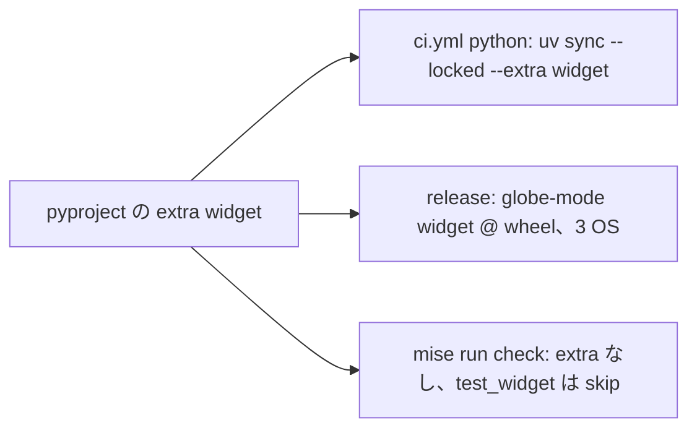

# S097 anywidget を extra に戻す

| | |
| --- | --- |
| セッション | S097 |
| 日付 | 2026-11-02 |
| ブランチ | `feature/s097-anywidget-extra` |
| Phase | P6 |
| スライド | [slides.html](slides.html) |
| 作業記録 | `log/work/2026-11-02-s097-anywidget-extra.md` |

## 1. 目的

[S078](../S078-marimo-anywidget/解説書.md) は、ci.yml の `python` ジョブと release.yml の wheel の pytest が extra を入れないため、`anywidget` を Python パッケージ `globe_mode` の通常の依存にした。その代償で、wheel を入れる人すべてに ipython など 18 本が付く。ユーザーの判断（2026-11-02）で extra に戻し、CI の側で extra を入れる。Phase は [P6](../../roadmap.md)。

## 2. 決定と理由

| 項目 | 決定 | 理由 |
| --- | --- | --- |
| `pyproject.toml` | `[project.optional-dependencies] widget = ["anywidget>=0.11.0"]` | 使うのは `globe_mode.widget` だけ。`globe_mode/__init__.py` は widget を import しない（触らない） |
| ci.yml の `python` | `uv sync --locked --extra widget` | `--all-extras` と同じ大きさで、入れるものが読める |
| release.yml の wheel の pytest | `--with "globe-mode[widget] @ $(ls wheel/*.whl)"` | `--with anywidget` を足すより、wheel の METADATA の extra が効くことまで確かめられる。uv は相対パスの direct reference を受ける（手元のダミーの wheel で確かめた） |
| `test_widget.py` | 先頭で `pytest.importorskip("anywidget")` | extra なしの `uv sync --locked`（`mise run check`）でも pytest が通る |
| `widget.py` | import は遅延しない。無ければ `ImportError` に `pip install "globe-mode[widget]"` を添える | 使う人に直し方を見せる |
| `.github/scripts/ci_plan.py` | 変えない | `pyproject.toml`・`uv.lock` の変更はすでに `python` を起こす |

ライセンスの表は [doc/licenses.md](../../licenses.md) の anywidget の行を extra `widget` に直した。

## 3. 図



## 4. 再現手順

```bash
uv lock
uv sync --locked --extra widget && uv run pytest -q src/Python/tests
uv sync --locked && uv run pytest -q src/Python/tests   # test_widget.py は skip
uv export --frozen --no-dev --no-emit-project --no-hashes            # 依存の数
gh workflow run ci.yml --ref feature/s097-anywidget-extra -f full=true
gh workflow run release.yml --ref feature/s097-anywidget-extra       # dry-run
```

検証の結果（数字）:

- extra なしの依存（`uv export`、ロック上の全 OS）: 49 → 30。外れたのは anywidget と推移的な 18 本（colorama は Windows だけ、pexpect・ptyprocess は Windows 以外）。
- 手元と CI の結果は [作業記録](../../../log/work/2026-11-02-s097-anywidget-extra.md) に書く。

## 5. 次回

- PyPI に出すときは README に `globe-mode[widget]` の入れ方を書く。
- marimo の WASM で wheel を使う道（[S093 の調査](../../research/marimo-wasm-2026-11-02.md)）は持ち越し。
