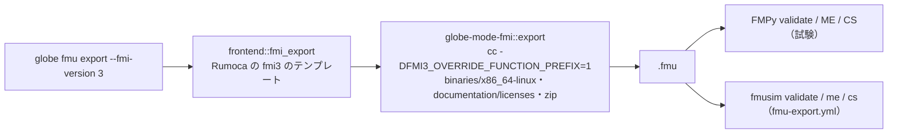

# S098 FMI 3.0 の Export（P5a の 2 回目）

| | |
| --- | --- |
| セッション | S098 |
| 日付 | 2026-11-02 |
| ブランチ | `feature/s098-fmi-export-fmi3` |
| Phase | P5（P5a の 2 回目） |
| スライド | [slides.html](slides.html) |
| 作業記録 | [log/work/2026-11-02-fmi-export-fmi3.md](../../../log/work/2026-11-02-fmi-export-fmi3.md) |

## 1. 目的

[S094](../S094-fmi-export-rumoca/解説書.md) の持ち越しのうち、FMI 3.0 の Export、FMPy での 3.0 の検査、fmusim での検査、生成物のライセンスの表示を片付ける。[roadmap.md](../../roadmap.md) の P5 の完了条件「Export した FMU が FMPy・fmusim・fmuCheck を通る」の 2 つ目（fmusim）まで進める。

## 2. 決定と理由

決定は [ADR-0031](../../adr/0031-fmi-export-p5a-first.md) の追記（新しい ADR は作らない）。

| 項目 | 決定 | 理由 |
| --- | --- | --- |
| 版の選び方 | `globe fmu export --fmi-version 2\|3`（既定 2）、`export_me_sources(model, fmi_version)` | 既存の呼び出しの振る舞いが変わらない。frontend の `render_rumoca_fmi` は元から `"fmi3"` を受ける |
| 3.0 の置き場 | `binaries/x86_64-linux/<modelIdentifier>.so`、ヘッダは `fmi3Functions.h`（FMPy の `c-code` にある） | FMI 3.0 のプラットフォームの名前 |
| 3.0 の `--build` の定義 | `sources/buildDescription.xml` の `PreprocessorDefinition` を `-D` で `cc` に渡す | Rumoca の `fmi3` の `model.h` は `FMI3_FUNCTION_PREFIX` を `<modelIdentifier>_` にし、`FMI3_OVERRIDE_FUNCTION_PREFIX=1` のときだけ接頭辞なしの関数を出す。渡さないと FMPy が `fmi3ActivateModelPartition` を引けずに落ちた |
| fmusim | 手動の `.github/workflows/fmu-export.yml`（`workflow_dispatch` だけ）で回す | 外から取ったバイナリを手元で実行する許可が無い（S094 と同じ） |
| ライセンスの表示 | FMU に `documentation/licenses/Rumoca-LICENSE.txt` を入れる | 生成物は Rumoca のテンプレートの文面を多く含むので Apache-2.0 §4(a)(c) に合わせる（[licenses.md](../../licenses.md) の「生成コード」） |

ライセンスの表示の中身は、出典（`https://github.com/CogniPilot/rumoca`、rev `276e82bd0fd48960ac201e782918d28bf19cf7ce`）、Rumoca の LICENSE の著作権表示 `Copyright 2025-2026 CogniPilot Foundation`、リポジトリの `LICENSE-APACHE`（Apache-2.0 の全文。Rumoca の LICENSE とは著作権表示の 1 行と空行だけが違う）。Rumoca の LICENSE は cargo の git checkout（`~/.cargo/git/checkouts/rumoca-*/276e82b/LICENSE`）で読んだ。NOTICE は無い（<https://github.com/CogniPilot/rumoca/blob/276e82bd0fd48960ac201e782918d28bf19cf7ce/LICENSE>、確認日 2026-11-02）。

`fmu-export.yml` は main に無いと `gh workflow run` が 404 になるので、feature ブランチで 1 度だけ `push` のトリガを足して回し（コミット `7f11b05`）、次のコミットで外した。最終の形は `workflow_dispatch` だけ。

## 3. 図



## 4. 再現手順

```bash
H=$(uv run --no-project --with fmpy python -I -c "import fmpy, os; print(os.path.join(os.path.dirname(fmpy.__file__), 'c-code'))")
cargo run -p globe-mode-cli -- fmu export src/Modelica/GlobeModeValidation \
  -m GlobeModeValidation.Simulation.Decay --out /tmp/fmu3 --fmi-version 3 --build --fmi-headers "$H"
cargo test -p globe-mode-cli --test fmu_export -- --nocapture   # 4 本
gh workflow run fmu-export.yml   # main に入った後。fmusim まで回す
```

検証の結果（Decay、終了時刻 1、e⁻¹ = 0.36787944117144233）:

| 道具 | 版 | validate | ME の x(1) − e⁻¹ | CS の x(1) − e⁻¹ |
| --- | --- | --- | --- | --- |
| FMPy 0.3.32（相対許容誤差 1e-8、手元と CI） | 2.0 | No problems found. | −2.6e-8 | 3.3e-16 |
| FMPy 0.3.32（同上） | 3.0 | No problems found. | −2.6e-8 | 3.3e-16 |
| fmusim（既定の設定、run 41445403219） | 2.0 | ZIP・model description を通過 | −1.6e-4 | 3.3e-16 |
| fmusim（同上） | 3.0 | ZIP・model description・build description を通過 | −1.6e-4 | 3.3e-16 |

- ME の値は 2.0 と 3.0 でビットまで同じ（0.3678794150955906）。CS は Rumoca の Dormand–Prince 5(4) の内部の歩で、2.0・3.0・FMPy・fmusim のどれでも 0.36787944117144267。
- fmusim の ME の −1.6e-4 は fmusim の既定の許容誤差によるもので、許容誤差を絞る試しはしていない。
- S094 の作業記録の「ME 2.6e-9」は桁の書き誤りで、0.3678794151 − 0.3678794412 = −2.6e-8（今回と同じ）。
- fmusim は v0.15.0 の release の `fmusim-x86_64-linux.zip`（sha256 `d92bd9054ac9693d263c4d68e75a6dd4d540cdd415c178dd75521571ed9e29a0`）だが、`fmusim --version` は `fmusim 0.14.0` と出た。

## 5. 次回

- fmuCheck（FMI 2.0 だけ）での検査。
- main に入った後に `gh workflow run fmu-export.yml` で回し直す（今回の run は一時の `push` トリガのもの）。
- Windows・macOS 向けのビルド（`zig cc`）、入力を持つモデル（start を種にしない）、事象のあるモデル（P5b、S099）。
