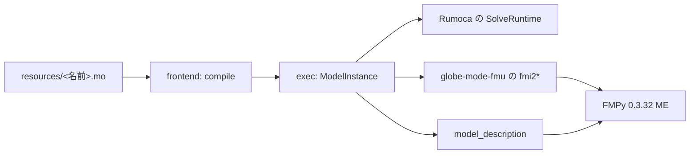

# S099 exec の微分の API と FMU（P5b の 2 回目）

| | |
| --- | --- |
| セッション | S099 |
| 日付 | 2026-11-02 |
| ブランチ | `feature/s099-fmu-exec-api` |
| Phase | P5（P5b） |
| スライド | [slides.html](slides.html) |
| 作業記録 | [log/work/2026-11-02-fmu-exec-api.md](../../../log/work/2026-11-02-fmu-exec-api.md) |

## 1. 目的

- [S095](../S095-fmu-runtime/解説書.md) の持ち越しの 1 つ目。`globe-mode-exec` に「状態・パラメータ・時刻 → 微分」の公開 API を足し、`globe-mode-fmu` の手書きの Decay（`der(x) = -k*x`）をそれで置き換える。
- 既存の `simulate` / `run` / session の道は変えない。`globe-mode-fmi`・CLI の `fmu export`・`frontend/src/fmi_export.rs`（P5a、S098 が並行）は触らない。

## 2. 決定と理由

詳細は [ADR-0032](../../adr/0032-p5b-own-runtime.md) の追記（S099）。

| 項目 | 決定 | 理由 |
| --- | --- | --- |
| API | `globe_mode_exec::ModelInstance`（`new(&CompiledModel, &上書き, 開始時刻)`・`set_time`・`set_states`・`states`・`derivatives`・`n_states`・`state_names`・`parameters`） | FMI 2.0 ME の `fmi2SetTime`・`fmi2SetContinuousStates`・`fmi2GetDerivatives` にそのまま当たる形 |
| 包む相手 | Rumoca の公開の `SolveRuntime`（`eval_state_derivatives`・`settle_initialization_system`） | FMI ME 風の host の `SolveMeKernel` の関数は `pub(crate)`、積分器の `MeDerivativeHandle` は host の呼び出しの間しか使えない |
| 事象 | 根の条件か `sample` のあるモデルは `GM-U0004` で断る | 事象の表示関数と事象の処理は今回の範囲の外 |
| 載せ替えの道 | 道 2: 1 つの cdylib が `resources/<完全修飾名>.mo` を `fmi2Instantiate` で compile する | 道 1 は利用者にツールチェーンが要り、道 3 は直列化の形を決める仕事が大きい。道 2 は exec の API がそのまま使える |
| パラメータ | `fmi2SetReal` で覚え、`fmi2ExitInitializationMode` で lowering からやり直す | `SimOptions::param_overrides` と同じ道なので、依存するパラメータにも届く |
| `modelDescription.xml` | 手書きをやめ、`globe_mode_fmu::model_description` が `ModelInstance` の状態名・パラメータから作る | 変数表を手で合わせなくてよい。値参照は `0..n` 状態、`n..2n` 微分、`2n..` パラメータ |
| guid | モデル名と文面の FNV-1a（64 ビット） | `fmi2Instantiate` が resources の文面から同じ値を作って突き合わせられる |

## 3. 図



## 4. 再現手順

```bash
export CARGO_TARGET_DIR=…/.git-worktree/target-shared
cargo test -p globe-mode-fmu -- --nocapture --test-threads 1
```

- `fmpy_simulates_decay`・`fmpy_matches_exec_on_harmonic_oscillator`（Linux x86_64 だけ）は `cargo build --lib` で cdylib を作らせ、`model_description` で `modelDescription.xml` を作り、`tests/fmpy_run.py` が FMU に詰めて FMPy の `validate_fmu`（問題 0）と ME の `simulate_fmu` を回す。uv か FMPy が無ければ skip。
- Decay: x(1) = 0.3678794150955906（e⁻¹ との差 2.6e-8）。
- HarmonicOscillator（状態 2、事象なし）: FMPy の x(1) = -0.41614683955697307、v(1) = -1.818594856574809。`globe_mode_exec::run`（既定の bdf）は x(1) = -0.4161468121809279、v(1) = -1.8185947093271577。差は 2.7e-8・1.5e-7（試験は 1e-4 以内）。
- `explicit_euler_through_the_c_abi`: resources を置いた一時の置き場から関数を直接呼び、k = 2 にして陽的 Euler で x(1) が e⁻² に 1e-4 以内。`fmi2Reset` で x と k が 1 に戻る。
- `events_are_refused`: BouncingBall は `ModelInstance::new` が `GM-U0004`。
- cdylib の大きさ: debug 702 MB、release 44.1 MB、strip 後 32.8 MB、gzip で 12.4 MB。

## 5. 次回

- 事象のあるモデル（event indicator、`fmi2NewDiscreteStates`）、出力（代数変数）の値参照。
- MSL を使うモデル（resources へのライブラリの同梱。`fmi2Instantiate` のたびの compile の時間）。
- `modelDescription.xml` の生成を `globe-mode-fmi`（P5a）と共有する。CS、FMI 3.0、Windows・macOS の置き場。
- `resourceLocation` の `%xx` を戻す（今は `shortcut:` の注記）。
