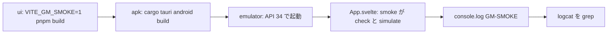

# S100 Android のエミュレータで検査と実行

| | |
| --- | --- |
| セッション | S100 |
| 日付 | 2026-11-02 |
| ブランチ | `feature/s100-android-emulator-smoke` |
| Phase | P6 |
| スライド | [slides.html](slides.html) |
| 作業記録 | `log/work/2026-11-02-s100-android-emulator-smoke.md` |

## 1. 目的

[roadmap.md](../../roadmap.md) の P6 の完了条件「Android API 34 のエミュレータで検査と実行が通る」。[S092](../S092-android-apk-ci/解説書.md) の持ち越しの 1 つ目。S092 の `android.yml` のジョブ `emulator` は APK を起動してプロセスが生きていることを見るだけで、UI（`WorkerBackend`、wasm）から検査と実行が通るかは見ていなかった。

## 2. 決定と理由

| 項目 | 決定 | 理由 |
| --- | --- | --- |
| 自動実行の入口 | `App.svelte` の `onMount` で、ビルド時の `VITE_GM_SMOKE=1` か URL の `?smoke=1` のときだけ `smoke()` を呼ぶ | Tauri の Android は `frontendDist` の `index.html` を開くのでクエリを渡せない。ブラウザの試験（`test_ui.py`）はクエリで同じ道を回せる。どちらも無ければ何もしないので、Desktop とブラウザの既定の挙動は変わらない |
| 中身 | 既存の `check()`・`simulate()`（ボタンと同じ関数）を順に呼ぶ | 新しい backend の道を作らない。エディタの初期の文面（Decay）をそのまま使う |
| 判定 | 検査: 失敗の文言が無く error の診断が 0。実行: 失敗の文言が無く、`x` の最後の値が e⁻¹ と 1e-3 以内 | Decay の x(1) は e⁻¹ と分かっている |
| 出力 | `console.log` に `GM-SMOKE check=ok simulate=ok x1=…` の 1 行（失敗なら `failure=…` も付ける） | WebView の console は logcat に出る（タグに依らず `GM-SMOKE` で grep する） |
| CI | `android.yml` のジョブ `ui` を `VITE_GM_SMOKE=1` でビルドし、`emulator` は logcat に `GM-SMOKE` が出るまで最大 5 分待ち、`check=ok simulate=ok` が無ければ失敗 | 固定の `sleep 45` をやめ、出たらすぐ進む。行は Step Summary にも出す |
| artifact の APK | CI の debug APK（`globe-android`）は起動すると smoke を回す | 署名なしの debug の試験用。release の APK を作るときは `VITE_GM_SMOKE` を付けない |

## 3. 図



## 4. 再現手順

```bash
# ブラウザ（手元）。?smoke=1 の GM-SMOKE の行も確かめる
mise run ui:check
# Android（Actions）
gh workflow run android.yml --ref feature/s100-android-emulator-smoke
gh run download <run-id> -n android-logcat
grep GM-SMOKE logcat.txt
```

検証の結果（数字）:

- 手元の `test_ui.py`（wasm は共有 target の `wasm-pkg/web` を使った）: `GM-SMOKE check=ok simulate=ok x1=0.3678797279080248`（e⁻¹ との差 3.1e-7）。全体で 15.6 s
- Actions: run 41444392188 の 2 回目の試行で全ジョブ success（ui 4 分 05 秒・apk 12 分 40 秒・emulator 2 分 27 秒）。logcat は `Displayed … +3s446ms` の 5.7 s 後に `I Tauri/Console: File: http://tauri.localhost/assets/main-CYuiFFjw.js - Line 17 - Msg: GM-SMOKE check=ok simulate=ok x1=0.3678797279080248`（ブラウザと同じ値）。1 回目の試行は apk が Gradle の plugin portal から Kotlin 2.3.21 の POM を引けずに落ちた（`Could not parse POM`、コードと無関係）ので `gh run rerun --failed` で回し直した

## 5. 次回

- Android での MSL の置き場（今は MSL.json を同梱しないので「MSL を読む」は失敗する）
- Rust を mobile の lib に直接 link する道（[ADR-0023](../../adr/0023-desktop-and-web-process-layout.md) の (a) を Android でどう守るか）
- release の署名つき APK（`VITE_GM_SMOKE` を付けないビルド）
