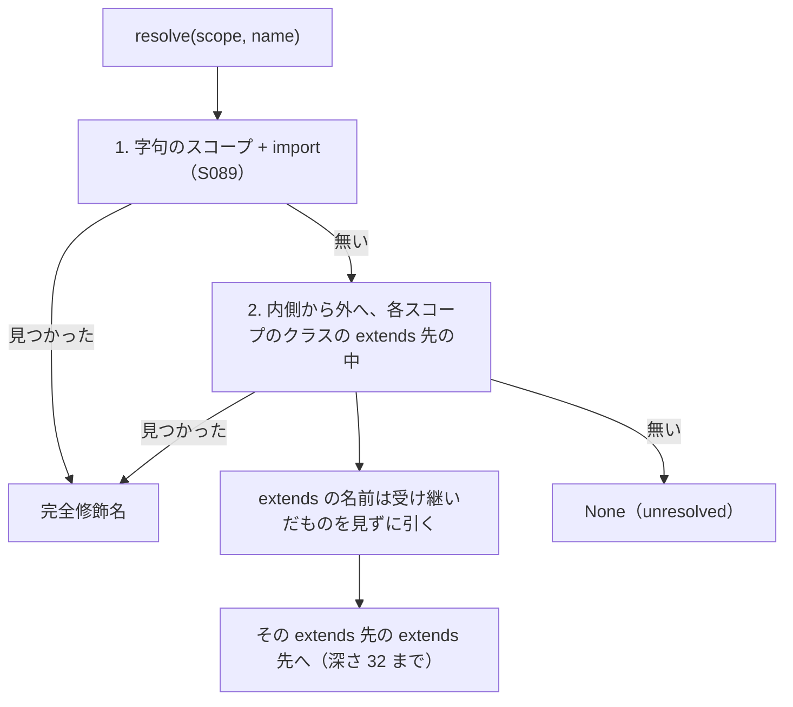

# S101 graph の継承した入れ子のクラス

| | |
| --- | --- |
| セッション | S101 |
| 日付 | 2026-11-03 |
| ブランチ | `feature/s101-graph-nested-inherited` |
| Phase | P4 |
| スライド | [slides.html](slides.html) |
| 作業記録 | [log/work/2026-11-03-graph-nested-inherited.md](../../../log/work/2026-11-03-graph-nested-inherited.md) |

## 1. 目的

S089（[解説書](../S089-graph-imports-index-cache/解説書.md)）の持ち越しの 1 つ目を片付ける。

- `model A extends B; C c; end A;` で `C` が `B`（または `B` の extends 先）の中の入れ子のクラスのとき、`ClassIndex::resolve` が `C` を引けず、graph の部品が `unresolved` に落ちていた。
- 持ち越しの 2 つ目（salsa の backdate）は触らない。

## 2. 決定と理由

| 項目 | 決定 | 理由 |
| --- | --- | --- |
| 直す場所 | `globe-mode-ir` の `ClassIndex::resolve` だけ | graph・db・`interface`・`connects`・`builtin_base` はみな `resolve` を通る。`globe-mode-graph`・`globe-mode-db`・frontend は変えていない |
| 探し方 | 各スコープのクラスの extends 先（再帰）の中に `name` があるかを見る。extends の名前は受け継いだものを見ずに引く（MLS §5.6.1） | extends の名前を引くのに受け継いだものを見ると、自分自身へ戻って止まらない |
| 循環 | extends の深さ 32 で打ち切る | `collect_interface` と同じ上限 |
| 順 | 字句のスコープと import で引けないときだけ、内側から外へ受け継いだ入れ子を見る（`shortcut:`） | MLS では受け継いだ要素は外側のスコープより先。毎段で見る版は MSL の例題 479 本の graph（深さ 4、debug）が 40 → 174 s になった。今の版は MSL のモデル 2,002 本（深さ 1）で 23.2 → 24.2 s |

`shortcut:` の限界: 受け継いだ入れ子と同じ名前のクラスが外側のスコープにもあると、外側を選ぶ（MLS と逆）。MSL のモデル 2,002 本では、引けた型が変わったものは 0 本（`unresolved` が減った 1 本だけ）。

## 3. 図



## 4. 再現手順

```bash
export CARGO_TARGET_DIR=…/.git-worktree/target-shared
ln -s <main のチェックアウト>/data/msl data/msl   # worktree に MSL が無ければ
cargo test -p globe-mode-ir -p globe-mode-graph -p globe-mode-db
cargo test -p globe-mode --test graph_library -- --nocapture
mise run check
```

検証の結果（数字）:

- 最小の例（`globe-mode-db` の `nested_class_of_extended_class_is_resolved`。`Top extends Mid`、`Mid extends Base`、`Part` は `Base` の入れ子）: 前は `unresolved` が `["Part"]` で部品のノード 0、後は `unresolved` 0、ノード 2（`NestedInherited.Base.Part`）、辺 1 本は `flow`
- MSL 4.1.0 の実例 `Modelica.Fluid.Pipes.StaticPipe`（`extends PartialStraightPipe` の入れ子 `replaceable model FlowModel` を `FlowModel flowModel` に使う）: ノード 1 → 2、`unresolved` 3 → 2（残りは `Medium.AbsolutePressure`・`Medium.MassFlowRate`）、辺 0 → 0
- MSL のモデル 2,002 本（深さ 1、`with_libraries_full`）の合計: ノード 10,338 → 10,339、辺 11,187 → 11,187、`unresolved` 321 → 320。変わったのは StaticPipe の 1 本だけ
- MSL の例題 479 本（深さ 1 と 4）: 前後で差 0。`ChuaCircuit` はノード 7・辺 9（S079・S089 と同じ）、2 回目の graph 4.6 ms（S089 は 6.9 ms、debug）
- 依頼の `Modelica.Electrical.Analog.Examples.*`・`Modelica.Mechanics.Rotational.Examples.*` には、この形で引けない例は無かった（`unresolved` は前から 0）

## 5. 次回

- `replaceable package Medium = …` のような短いクラスの別名の中（`Medium.AbsolutePressure`）は引かない。MSL のモデル 2,002 本の `unresolved` 320 のうち 269 は `Medium.` で始まる
- 受け継いだ入れ子と外側のスコープの名前がぶつかるときの順（`shortcut:`）
- salsa の backdate（S089 の持ち越しの 2 つ目）
