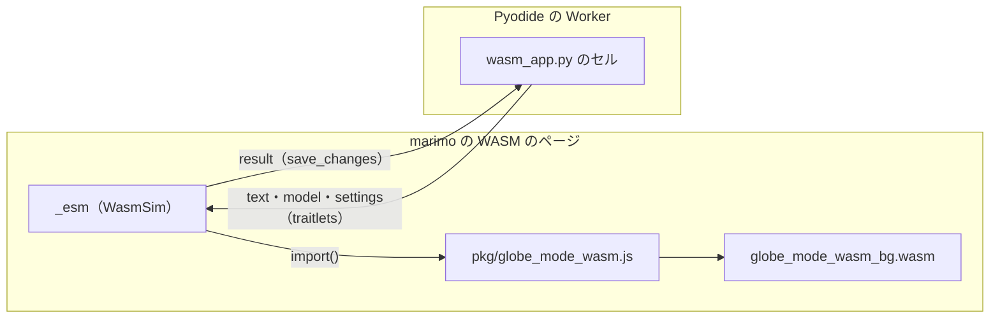

# S102 marimo の WASM で anywidget から globe-mode-wasm

| | |
| --- | --- |
| セッション | S102 |
| 日付 | 2026-11-03 |
| ブランチ | `feature/s102-marimo-wasm-anywidget` |
| Phase | P6 |
| スライド | [slides.html](slides.html) |
| 作業記録 | [log/work/2026-11-03-marimo-wasm-anywidget.md](../../../log/work/2026-11-03-marimo-wasm-anywidget.md) |

## 1. 目的

[S093](../S093-web-csp-marimo-wasm/解説書.md) の持ち越しの 1 つ目。[roadmap](../../roadmap.md) の P6 の完了条件「marimo の WASM で 2 GB 未満に収まる」に向けて、[調査](../../research/marimo-wasm-2026-11-02.md) の道 (C)（anywidget の `_esm` から `globe-mode-wasm` を直接呼ぶ）を試作し、`marimo export html-wasm` で動くかとメモリを測る。ついでに README に extra `widget` の入れ方を足す（[S097](../S097-anywidget-extra/解説書.md) の持ち越し）。

## 2. 決定と理由

| 項目 | 決定 | 理由 |
| --- | --- | --- |
| 試作の置き場 | 新しいノートブック `src/Python/marimo/wasm_app.py` に widget のクラス `WasmSim` を書く。`globe_mode` のパッケージには足さない | `globe_mode` は `_native`（abi3 の wheel）を import するので Pyodide では読めない。ノートブックの中なら anywidget と traitlets だけで済む |
| Python と JS の分担 | Pyodide 側は文面（`text`）・モデル名・設定を traitlets で渡すだけ。結果は traitlet `result` で返す | 依頼のとおり。Rust を Python から呼ばない |
| wasm の置き場 | `mise run wasm:build` の `wasm-pkg/web` の糊と `.wasm` を書き出し先の `pkg/` に写し、`new URL("pkg", document.baseURI)` で引く | `_esm` は blob の URL で読まれるので、相対の URL はページを基準にする |
| 実行のスレッド | メインのスレッドで同期に `Workspace.check`・`simulate` を呼ぶ（`GlobeWorker` は使わない） | 最小の試作。Decay は一瞬で終わる |
| 検査 | `src/Python/marimo/wasm_check.py`: 書き出し → http.server（`test_ui.py` の流儀）→ Playwright の Chromium（`--enable-precise-memory-info`） | 既存の流儀に合わせた。手元で 12 s ほどで終わるので CI の workflow は足さなかった |
| CSP | header を付けない | marimo の WASM に合う CSP は持ち越し（依頼の「やらないこと」）。`--offline` なら外への要求が 0 件になることだけ確かめた |
| marimo の RPC の時間切れ | `RPC request timed out.` の 1 つの文言だけを未捕捉の例外から除く | 負荷が高いと Pyodide の起動（約 45 s）より先に marimo 自身の RPC が時間切れを投げる。起動後の `bridge` は成功で返り、結果も出る |

## 3. 図



## 4. 再現手順

```bash
export CARGO_TARGET_DIR=…/.git-worktree/target-shared
mise run wasm:build                                   # wasm-pkg/web（今回は既存の成果物を使った）
uv run marimo check src/Python/marimo/wasm_app.py
uv run python src/Python/marimo/wasm_check.py         # CDN・PyPI から Pyodide と anywidget を取る
uv run python src/Python/marimo/wasm_check.py --offline   # 書き出し先に Pyodide とパッケージを取る
```

検証の結果（数字。手元の WSL、Chromium 1248 headless）:

- x(1) = 0.367879468116207（e⁻¹ との差 2.7e-8）、check は passed。Pyodide は v314.0.0。
- メモリ: ページの JS heap used 22〜25 MiB / total 25〜37 MiB、`globe-mode-wasm` の線形メモリ 2 MiB、ブラウザの RSS の合計 857〜966 MiB（4 回）。2 GB 未満。
- 開いてから結果まで 11.1〜11.8 s（load average 29 の時は約 58 s）。
- origin の外への要求: 既定は `cdn.jsdelivr.net`・`files.pythonhosted.org`・`wasm.marimo.app`、`--offline` は 0 件（書き出し先 52 MiB）。

## 5. 次回

- MSL（15 MiB の JSON）を widget に渡す道と、そのときのメモリ。
- marimo の WASM に合う CSP の header（`--offline` の書き出しで）。
- 長いモデルのために Web Worker（`GlobeWorker`）で回す。
- emscripten の wheel（調査の道 (B)）。
