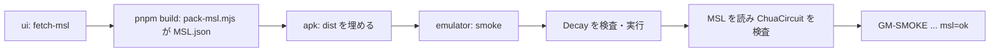

# S103 Android で MSL を読む

| | |
| --- | --- |
| セッション | S103 |
| 日付 | 2026-11-03 |
| ブランチ | `feature/s103-android-msl` |
| Phase | P6 |
| スライド | [slides.html](slides.html) |
| 作業記録 | `log/work/2026-11-03-android-msl.md` |

## 1. 目的

[S092](../S092-android-apk-ci/解説書.md) の持ち越しの 2 つ目。Android の APK は `MSL.json` を同梱しないので、UI の「MSL を読む」が失敗していた。Android でも MSL を読み、MSL の例題を検査できるようにする（[roadmap.md](../../roadmap.md) の P6）。

## 2. 決定と理由

実装の前に 2 つの道を比べた（[ADR-0023](../../adr/0023-desktop-and-web-process-layout.md) の「S103」）。

| 道 | 要るもの | 大きさ |
| --- | --- | --- |
| (a) mobile でも `fetch_msl`（S069・S084）を動かす | `#[cfg(mobile)]` の入口に command と `msl.rs` を載せ、app のデータディレクトリの `.mo` を WebView の `WorkerBackend` に渡す新しい道。初回は回線が要る | Rust と TS の新しいコード |
| (b) ビルド時に `MSL.json` を同梱する | `android.yml` の `ui` で `cargo xtask fetch-msl` してから `pnpm build`。既存の `pack-msl.mjs` が `dist/msl/MSL.json` を作り、Tauri が APK に埋める | workflow の 1 段。アプリのコードは不変 |

| 項目 | 決定 | 理由 |
| --- | --- | --- |
| 道 | (b) | 変更が最小で、回線も要らない。UI の「MSL を読む」はブラウザと同じ `fetch("msl/MSL.json")` の道 |
| 形 | ブラウザと同じ全部読みの `MSL.json`（15.2 MiB、2556 ファイル） | S054 の分割読み込みは UI がまだ使っていない。使うときにブラウザと一緒に替える |
| 版 | 4.1.0 だけ | 版の切り替え（S084）は Desktop の sidecar の機能 |
| smoke | Decay の後に `loadMsl()` を呼び、`Modelica.Electrical.Analog.Examples.ChuaCircuit` を検査して error 0 なら `msl=ok` を同じ行に足す | ボタンと同じ関数を使う。ChuaCircuit はブラウザの試験と同じ例題 |
| CI | `ui` は `dist/msl/MSL.json` が無ければ失敗。`emulator` は最大 10 分待ち、`msl=ok` が無ければ失敗 | MSL を読む時間の分だけ待ちを延ばした |

## 3. 図



## 4. 再現手順

```bash
# ブラウザ（手元）。data/msl があれば smoke の行に msl=ok が出る
mise run ui:check
# Android（Actions）
gh workflow run android.yml --ref feature/s103-android-msl
gh run download <run-id> -n android-logcat
grep GM-SMOKE logcat.txt
```

検証の結果（数字）:

- 手元の `test_ui.py`（wasm は共有 target の `wasm-pkg/web`、`data/msl` は main の取得物への symlink）: ok。`GM-SMOKE check=ok simulate=ok x1=0.3678797279080248 msl=ok`。MSL を読む 0.5 s、ChuaCircuit の検査 1.8 s（error 0）
- Actions: run 41521456071 が 1 回目で全ジョブ success（ui 6 分 45 秒・apk 4 分 02 秒・emulator 2 分 16 秒）。logcat は `Displayed … +2s48ms` の 13.6 s 後に `I Tauri/Console: … Msg: GM-SMOKE check=ok simulate=ok x1=0.3678797279080248 msl=ok`
- APK（debug、universal）: 251,629,679 → 257,983,183 bytes（+6.1 MiB）。`MSL.json` は gzip で約 2.6 MB で、Tauri が ABI ごとの lib に圧縮して埋めるので 2 つ分

## 5. 次回

- release の署名つき APK（`VITE_GM_SMOKE` を付けないビルド）
- Rust を mobile の lib に直接 link する道（ADR-0023 の (a) を Android でどう守るか）
- 分割読み込み（S054）を UI に使うとき、ブラウザと Android を一緒に替える
