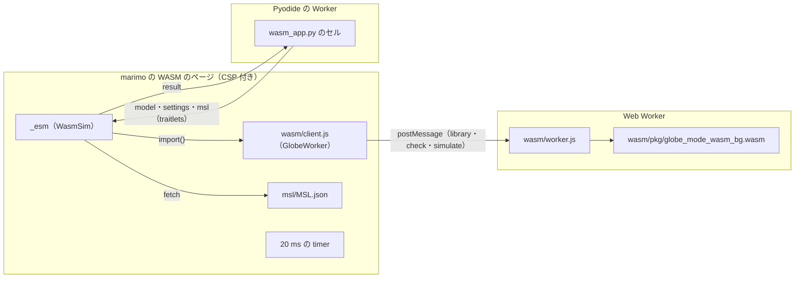

# S104 marimo の WASM で MSL を Web Worker で回す

| | |
| --- | --- |
| セッション | S104 |
| 日付 | 2026-11-03 |
| ブランチ | `feature/s104-marimo-wasm-msl-worker` |
| Phase | P6 |
| スライド | [slides.html](slides.html) |
| 作業記録 | [log/work/2026-11-03-marimo-wasm-msl-worker.md](../../../log/work/2026-11-03-marimo-wasm-msl-worker.md) |

## 1. 目的

[S102](../S102-marimo-wasm-anywidget/解説書.md) の持ち越しの 3 つ（[roadmap](../../roadmap.md) の P6「marimo の WASM で 2 GB 未満に収まる」）。

1. MSL（`MSL.json`、15 MiB）を widget に渡し、`Modelica.Electrical.Analog.Examples.ChuaCircuit` を check → simulate してメモリを測る。
2. 計算を Web Worker に出し、simulate の間もメインのスレッドが応答することを確かめる。
3. `--offline` の書き出しに合う最小の CSP を付け、違反 0 件で動かす。

## 2. 決定と理由

| 項目 | 決定 | 理由 |
| --- | --- | --- |
| Worker | `globe-mode-wasm` の `web/client.js`（`GlobeWorker`）と `worker.js` をそのまま書き出し先の `wasm/` に写し、`_esm` から `import()` する | ブラウザ版の `WorkerBackend`（`src/Svelte/src/lib/worker-backend.ts`）と同じもの。新しい Worker を書かずに済む |
| MSL の渡し方 | `_esm` が `fetch("msl/MSL.json")` して `GlobeWorker.library(json, "MSL")` | ブラウザ版（`App.svelte`）と同じ道。15 MiB を traitlets と Pyodide に通さない |
| 固まらないことの確かめ方 | simulate の間、ページで 20 ms ごとの `setInterval` を回し、走った回数と間隔の最大を `result` に入れる。`wasm_check.py` は回数 > 0・最大 < 1 s を確かめる | 1 つの数で分かる。同期で回せば simulate の長さだけ止まる |
| CSP | `default-src 'self'; script-src 'self' 'unsafe-inline' 'wasm-unsafe-eval' data:; style-src 'self' 'unsafe-inline'; img-src 'self' data:; font-src 'self' data:` を `--offline` のときだけ header で付ける | 1 つずつ外して確かめた最小。表は [調査](../../research/marimo-wasm-2026-11-02.md) の「MSL・Web Worker・CSP」 |
| 違反の数え方 | console の文言に `Content Security Policy` を含むもの | Worker の中の違反もページの console に来る。`page.wait_for_function` は文字列を eval するので CSP に断られ、`page.evaluate` の繰り返しで待つ |
| 既定（`--offline` 無し） | CSP を付けない | Pyodide と anywidget を CDN・PyPI から取るので、`'self'` だけでは動かない |

- `_esm` は anywidget が `data:text/javascript;base64,…` の URL で `import()` する（CSP の違反の文言で分かった。S102 の「blob の URL」は誤りで、コメントを直した）。置き場は `document.baseURI` を基準にしているので動作は変わらない。
- `script-src` の `blob:` と `worker-src` は要らなかった。Worker は同じ origin の `wasm/worker.js` から起こすので、`worker-src` が無ければ `script-src 'self'` に落ちる。

## 3. 図



## 4. 再現手順

```bash
export CARGO_TARGET_DIR=…/.git-worktree/target-shared
mise run wasm:build                 # wasm-pkg/web（今回は 2026-11-02 の既存の成果物）
cargo xtask fetch-msl && (cd src/Svelte && node scripts/pack-msl.mjs)   # src/Svelte/public/msl/MSL.json
uv run marimo check src/Python/marimo/wasm_app.py
uv run python src/Python/marimo/wasm_check.py --offline   # CSP を付け、違反 0 件を確かめる
```

検証の結果（手元の WSL、Chromium headless、`--offline`、2 回）:

- Decay: check passed、x(1) = 0.367879468116207（誤差 2.7e-8）。
- ChuaCircuit: MSL の読み込み 0.7 s、check passed、simulate（bdf）0.5〜0.6 s、C1.v(T) = -0.9928894683235796。
- simulate の間の timer: 26〜29 回、間隔の最大 20 ms。
- メモリ: JS heap used 36 MiB / total 40 MiB、wasm の線形メモリ Decay 2 MiB・ChuaCircuit 112 MiB、ブラウザの RSS の合計 1152〜1154 MiB。2 GB 未満。
- 開いてから結果まで 14.9〜17.0 s。origin の外への要求 0 件、CSP の違反 0 件。

## 5. 次回

- emscripten の wheel（調査の道 (B)）。`globe_mode` の Python の API を Pyodide から使う。
- `wasm_check.py` を CI に入れる（書き出しの時にネットが要る）。
- 長いモデルで timer の間隔を測る（ChuaCircuit の simulate は 0.6 s と短い）。
