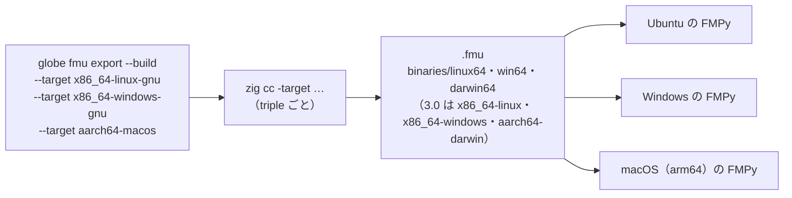

# S105 Windows・macOS 向けの FMU（P5a の 3 回目）

| | |
| --- | --- |
| セッション | S105 |
| 日付 | 2026-11-03 |
| ブランチ | `feature/s105-fmu-export-cross` |
| Phase | P5（P5a の 3 回目） |
| スライド | [slides.html](slides.html) |
| 作業記録 | [log/work/2026-11-03-fmu-export-cross.md](../../../log/work/2026-11-03-fmu-export-cross.md) |

## 1. 目的

[S098](../S098-fmi-export-fmi3/解説書.md) の持ち越しのうち、Windows・macOS 向けの FMU のビルドを片付ける。`globe fmu export --build` は `cc` で host（x86_64 の Linux）の置き場だけを作っていた。1 つの FMU に linux64・win64・darwin64 を同梱し、各 OS の FMPy で確かめる。

## 2. 決定と理由

決定は [ADR-0031](../../adr/0031-fmi-export-p5a-first.md) の追記（新しい ADR は作らない）。

| 項目 | 決定 | 理由 |
| --- | --- | --- |
| 指定のしかた | `--target <triple>`（何度でも、`--build` が要る）。省略すると今までどおり host を `cc` で | 既存の呼び出しが変わらない |
| コンパイラ | `--target` ごとに `zig cc -target <triple>`（`ZIG` で上書き可） | zig は mise に入っている（`mise.toml`）。`cc` crate は使っておらず `Command` で呼んでいたので、引数を 3 つ足すだけで済む。新しい依存は無い |
| 置き場の名前 | FMI 2.0: `x86_64-linux*` → `linux64`、`x86_64-windows*` → `win64`、`*-macos` → `darwin64`。3.0: `<arch>-linux`・`<arch>-windows`・`<arch>-darwin` | FMI の規格の名前。2.0 の `darwin64` は arch を区別せず、FMPy も Apple silicon で `darwin64` を引く（下の macOS の結果で確かめた） |
| Windows の副産物 | zig が置く `.pdb` と import library（`.lib`）を消す | FMU に要らない。2.0 の `.pdb` は展開で 1,110,016 B ある |
| `-lm` | Windows 向けにもそのまま渡す | `zig cc -target x86_64-windows-gnu … -lm` は通る（手元で確かめた） |
| 検査 | `fmu-export.yml` の `fmu-export` が 3 つの `--target` で FMU を作り artifact `fmu-cross` に置き、ジョブ `fmu-cross`（Ubuntu・Windows・macOS arm64 の matrix）が FMPy 0.3.32 で validate と ME・CS を回す | 手元の WSL では Windows・macOS のバイナリを読み込めない |

## 3. 図



## 4. 再現手順

```bash
H=$(uv run --no-project --with fmpy python -I -c "import fmpy, os; print(os.path.join(os.path.dirname(fmpy.__file__), 'c-code'))")
cargo run -p globe-mode-cli -- fmu export src/Modelica/GlobeModeValidation \
  -m GlobeModeValidation.Simulation.Decay --out /tmp/fmu --build --fmi-headers "$H" \
  --target x86_64-linux-gnu --target x86_64-windows-gnu --target aarch64-macos
cargo test -p globe-mode-cli --test fmu_export -- --nocapture   # 5 本（zig が無ければ cross は飛ばす）
cargo test -p globe-mode-fmi --features export --lib export     # 置き場の名前の表
gh workflow run fmu-export.yml --ref <branch>                   # Windows・macOS の FMPy
```

検証の結果（Decay、終了時刻 1、FMPy 0.3.32、相対許容誤差 1e-8、run 41531879481）。2.0・3.0 とも同じ値:

| ランナー | validate | ME の x(1) − e⁻¹ | CS の x(1) − e⁻¹ |
| --- | --- | --- | --- |
| ubuntu-24.04（zig の `.so`） | No problems found. | −2.608e-8 | 3.331e-16 |
| windows-latest（zig の `.dll`） | No problems found. | −2.608e-8 | 3.331e-16 |
| macos-latest、arm64（zig の `.dylib`） | No problems found. | −2.608e-8 | 3.331e-16 |

- ME の x(1) は Linux・Windows が 0.3678794150955906、macOS が 0.3678794150955903（最後の桁だけ違う）。CS はすべて 0.36787944117144267（S098 と同じ）。
- FMU の中の大きさ（2.0）: `linux64/*.so` 37,784 B、`win64/*.dll` 226,304 B、`darwin64/*.dylib` 55,504 B。

## 5. 次回

- fmuCheck（開発終了）は扱わない。Windows・macOS の fmusim は回していない（Linux だけ）。
- `aarch64-linux`・`x86_64-macos`（3.0 の `x86_64-darwin`）は置き場の名前は出せるが、ランナーで確かめていない。
- 入力・事象のあるモデル（P5b、S099）。
