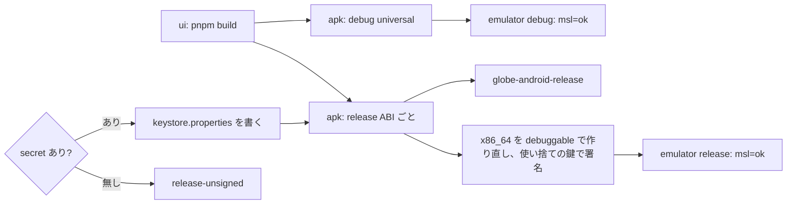

# S106 Android の release APK

| | |
| --- | --- |
| セッション | S106 |
| 日付 | 2026-11-03 |
| ブランチ | `feature/s106-android-release-apk` |
| Phase | P6 |
| スライド | [slides.html](slides.html) |
| 作業記録 | `log/work/2026-11-03-android-release-apk.md` |

## 1. 目的

[S092](../S092-android-apk-ci/解説書.md)・[S103](../S103-android-msl/解説書.md) の持ち越し「release の署名つき APK」。`android.yml` で release の APK を作り、debug と大きさを並べる。鍵は secret があるときだけ使い、リポジトリには置かない。release でもエミュレータの smoke（`GM-SMOKE … msl=ok`）を通す（[roadmap.md](../../roadmap.md) の P6）。

## 2. 決定と理由

| 項目 | 決定 | 理由 |
| --- | --- | --- |
| ABI | release は `--split-per-abi --target aarch64 --target x86_64` | 配るのは aarch64 だけでよいが、エミュレータ（x86_64）の smoke に x86_64 の release が要る。ABI ごとに分けたので aarch64 の APK に x86_64 の lib は入らない |
| 署名の分岐 | job の `env` に secret を写し、`if: env.ANDROID_KEYSTORE_BASE64 != ''` | secret は `if:` に直接書けない（GitHub の手引き） |
| 署名の場所 | secret から `gen/android/keystore.properties` を書き、`build.gradle.kts` がそれを見て `signingConfigs.release` を作る | Tauri の手引きと同じ形。ファイルは `.gitignore` 済み。無ければ `app-*-release-unsigned.apk` |
| 鍵のパスワード | `password` 1 つでなく `storePassword`・`keyPassword` に分ける | secret を 4 つ（keystore とパスワード 2 つと alias）で受けるため |
| smoke | smoke 用の x86_64 の release（次の行）が署名なしなら、runner の中で作る使い捨ての鍵（`keytool`、有効 1 日）で `apksigner` 署名して入れる | 署名なしの APK はエミュレータに入らない。runner には `~/.android/debug.keystore` が無かった（run 41530541915 の失敗）。配布物（artifact `globe-android-release`）には触らない |
| emulator | matrix で debug と release の 2 本、logcat は `android-logcat` と `android-logcat-release` | 同じ待ち方（`GM-SMOKE … msl=ok`）を両方に使う |
| smoke 用は debuggable | x86_64 だけ `GM_SMOKE_DEBUGGABLE=1` で作り直し、`build.gradle.kts` が release に `isDebuggable = true` を立てる | Tauri（wry の `Logger.kt`）は `BuildConfig.DEBUG` のときだけ WebView の console を logcat に出す。run 41537253164 で release の smoke は `GM-SMOKE` の行が出ず 10 分待って失敗した。R8 と release の Rust はそのまま。配布物は作り直す前に upload 済み |
| `VITE_GM_SMOKE` | release も同じ UI（smoke 入り）で作る | UI のビルドは 1 回だけ。smoke は起動時に 1 行出すだけ。配布用の UI を分けるのは持ち越し |
| debug の artifact | `globe-android` は `universal/debug/*.apk` だけ | 中身は S092 から変えない |

## 3. 図



## 4. 鍵の作り方と secret の登録（ユーザーがやること）

鍵はこのセッションでは作らず、コミットもしない。出典は [Tauri: Android Code Signing](https://v2.tauri.app/distribute/sign/android/)（確認日 2026-11-03）、[GitHub: Using secrets in GitHub Actions](https://docs.github.com/en/actions/security-for-github-actions/security-guides/using-secrets-in-github-actions)（確認日 2026-11-03）、[Android Developers: Sign your app](https://developer.android.com/studio/publish/app-signing)（確認日 2026-11-03）。

```bash
# 1. 鍵を作る（リポジトリの外に置く。keytool は JDK に入っている）
keytool -genkey -v -keystore ~/globemode-upload.jks -keyalg RSA -keysize 2048 -validity 10000 -alias upload
# 2. secret を登録する（値は対話で入れる。ファイルは標準入力で渡す）
base64 -w0 ~/globemode-upload.jks | gh secret set ANDROID_KEYSTORE_BASE64
gh secret set ANDROID_KEYSTORE_PASSWORD
gh secret set ANDROID_KEY_ALIAS        # 上の例なら upload
gh secret set ANDROID_KEY_PASSWORD     # keytool で別にしなければ keystore と同じ
# 3. 回す
gh workflow run android.yml
```

- 鍵を失うと同じアプリとして更新を出せない。`.jks` とパスワードはリポジトリの外に控える（Play App Signing を使わないとき鍵を失うと更新できない、と Android Developers の手引き。公開のソース管理に入れるな、と Tauri の手引き）。
- secret を登録すると release の APK は `app-arm64-release.apk` になり（`-unsigned` が付かない）、smoke はその x86_64 をそのまま入れる。

## 5. 再現手順

```bash
gh workflow run android.yml --ref feature/s106-android-release-apk
gh run view <run-id>                                # Step Summary に APK の大きさの表
gh run download <run-id> -n globe-android-release   # release の APK
gh run download <run-id> -n android-logcat-release && grep GM-SMOKE logcat.txt
```

検証の結果（数字）:

- Actions: run 41544046811（aec3f7b、secret なし）が全ジョブ success（ui 8 分 45 秒・apk 8 分 23 秒・emulator の release 2 分 18 秒・debug 1 分 56 秒）
- smoke: release は `Displayed … +4s302ms` の 14.7 s 後、debug は `+1s106ms` の 11.8 s 後に、どちらも `GM-SMOKE check=ok simulate=ok x1=0.3678797279080248 msl=ok`
- APK（Step Summary）: debug の universal 257,983,951 bytes（246.0 MiB）、release の aarch64 12,706,158 bytes（12.1 MiB）、x86_64 13,290,251 bytes（12.7 MiB）。どちらも secret が無いので `-release-unsigned`。debug は lib のデバッグ情報を残し 2 ABI 分なので約 20 倍
- 途中の失敗: run 41530541915（runner に `~/.android/debug.keystore` が無い）、run 41537253164（release の smoke で `GM-SMOKE` が logcat に出ない。Tauri の `Logger` が `BuildConfig.DEBUG` でしか console を出さない）

## 6. 次回

- secret を登録した run で、署名つきの aarch64 の APK を実機に入れて確かめる（ユーザーの鍵が要る）
- 配布用の UI を smoke なし（`VITE_GM_SMOKE` を付けない）で作るか
- Rust を mobile の lib に直接 link する道（ADR-0023 の (a) を Android でどう守るか）
