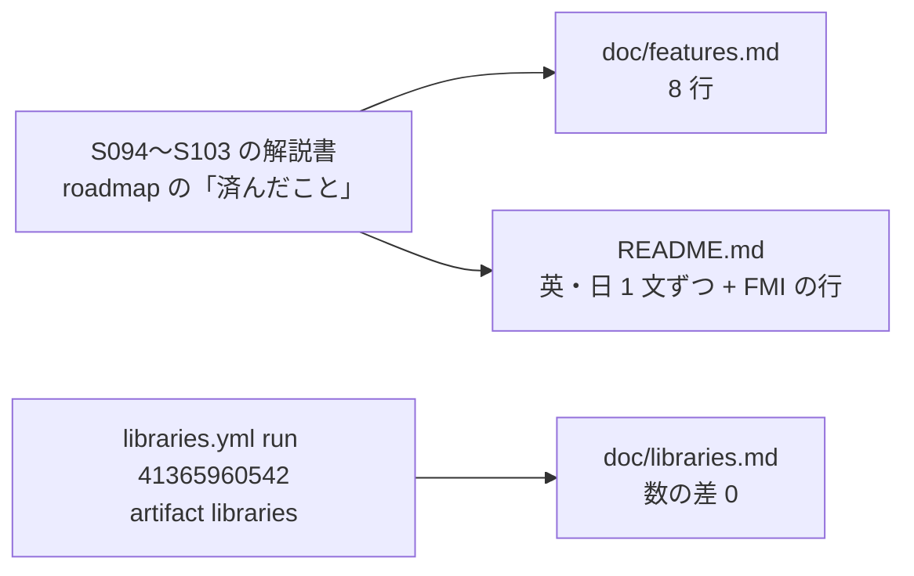

# S107 正典の文書を最近のセッションに追いつかせる

| | |
| --- | --- |
| セッション | S107 |
| 日付 | 2026-11-03 |
| ブランチ | `feature/s107-features-libraries-sync` |
| Phase | P5・P6（文書だけ） |
| スライド | [slides.html](slides.html) |
| 作業記録 | `log/work/2026-11-03-features-libraries-sync.md` |

## 1. 目的

正典の文書を S094〜S103 の成果に合わせる。文書だけで、コードと [roadmap.md](../../roadmap.md) は変えない（roadmap は並行の作業が編集中）。

- [features.md](../../features.md)（最終更新は S094）に S095〜S103 の成果を書く。
- [libraries.md](../../libraries.md)（S058 の run）を、`libraries.yml` の最新の成功 run 41365960542（2026-11-02 の定期実行）の artifact で写し直す。
- [README.md](../../../README.md) の状態に S094〜S103 の成果を英語・日本語で 1 文ずつ足す。

S099（`fmu-exec-api`）は main に取り込まれていないので書かない。S104〜S106 は進行中なので触らない。

## 2. 決定と理由

- **features.md は既存の行に書き足す（8 行）。** 新しい行は足さなかった。自前の FMU ランタイム（S095）は「FMI 2.0 Export」の P5b に当たり、別の行にすると同じ機能が 2 行になるため。直した行: connect のネットワークグラフ（S101）、FMI 2.0 Export（S095）、FMI 3.0 Export（S098）、Android（S092・S100・S103）、ブラウザ（S093）、marimo（S078・S097・S102）、Reference-FMUs・FMPy・fmusim・fmuCheck（S094・S098）、Rumoca との差分照合（S096 の [upstream.md](../../upstream.md)）。
- **libraries.md は artifact をそのまま写し、末尾の手書きの 1 行だけ残した。** artifact の `libraries.md` と main の版の違いは、前書きの「MSL 4.1.0」の太字・時間の列・末尾の「元の run」の行だけだった。「元の run」の行は手で書いたものなので、今回の run の番号・日時・main のコミット（`a778ea92`、S068 のマージ）に書き換えて残した。
- **README は状態の段落に 1 文、「今後必要になりそうな機能」の FMI の行を直した。** FMI の読み込みは [ADR-0026](../../adr/0026-fmi-import-placement.md) が Proposed のままなので「未」と書いた。

### libraries.md の前回との差

前回は S058 の run 41248143483（Chemical・DeltaRobot）と 41250636800（残り 5 つ）、今回は run 41365960542（[libraries.yml](../../../.github/workflows/libraries.yml) の定期実行、2026-11-02 00:13 UTC）。

| ライブラリ | 例題 | OK | GM-U | panic | 実行できた | 時間（検査 + 実行）前 → 後 |
| --- | ---: | ---: | ---: | ---: | ---: | --- |
| AixLib | 642（±0） | 119（±0） | 163（±0） | 0（±0） | 98（±0） | 0:12 + 0:01 → 同じ |
| Buildings | 809（±0） | 119（±0） | 193（±0） | 4（±0） | 88（±0） | 1:13 + 0:06 → 1:04 + 0:06 |
| Chemical | 76（±0） | 12（±0） | 43（±0） | 0（±0） | 0（±0） | 0:02 + 26 s → 0:02 + 25 s |
| ClaRa | 5（±0） | 0（±0） | 0（±0） | 0（±0） | 0（±0） | 5 s + 0 s → 6 s + 0 s |
| DeltaRobot | 21（±0） | 9（±0） | 5（±0） | 0（±0） | 5（±0） | 12 s + 16 s → 13 s + 16 s |
| IBPSA | 457（±0） | 88（±0） | 135（±0） | 4（±0） | 66（±0） | 0:05 + 24 s → 0:05 + 20 s |
| ThermofluidStream | 122（±0） | 4（±0） | 115（±0） | 0（±0） | 2（±0） | 0:02 + 38 s → 0:02 + 31 s |

判定と実行できた本数はすべて同じ（差 0）。版（コミット）も 7 つとも同じ。違いは時間だけで、ランナーのばらつき。main の表は S063〜S068 の直しの後の数をすでに持っていた（S068 の作業記録の MSL 4.1.0 の AixLib 98・IBPSA 66・DeltaRobot 5 と一致）。

## 3. 図



## 4. 再現手順

```bash
D=$(mktemp -d)
gh run download 41365960542 -n libraries -D "$D"
diff "$D/libraries.md" doc/libraries.md   # 末尾の「元の run」の行だけが違う
python3 -I .claude/skills/session-docs/check_docs.py
```

## 5. 次回

- S099・S104〜S106 が main に入ったら、features.md の FMI（実行の API、クロスビルド）と Android（release の APK）、marimo（WASM で MSL）の行を直す。
- features.md の 1〜3 章の P4 の行（ライブラリツリー、プロットなど）は S094 より前の成果も書かれていない行がある。今回は範囲の外。
