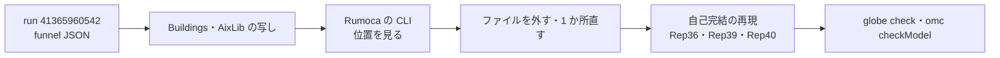

# S108 upstream-ef024-er002

| | |
| --- | --- |
| セッション | S108 |
| 日付 | 2026-11-03 |
| ブランチ | `feature/s108-upstream-ef024-er002` |
| Phase | P3 |
| スライド | [slides.html](slides.html) |
| 作業記録 | `log/work/2026-11-03-upstream-ef024-er002.md` |

## 1. 目的

S091（[解説書](../S091-upstream-ef024-et004/解説書.md)）の持ち越しを片付ける。

1. EF024 の残り 9 本（Buildings の `nomVal` 7、AixLib の `T` 1・`nXi` 1）を最小にする
2. ER002 の `unresolved function call: 'specificEntropyOfpTX'` 39 本（AixLib）を最小にする
3. 下書きを [research/upstream/](../../research/upstream/README.md) に足し、[upstream.md](../../upstream.md) の一覧と提出の順に行を足す

文書だけの作業で、製品コード・xtask・CI は変えない。issue は出さない（出すのはユーザー）。

## 2. 決定と理由

| 項目 | 決定 | 理由 |
| --- | --- | --- |
| 本数の出どころ | libraries の [run 41365960542](https://github.com/asari300/20261018_GlobeMode/actions/runs/41365960542) の `*-funnel.json`（S091 と同じ） | 最新の定期実行。モデル名を引ける |
| 最小化の道具 | `fetch-library` で取得した Buildings 14.0.0・AixLib 3.0.1 の写し（`.mo` だけ）と Rumoca v0.10.2 の CLI | CLI は位置（ファイルと行）を出す。`globe check` は位置を出さない |
| `nomVal` 7・`T` 1 | 新しい下書き **31**（EF024、束縛が replaceable な record を通して成分を読む）。**Rumoca の穴** | 2 つの形（record の成分が replaceable、record のクラスが replaceable）とも `replaceable` を外すと通る。同じ原因と見て 1 件にした |
| `nXi` 1 | 下書き **28** に追記（`Rep36.M5`）。**Rumoca の穴** | 次元が package の定数という 28 の形。package を redeclare しても、モデルの中の record の次元だと落ちる |
| `specificEntropyOfpTX` 39 | 新しい下書き **32**（ER002）。**Rumoca の穴**、ただし呼ばれる関数は AixLib の誤り | モデルが使わない別の派生クラス（`ExhaustHeatExchanger`）の CHP の媒質まで解決して止まる。omc は通す |
| 番号 | 31・32（`Rep39`・`Rep40`） | 30 の次。一度 32 として分けた形（関数の束縛が record の成分を読む）は 31 の形 2 と分かったので 31 にまとめた |
| GlobeMode 側 | 回避は入れない（Rust は触らない） | 依頼の範囲外。32 は `--library` が閉包だけ読むので `globe check` では出ない |

## 3. 図



## 4. 再現手順

```bash
cd doc/research/upstream
R=../../../data/rumoca/rumoca-linux-x86_64     # cargo xtask fetch-rumoca
$R compile 31-ef024-binding-reads-field-of-replaceable-record.mo -m Rep39.M2   # EF024 nomVal
$R compile 31-ef024-binding-reads-field-of-replaceable-record.mo -m Rep39.F    # EF024 a
$R compile 28-et004-ef024-dimension-from-package-constant.mo -m Rep36.M5       # EF024 n
$R compile 32-er002-unused-function-of-other-subclass-medium.mo -m Rep40.M     # ER002
```

| 確かめたこと | 結果 |
| --- | --- |
| `globe check` と CLI のコード | 3 つの再現の 12 本で一致（失敗 7・対照 5） |
| omc 1.27.2 の `checkModel` | 12 本とも completed successfully |
| Buildings の写しで `DXCoil.m_flow_small` の束縛を定数に | `SpeedSelect` が S0〜S10 を通る。`DryCoil`・`WetCoil` は別の EF004 で止まる |
| AixLib の写しで `ExhaustHeatExchanger.mo` を空のモデルに | `PartialFourPort` を継いで `Medium1.setState_phX` を呼ぶ試しのモデルの ER002 が消える。`extends ...(redeclare package Medium1 = ...CHPFlueGasLambdaOnePlus)` だけにすると戻る |
| `globe check -L` で同じ例題 | ER002 は出ない（閉包だけ読む、[ADR-0025](../../adr/0025-native-library-closure.md)）。`ZonalFlow` は EI032 |
| 本数 | 31 は 8（`nomVal` 7・`T` 1）、28 は 3 → 4、32 は 39 |

- Rumoca の CLI は MSL と AixLib を別々の `--source-root` に渡すと `import Modelica...` が引けないので、1 つの根に並べて渡した。AixLib の取得物の `RadiatorTypes/` と `Obsolete/DataBase/` は CLI が読み込みで断るので写しから外した。
- CLI は渡したファイルと同じディレクトリの `.mo` も読む。再現のパッケージの名前は分けてある。
- 詳しくは [libraries-2026-11-01.md](../../research/libraries-2026-11-01.md) の「EF024 の残りと `specificEntropyOfpTX`（S108）」、判定の一覧は [upstream/README.md](../../research/upstream/README.md)。

## 5. 次回

- 下書き 28〜32 を Rumoca の main で確かめて出す（ユーザー）。32 の元の AixLib の誤り（`specificEntropyOfpTX` を写していない）を AixLib に知らせるかもユーザーが決める
- AixLib の `T`（31 の形 2）と `nXi`（28 の追記）の 2 本を、ライブラリの写しで直して確かめる
- funnel（全部読み）も閉包で読むかを決める。決めれば ER002 の 39 本は別の失敗に変わる
