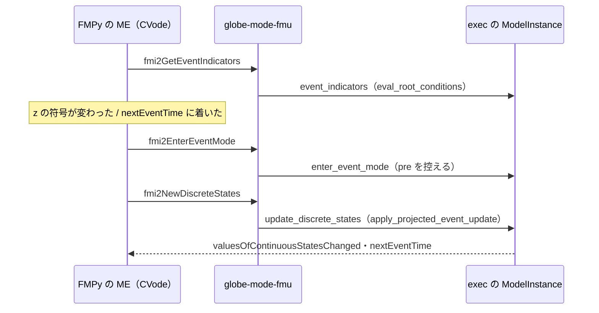

# S109 事象のあるモデルを FMU で回す（P5b の 3 回目）

| | |
| --- | --- |
| セッション | S109 |
| 日付 | 2026-11-03 |
| ブランチ | `feature/s109-fmu-events` |
| Phase | P5（P5b） |
| スライド | [slides.html](slides.html) |
| 作業記録 | [log/work/2026-11-03-fmu-events.md](../../../log/work/2026-11-03-fmu-events.md) |

## 1. 目的

- [S099](../S099-fmu-exec-api/解説書.md) の持ち越しの 1 つ目。事象（根の条件・`sample`）のあるモデルを `globe-mode-fmu` で回す。
- `ModelInstance` に事象指示関数と事象の処理を足し、FMU の `fmi2GetEventIndicators`・`fmi2EnterEventMode`・`fmi2NewDiscreteStates` につなぐ。Rumoca は改変しない。
- 出力の値参照、MSL を使うモデル、CS・FMI 3.0・Windows は範囲の外。

## 2. 決定と理由

詳細は [ADR-0032](../../adr/0032-p5b-own-runtime.md) の追記（S109）。

| 項目 | 決定 | 理由 |
| --- | --- | --- |
| 包む相手 | S099 と同じ `SolveRuntime`（公開）。host の `apply_discrete_event_updates` と同じ順に公開の関数を呼ぶ | host の `SolveMeKernel` の事象の関数は rev 276e82bd でも `pub(crate)` |
| 事象指示関数 | `eval_root_conditions` + `orient_typed_root_zeros` | host の `get_event_indicators` と同じ値（ちょうど 0 を関係式の側に寄せる） |
| 越えた根 | 直前の事象の後の値と今の値を `root_crossings_with_relation_memory` で比べ、`root_relation_overrides` に渡す | 根の真上で関係式の記憶がどちらの側かを決めるため（host の `pending_root_crossings` と同じ役） |
| 時刻事象 | `SolveStopSchedule` と `next_runtime_event_stop`。端は `f64::MAX` | FMI の ME は終了時刻を知らせなくてよい。`next_periodic_event_time` は有限の端を要る（無限だと何も返さなかった） |
| `newDiscreteStatesNeeded` | いつも偽 | Rumoca は 1 回の呼び出しで事象の反復を収束させる（host の `MeDiscreteStates` と同じ） |
| 事象の回数の比べ方 | FMPy の `enterEventMode`・`newDiscreteStates` を数える（`tests/fmpy_run.py`） | Integer の n は値参照が無く（持ち越し）、FMU の外から読めない |

## 3. 図



## 4. 再現手順

```bash
export CARGO_TARGET_DIR=…/.git-worktree/target-shared CARGO_BUILD_JOBS=2
cargo test -p globe-mode-fmu --test fmpy -- --nocapture --test-threads 1
```

- `fmpy_matches_exec_on_bouncing_ball`: FMPy 0.3.32 の ME で `reinit=3 events=6`、h(2) = 0.26073984246749315、v(2) = -0.16588584207712853。exec の `run`（既定の bdf）は n = 3、h(2) = 0.26074169044319206、v(2) = -0.1658694813220666。差は 1.8e-6・1.6e-5（試験は 1e-3 以内）。
- `fmpy_matches_exec_on_sample_counter`: `events=10`（exec の n = 10）、x(1) = 1.0（exec は 0.9999999999999998）。
- Event Mode が 6 回なのは、床を下へ越えたとき（`when h < 0` が発火して `reinit`）と上へ越えたとき（発火しない）が 3 回ずつあるため。
- S099 の `events_are_refused` は消した（断らなくなったので）。

## 5. 次回

- 離散・出力の変数の値参照（BouncingBall・SampleCounter の n、SampleCounter の xs）。今は FMPy で Event Mode の回数を数えて突き合わせている。
- `initial()` の事象（`apply_projected_initial_event_boundary`）、host の多様体の射影、状態事象と時刻事象が同時のとき。
- MSL を使うモデル、`modelDescription.xml` の生成を P5a と共有、CS・FMI 3.0・Windows（S099 の持ち越しのまま）。
