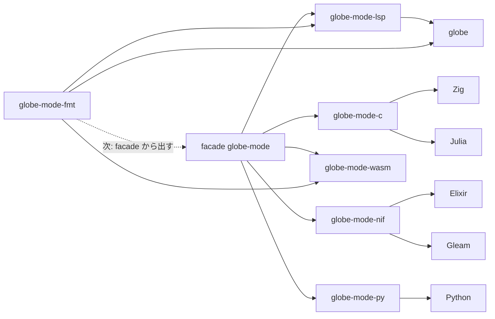

# S110 言語 API の機能表

| | |
| --- | --- |
| セッション | S110 |
| 日付 | 2026-11-03 |
| ブランチ | `feature/s110-lang-api-matrix` |
| Phase | P7（言語 API と UI 比較の 2 回目。1 回目は [S039](../S039-python-wheel/解説書.md)） |
| スライド | [slides.html](slides.html) |
| 作業記録 | [log/work/2026-11-03-lang-api-matrix.md](../../../log/work/2026-11-03-lang-api-matrix.md) |

## 1. 目的

[roadmap](../../roadmap.md) の P7 の完了条件「参照シナリオが 6 言語で通る」の前段。各言語の API がどの機能を出しているかを表にし、参照シナリオを 1 つ決めて、穴を埋める順を決める。文書だけで、コードは変えない。cargo のビルドも回さない（他の作業が走っているため）。

表と根拠のファイル、手元で回した結果は [doc/research/lang-api-matrix-2026-11-03.md](../../research/lang-api-matrix-2026-11-03.md) に置いた。ここでは決定と要約だけを書く。

## 2. 決定と理由

| 項目 | 決定 | 理由 |
| --- | --- | --- |
| 表の列 | Rust facade・C ABI・Zig・Julia・Elixir・Gleam・Python・wasm・LSP・CLI | P7 の 6 言語に、比べるための 4 つを足した |
| 表の行 | open・check・simulate・simulate_columns・format・lint・graph・MSL の全部読み・分割読み・設定の override・進捗・中断・FMU export の 13 行 | 依頼の機能。outline・flat などは参照シナリオに要らないので外した |
| 中断 | `max_wall_seconds`（予算）を「あり」に数える | どの口にも予算はある。呼び手が途中で止める口はどこにも無く、それは「進捗」と合わせて最後に設計する |
| 参照シナリオ | Decay を開く → check → simulate → `final.x` が e⁻¹ → 同じ本文を format | S039 のシナリオ（graph を含む）に「整形」を足し、編集から実行までの 1 周にした。MSL は使わない |
| 判定の仕方 | Python・wasm・LSP・CLI は既にある build で回す。C・Zig・Julia・Elixir・Gleam・Rust はソースを読んで【未確認】を付ける | ビルドを回さない約束 |
| 埋める順 | facade に `format` / `lint` → C・NIF・py に足し Julia の包みを足す → 各言語の試験 → 列の道 → FMU → 進捗と中断 | 束ねは facade だけに依存する方針（S039・S075・S082）を崩さずに 6 言語の参照シナリオを閉じられる。依存の追加は 0 |

### 言語ごとの穴の数（13 行のうち）

| Rust facade | C | Zig | Julia | Elixir | Gleam | Python | wasm | LSP | CLI |
| --- | --- | --- | --- | --- | --- | --- | --- | --- | --- |
| 4 | 6 | 6 | 7 | 6 | 6 | 5 | 2 | 3 | 2 |

### 参照シナリオが今通るか

- 通った: wasm（Node）、LSP（`globe lsp`）、CLI（`globe`）。
- 通らない: P7 の 6 言語すべて。足りないのは 6 言語とも format だけ（1〜4 の API はある）。Python は 1〜4 を手元で回した。
- Rust facade は format が facade の外（`globe-mode-fmt`）にあるが、2 つの crate を使えば通る【未確認】。

## 3. 図



今は `globe-mode-fmt` を wasm・LSP・CLI が直接使い、facade を通る束ね（C・NIF・py）には届いていない。これが 6 言語の参照シナリオの唯一の穴。

## 4. 再現手順

既にある build を使う（cargo は回さない）。

```bash
# Python（main の .venv。S085 より前の build なので simulate_columns は無い）
.venv/bin/python -I -c "import sys; sys.path.insert(0, 'src/Python/mod'); import globe_mode as g; \
  ws = g.Workspace(); ws.load_dir('src/Modelica'); m = 'GlobeModeValidation.Simulation.Decay'; \
  print(ws.check(m)['passed'], ws.simulate(m)['final']['x'])"
# → True 0.367879468116207

# wasm（Node）: Workspace → set_file → check → simulate → simulate_columns → format → lint
# → passed / ok / x = 0.367879468116207 / format 318 文字 / lint 0 件 / 815 ms

# LSP: globe lsp に didOpen → globe/check → globe/simulate → globe/simulateColumns → globe/format
# CLI
globe check -m GlobeModeValidation.Simulation.Decay src/Modelica --json   # passed: true
globe simulate -m GlobeModeValidation.Simulation.Decay src/Modelica -o -  # 最後の行 1,0.367879468116207
globe fmt --check src/Modelica/GlobeModeValidation/Simulation/Decay.mo    # 整形が要る（終了コード 1）
```

wasm と LSP の手順の台本は手元の一時ファイルで回した（コミットしていない）。

## 5. 次回

- 埋める順の 1 と 2: facade に `format(text, options_json)` / `lint(text)` を足し、`gm_format` / `gm_lint`（C）、NIF と py の `format` / `lint`、Julia の `format`・`load_dir`・`graph` の包みを足す。
- 3: 参照シナリオを `test_api.py`・`main.zig`・`globe_mode.jl`・`globe_mode_test.exs`・`globe_mode_test.gleam` に入れ、CI のジョブ `lang` で回す。これで P7 の完了条件の前半を満たす。
- 持ち越し: 列の道（C・NIF）、FMU export を facade に（S109 の後）、進捗と途中で止める口（ADR が要る）。main の `.venv` の `_native.abi3.so` が古い（`uv sync` で作り直す）。
