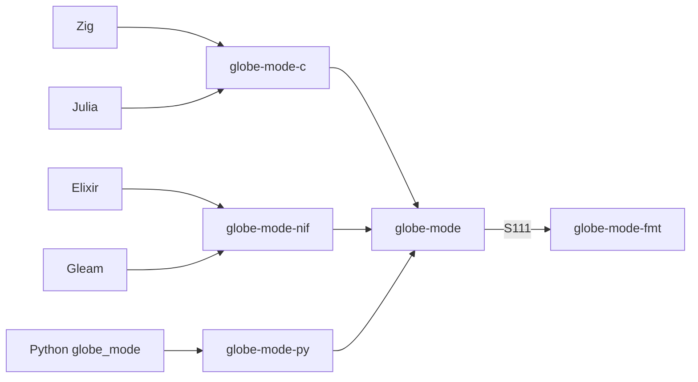

# S111 6 言語に format と lint

| | |
| --- | --- |
| セッション | S111 |
| 日付 | 2026-11-03 |
| ブランチ | `feature/s111-lang-format-lint` |
| Phase | P7（言語 API と UI 比較の 3 回目。前回は [S110](../S110-lang-api-matrix/解説書.md)） |
| スライド | [slides.html](slides.html) |
| 作業記録 | [log/work/2026-11-03-lang-format-lint.md](../../../log/work/2026-11-03-lang-format-lint.md) |

## 1. 目的

[S110 の調査](../../research/lang-api-matrix-2026-11-03.md)で決めた「埋める順」の 1 と 2 を行い、参照シナリオ（Decay を開く → check → simulate → `final.x` が e⁻¹ → format）を P7 の 6 言語（C・Zig・Julia・Elixir・Gleam・Python）で通す。6 言語に共通して欠けていたのは format だけだった。

## 2. 決定と理由

| 項目 | 決定 | 理由 |
| --- | --- | --- |
| どこに足すか | facade `globe-mode` に `format` / `lint` を足し、束ね（`globe-mode-c`・`globe-mode-nif`・`globe-mode-py`）は facade だけを呼ぶ | 「束ねは facade だけに依存する」（S039・S075・S082）を守る。facade は workspace の `globe-mode-fmt`（依存 0）に依存するだけで、外部の依存の追加は 0 |
| 形 | wasm の `src/Rust/mod/globe-mode-wasm/src/fmt.rs` と同じ: `format(text, indent, insert_origin)` は整形した本文か理由、`lint(text)` は `[{rule, line, column, message}]` の JSON | 束ねの入出力はどれも JSON の文字列。S110 の提案は `options_json` だったが、wasm・LSP と同じ 2 つの引数で足りる |
| C ABI | `gm_format(text, uint32_t indent, int insert_origin)` は `{"text": …}` か `{"error": …}`、`gm_lint(text)` は JSON の配列 | 既存の `gm_*` と同じく NULL を返さず誤りを JSON で返す。ヘッダの署名は `tests/header.rs` が突き合わせる |
| NIF | `format/3` は `{:ok, 本文}` か `{:error, 理由}`、`lint/1` は JSON の文字列。Elixir は `GlobeMode.format(text, indent: 2, insert_origin: true)` と `GlobeMode.lint`（デコード済み）、Gleam は `@external` | 既存の NIF と同じ形 |
| Python | `globe_mode.format`（誤りは `ValueError`）、`globe_mode.lint`（`list[dict]`） | Workspace は要らないので自由関数（wasm と同じ） |
| Julia | `format`・`lint` に加え、S110 の表で欠けていた `load_dir`・`graph` の包みを足した | C ABI にはあり、包みだけが無かった |
| CI | `.github/workflows/` は変えない。`ci_plan.py` は Cargo.toml から依存を読むので、facade・fmt の変更で C・NIF・py と `lang`・`python` のジョブが回る。`test_ci_plan.py` にその試験を足した | ジョブ `lang` は既に `c:zig`・`c:julia`・`elixir:test`・`gleam:test` を回しているので、各言語の試験に参照シナリオを足せば CI でも回る |

## 3. 図



## 4. 再現手順

ビルドは共有の target と `CARGO_BUILD_JOBS=2` で回した（RAM 3 GB で、別の作業も Rust をビルドしていた）。

```bash
export CARGO_TARGET_DIR="$MAIN/.git-worktree/target-shared" CARGO_BUILD_JOBS=2
cargo test -p globe-mode -p globe-mode-c -p globe-mode-py
mise run c:zig
mise run c:julia
mise run elixir:test
mise run gleam:test
uv sync && uv run pytest -q src/Python/tests
python3 .github/scripts/test_ci_plan.py
```

| 言語 | 試験 | 参照シナリオ |
| --- | --- | --- |
| C | `globe-mode-c` の単体試験（x(1) と `gm_format`・`gm_lint`、文法の誤りは `{"error"}`） | 通った |
| Zig | `src/Zig/src/main.zig`（`Decay.mo` を読んで `gm_format`） | 通った。x = 0.367879468116207、整形した本文 382 バイト |
| Julia | `src/Julia/test.jl`（x(1)・format・lint・graph・`load_dir`） | 通った。x = 0.367879468116207 |
| Elixir | `globe_mode_test.exs` | 通った（1 test, 0 failures） |
| Gleam | `globe_mode_test.gleam`（本文は Erlang の `file:read_file` で読む） | 通った（1 passed） |
| Python | `src/Python/tests/test_api.py` の `test_reference_scenario` | 通った（3 passed, 1 skipped） |

数字は [作業記録](../../../log/work/2026-11-03-lang-format-lint.md)にもある。機能表の更新は [調査](../../research/lang-api-matrix-2026-11-03.md)の 1 節。

## 5. 次回

- S110 の埋める順の 4: 列の道を C（`double *` と長さ）と NIF（binary）に。
- 順の 5: FMU export を facade に（S109 が `globe-mode-fmu` を触り終えてから）。
- 順の 6: 進捗と途中で止める口（ADR を先に）。
- wasm の `fmt.rs` は今も `globe-mode-fmt` を直に呼ぶ。facade の `format` / `lint` に寄せれば重複が消えるが、wasm を変えると `wasm:node`・`wasm:compare` が要るので今回は触らなかった。
