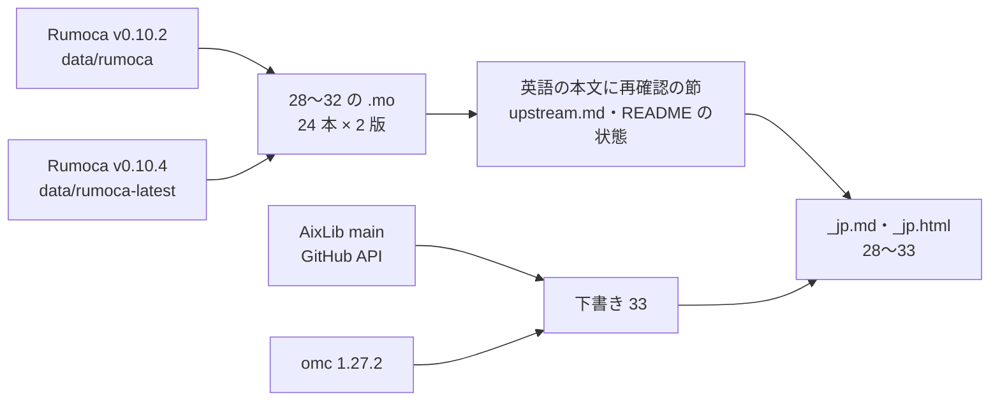

# S113 upstream-recheck-jp

| | |
| --- | --- |
| セッション | S113 |
| 日付 | 2026-11-03 |
| ブランチ | `feature/s113-upstream-recheck-jp` |
| Phase | P3 |
| スライド | [slides.html](slides.html) |
| 作業記録 | `log/work/2026-11-03-upstream-recheck-jp.md` |

## 1. 目的

S108（[解説書](../S108-upstream-ef024-er002/解説書.md)）の持ち越しのうち、上流の下書きを出す前の準備をする。出すのはユーザーで、このセッションでは出さない。

1. 下書き 28〜32 を Rumoca の最新で再現し、本文と [upstream.md](../../upstream.md)・[research/upstream/README.md](../../research/upstream/README.md) を直す
2. 28〜32 に日本語版（`_jp.md`）とスライド 1 枚の解説（`_jp.html`）を足す
3. AixLib の `specificEntropyOfpTX` の誤りを、同じ 4 点セットの下書き 33 にする

文書だけの作業で、製品コード・xtask・CI は変えない。`render_slides.py` だけ、1 枚のデッキで送りの検査を省くよう 1 行直した。

## 2. 決定と理由

| 項目 | 決定 | 理由 |
| --- | --- | --- |
| 「最新」 | リリース v0.10.4（2026-11-02 公開、タグのコミット `9c8c56fc`）の配布バイナリ。`data/rumoca-latest/` に置き、`.gitignore` に足した | main は v0.10.4 の 10 コミット後（`91d6e936`）。ソースからのビルドは RAM 3 GB では重いのでしない。10 コミットの題に名前の探索・次元・束縛に触れるものは無い。main は【未確認】と書いた |
| 28 | 件名を「replaceable な package を通して定数を読む次元」に絞る | v0.10.4 で `M`（`Real x[P.n]`）と `M2`（parameter 経由）が通る。`M1`・`M3`・`M5` は同じコードで落ちる |
| 29〜32 | 本文は直さず、再確認の節と環境を足す | v0.10.2 と同じコード・同じメッセージ |
| 33 | 相手は AixLib。英語・`.mo`・`_jp.md`・`_jp.html` の 4 点 | 宣言の無い関数の呼び出しは、どのツールでも誤り。omc 1.27.2 も AixLib 3.0.1 で断る。AixLib main（`e5df9a8d` = v3.0.1）でもファイルは同一 |
| 33 が既知か | 「CI のホワイトリストに載るが、原因を名指しする issue は無い」と書く | AixLib の `ci/whitelist/om_check_whitelist.txt` と issue #1291 に `CHPCombustionMixtureGasNasa` がある。出し方はユーザーが決める |
| `_jp.html` の置き場 | 下書きの隣（`doc/research/upstream/`）。`../../assets/` の相対パスで同じ CSS・JS | `check_docs.py` の slide の検査は `doc/sessions/*/*.html` だけが対象。`_jp.html` は同じ `check_slides` を直接呼んで確かめた。リンクの検査は `doc/**/*.html` なので対象 |
| `render_slides.py` | 1 枚のデッキは → キーと `#S03` の検査を省く | 1 枚では `#S02` に進めないので必ず落ちる |

## 3. 図



## 4. 再現手順

```bash
gh release download v0.10.4 -R CogniPilot/rumoca -p rumoca-linux-x86_64 -D data/rumoca-latest
chmod +x data/rumoca-latest/rumoca-linux-x86_64
cd doc/research/upstream
R=../../../data/rumoca-latest/rumoca-linux-x86_64
$R compile 28-et004-ef024-dimension-from-package-constant.mo -m Rep36.M     # v0.10.4 で通る
$R compile 28-et004-ef024-dimension-from-package-constant.mo -m Rep36.M3    # ET004（残る）
$R compile 32-er002-unused-function-of-other-subclass-medium.mo -m Rep40.M  # ER002（残る）
$R compile 33-aixlib-specific-entropy-of-ptx-missing.mo -m Rep41.M          # ER002（ライブラリの誤り）
```

| 確かめたこと | 結果 |
| --- | --- |
| 28〜32 の再現 24 本 × 2 版 | v0.10.4 で変わったのは 28 の `M`・`M2`（ET004 → 通る）だけ |
| 33 の `.mo`（`Rep41.M`・`M0`） | omc は `M` を `Function specificEntropyOfpTX not found` で断り `M0` を通す。Rumoca は v0.10.2・v0.10.4 とも `M` が ER002、`M0` が通る |
| AixLib 3.0.1 で `CHPFlueGasLambdaOnePlus.setState_psX` を呼ぶモデル（omc、MSL 4.0.0） | 670 行のエラー。`setState_pTX` の対照は通る |
| AixLib main の `CHPCombustionMixtureGasNasa.mo` | 取得物と同一（`diff` で差 0、改行は除いて比較） |

- ライブラリの例題そのものは v0.10.4 で回していない【未確認】。28 の `Temperature_u` は直った形なので 4 本 → 3 本の見込み。
- 一覧は [upstream.md](../../upstream.md)、表と再確認の節は [research/upstream/README.md](../../research/upstream/README.md)。

## 5. 次回

- ユーザーが `_jp.md`・`_jp.html` を読み、出すかを決める。28 は `M1`・`M3`・`M5` に絞る。33 は AixLib に出すか（ホワイトリストの件の原因として）を決める
- 17〜27 も v0.10.4 で確かめ直す（v0.10.2 から 221 コミットあり、次元や record の直しが入っている）
- GlobeMode の Rumoca の rev を v0.10.4 に上げるかを決める（`msl:funnel`・`msl:sim` の本数で）
