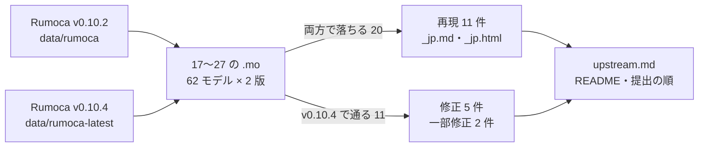

# S115 upstream-recheck-17-27

| | |
| --- | --- |
| セッション | S115 |
| 日付 | 2026-11-03 |
| ブランチ | `feature/s115-upstream-recheck-17-27` |
| Phase | P3 |
| スライド | [slides.html](slides.html) |
| 作業記録 | `log/work/2026-11-03-upstream-recheck-17-27.md` |

## 1. 目的

S113（[解説書](../S113-upstream-recheck-jp/解説書.md)）の持ち越し。上流の下書き 17〜27（20b・25b〜25h を含む）を Rumoca の最新のリリース v0.10.4 で確かめ直し、状態を直す。

1. 再現の `.mo` を v0.10.2 と v0.10.4 の CLI で回し、各下書きに「Re-check on Rumoca v0.10.4 (S115)」の節を足す
2. まだ再現する件に日本語版（`_jp.md`）とスライド 1 枚の解説（`_jp.html`）を足す
3. 直った件は [upstream.md](../../upstream.md) と [research/upstream/README.md](../../research/upstream/README.md) の状態を「v0.10.4 で修正」にし、提出の順から外す

文書だけの作業で、Rust のコード・xtask・CI は変えない。issue は出さない（ユーザーが日本語版を読んで決める）。

## 2. 決定と理由

| 項目 | 決定 | 理由 |
| --- | --- | --- |
| 「最新」 | S113 と同じリリース v0.10.4（`9c8c56fc`）の配布バイナリ | main のチェックアウトの `data/rumoca-latest/` にある。main（v0.10.4 の後）はビルドしない【未確認】 |
| 直った件（25・25b・25c・25g・26） | 本文の先頭に「Status (S115)」、再確認の節を足して残す。`_jp` は作らない | 出さない記録として残す。ライブラリの例題で本当に消えるかは、GlobeMode の Rumoca の rev を上げてから確かめる |
| 20 | 件名は変えず、出すのは 20b（2 つの Medium の形）だけと書く。`_jp` は 20b の形で作る | `loadResource`（`Rep20Load`・`Rep20TwoExtends.M`）は v0.10.4 で通る。20b の `Rep28.M` は同じ EF025 |
| 25e | 出すのは `parameter` の形だけ | `constant` の形（`MC`）は v0.10.4 で通る。MSL の `EOSIdealCoeff` は `parameter` の形（`Media/R134a.mo` の 52〜53 行） |
| 提出の順 | 20 を 5 位 → 13 位、24 を 6 位 → 5 位。直った 5 件は「—」の行にまとめる | 20 の本数が 138 → 2 になる。直った件は出さない |
| 28〜32 の `_jp.html` | 「提出の順」の数字だけ直した | 順が繰り上がったので、S113 の 1 枚の数字が古くなる |
| 01〜16 | 対象外 | 実行系・ソルバの件で、MSL の例題の実行が要る |

## 3. 図



## 4. 再現手順

```bash
cd doc/research/upstream
R=../../../data/rumoca-latest/rumoca-linux-x86_64
$R compile 17-er132-redeclare-function-extends-product.mo -m Rep17.M        # ER132（残る）
$R compile 25-ed019-function-conditional-boolean-loop.mo -m Rep25.M         # v0.10.4 で通る
$R compile 26-ed008-field-of-package-record-constant.mo -m Rep26.B          # v0.10.4 で通る
$R compile 20-ef025-function-selection-identity.mo -m Rep20Load --source-root ../../../data/msl   # v0.10.4 で通る
$R compile 20b-ef025-two-medium-aliases-modified-extends.mo -m Rep28.M      # EF025（残る）
```

| # | v0.10.4 の結果 |
| --- | --- |
| 17・18・19・21・24・25d・25f・25h・27 | 再現（コードもメッセージも v0.10.2 と同じ） |
| 20 | 一部直った（`loadResource` の形は通る、20b は再現） |
| 25e | 一部直った（`constant` は通る、`parameter` は再現） |
| 25・25b・25c・25g・26 | 直った |

- 62 モデルのうち、v0.10.4 で通るようになったのが 11、両方で落ちるのが 20、両方で通る（対照）のが 31。v0.10.4 で新たに落ちたものは 0。
- MSL を読む 3 本（`Rep18`・`Rep20Load`・`Rep20Load0`）は機械の負荷（1 分の平均 27〜34）で 1 本あたり数分かかった。
- ライブラリの例題そのものは v0.10.4 で回していない【未確認】。

## 5. 次回

- ユーザーが 17〜27 の `_jp.md`・`_jp.html` を読み、出すかを決める（20 は 20b、25e は `parameter` の形に絞る）
- 01〜16（実行系・ソルバ・diffsol）を v0.10.4 で確かめ直す（MSL の例題の実行が要る）
- GlobeMode の Rumoca の rev を v0.10.4 に上げるかを決める。上げたら、直った 5 件と 20 の `loadResource` の本数（136）がライブラリの検査で消えるかを `msl:funnel`・`libraries.yml` で確かめる
