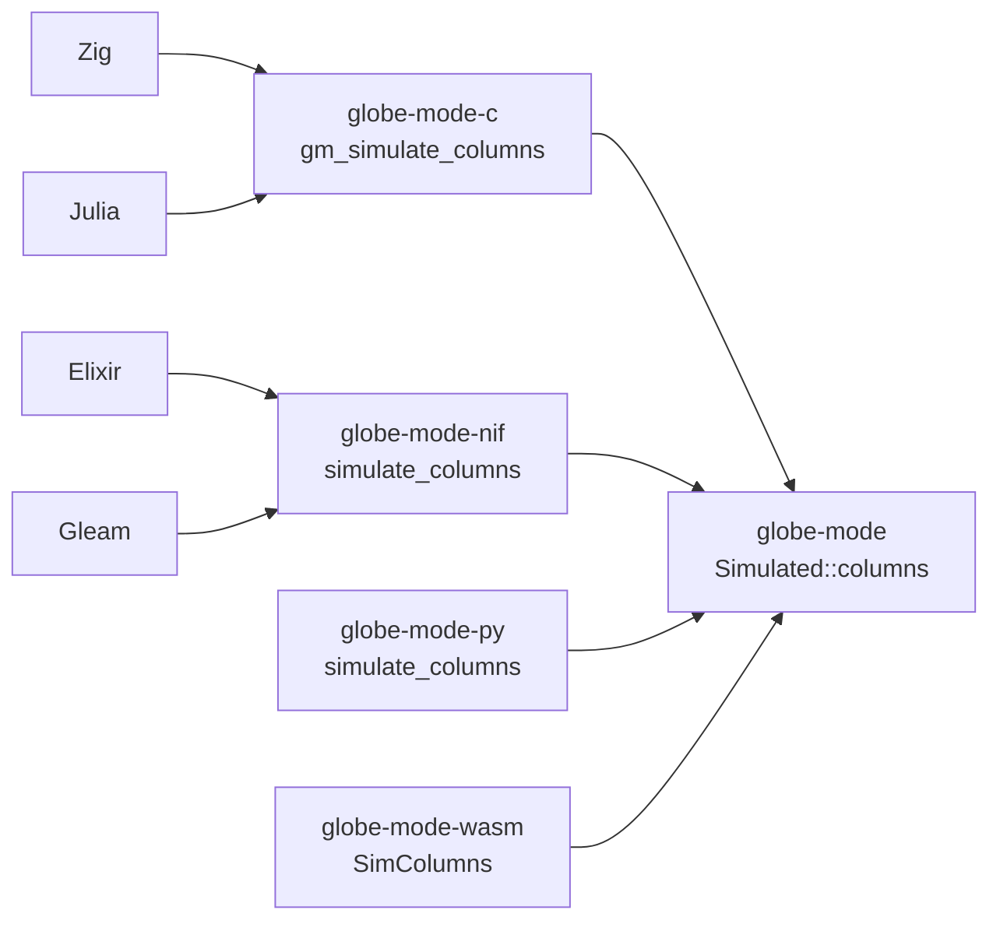

# S116 列の道を C ABI と NIF に

| | |
| --- | --- |
| セッション | S116 |
| 日付 | 2026-11-03 |
| ブランチ | `feature/s116-lang-columns` |
| Phase | P7（言語 API と UI 比較の 4 回目。前回は [S111](../S111-lang-format-lint/解説書.md)） |
| スライド | [slides.html](slides.html) |
| 作業記録 | [log/work/2026-11-03-lang-columns.md](../../../log/work/2026-11-03-lang-columns.md) |

## 1. 目的

[S110 の調査](../../research/lang-api-matrix-2026-11-03.md)の「埋める順」の 4。時系列を CSV の入った JSON でなく、列ごとの f64 で受け取る道（`simulate_columns`）を、Python（S085）と wasm（S051）に加えて C ABI・Zig・Julia・Elixir・Gleam から使えるようにする。

## 2. 決定と理由

| 項目 | 決定 | 理由 |
| --- | --- | --- |
| facade | `Simulated::columns(&self) -> (ColumnsLayout, Vec<&[f64]>)` を足した。`names[0]` は `time`、実行できなければ空の列と 0 点 | Python と wasm が同じ組み立てを別々に持っていた。借用で返すので、束ねがそれぞれの形（bytes・`double *`・binary・`Float64Array`）へ 1 回だけ写す。「束ねは facade だけに依存」を守る |
| Python・wasm | 列の組み立てを `Simulated::columns` に寄せた。wasm の `SimColumns` は `run` の代わりに `Simulated`（`compiled` は放す）を持つ | 重複を消す。JS・Python から見える形は変えていない（wasm の試験 9 本、Python の単体試験が通る） |
| C ABI | `char *gm_simulate_columns(ws, model, settings_json, double **data, size_t *len)` と `void gm_doubles_free(double *data, size_t len)` | 結果は `{"response", "names", "points"}` の JSON（既存の `gm_*` と同じく NULL を返さず、誤りは `{"error"}`）。列は 1 本の連続した配列（列 i は `data + i * points`）で、確保は Rust の `Box<[f64]>`。不透明な結果の型を足すより関数が少ない。誤りや実行できなかったときは `*data = NULL`、`*len = 0` |
| NIF | `simulate_columns/3` が `{:ok, {layout_json, [binary]}}`（DirtyCpu）。binary は列ごとの f64 の little-endian | Python の bytes と同じ。Elixir は `GlobeMode.simulate_columns` が `{:ok, layout（デコード済み）, columns}`、Gleam は `Result(#(String, List(BitArray)), String)` |
| Julia | `simulate_columns(ws, model)` が `(レイアウトの JSON, Vector{Vector{Float64}})`。列は Julia の配列に写してから `gm_doubles_free` | 所有を Julia の GC に渡さない。`points` は正規表現で拾う（JSON の標準ライブラリが無い。既存の `shortcut:` と同じ） |
| 依存 | 外部の依存の追加は 0。`.github/workflows/` は変えない | ジョブ `lang` は既に `c:zig`・`c:julia`・`elixir:test`・`gleam:test` を回す。`ci_plan.py` は Cargo.toml から依存を読み、依存は変えていない（`test_ci_plan.py` 25 本 OK） |

## 3. 図



## 4. 再現手順

ビルドは共有の target と `CARGO_BUILD_JOBS=2`（RAM 3 GB、別の作業と並行）。

```bash
export CARGO_TARGET_DIR="$MAIN/.git-worktree/target-shared" CARGO_BUILD_JOBS=2
cargo test -p globe-mode-c -p globe-mode-py -p globe-mode-wasm
mise run c:zig
mise run c:julia
mise run elixir:test
mise run gleam:test
mise run wasm:node
mise run wasm:compare
python3 .github/scripts/test_ci_plan.py
```

各言語の試験は、`GlobeModeValidation.Simulation.Decay` の列の道で、最後の x が JSON の道の `final.x` と同じ値（e⁻¹）であることと、点の数が CSV の行数 - 1 と同じことを確かめる。

| 言語 | 試験 | 結果 |
| --- | --- | --- |
| C | `globe-mode-c` の単体試験（Decay の簡易版、`names` が `["time", "x"]`、`len = 2 * points`、誤りで `data` が NULL）と `tests/header.rs` | 通った |
| Zig | `src/Zig/src/main.zig` | 501 点、x = 0.367879468116207 |
| Julia | `src/Julia/test.jl` | 501 点、x = 0.367879468116207。JSON の道 4.99 ms、列の道 4.16 ms |
| Elixir | `globe_mode_test.exs` | 501 点、x = 0.367879468116207。JSON の道 1,803 µs、列の道 1,602 µs |
| Gleam | `globe_mode_test.gleam`（`bit_array.slice` で最後の 8 バイト） | 通った（1 passed） |

時間は 1 回ずつ測っただけで、Decay（2 列 501 点）では差は小さい（JSON の CSV が約 14 KB）。大きな結果で効く（S085 で Python は 6 倍）。

## 5. 次回

- S110 の埋める順の 5: FMU export を facade に（`globe-mode-fmu` を触る作業が終わってから）。
- 順の 6: 進捗と途中で止める口（ADR を先に）。
