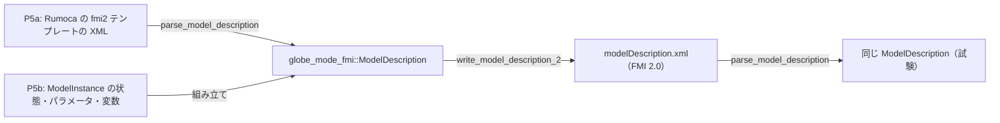

# S117 modelDescription.xml を P5a と P5b で共有

| | |
| --- | --- |
| セッション | S117 |
| 日付 | 2026-11-03 |
| ブランチ | `feature/s117-fmi-model-description-shared` |
| Phase | P5（P5a・P5b の共通） |
| スライド | [slides.html](slides.html) |
| 作業記録 | [log/work/2026-11-03-fmi-model-description-shared.md](../../../log/work/2026-11-03-fmi-model-description-shared.md) |

## 1. 目的

- [S099](../S099-fmu-exec-api/解説書.md)〜[S114](../S114-fmu-inputs/解説書.md) の持ち越し「`modelDescription.xml` の生成を P5a と共有」を片付ける。
- `globe-mode-fmi` の型 `ModelDescription`（S057 の読む側）に書く側を 1 つ足し、P5b（`globe-mode-fmu`）の文字列の連結をやめる。
- FMI 3.0 の書く側、CS、`Outputs` の `dependencies`、Enumeration・String は範囲の外。

## 2. 決定と理由

詳細は [ADR-0031](../../adr/0031-fmi-export-p5a-first.md) と [ADR-0032](../../adr/0032-p5b-own-runtime.md) の追記（S117）。

| 項目 | 決定 | 理由 |
| --- | --- | --- |
| 置き場 | `globe-mode-fmi` の既定の feature に `write_model_description_2(&ModelDescription) -> Result<String, Error>` | 読む側と型が既にある。`export` feature（Rumoca・zip）を引き込まずに `globe-mode-fmu` から使える |
| 型の拡張 | 変数に `initial`・`start`・`derivative`、`ModelStructure`（Outputs・Derivatives・InitialUnknowns）、`number_of_event_indicators`・`default_experiment`・`generation_tool`・`variable_naming_convention` | 今の P5b の XML を同じに書くのに要るもの。読む側も同じ欄を埋めるので round-trip を試せる |
| `start` の形 | 属性の文字列のまま | Real・Integer・Boolean で書き戻しが同じになる。`f64` にすると型の `Eq` も崩れる |
| `ModelStructure` の数 | 2.0 は `Unknown` の `index`、3.0 は `valueReference` | 版の数え方をそのまま持つ。`dependencies` は読まない |
| 書ける範囲 | FMI 2.0 の Real・Integer・Boolean。それ以外は `Err` | Enumeration は declaredType が要る（持ち越し） |
| P5a | Rumoca のテンプレートの XML を置き換えない | `description`・`unit`・`SourceFiles`・`UnitDefinitions` を落とさないため。代わりに読み→書き→読みを試験する |
| 空の要素 | 空の `Derivatives`・`InitialUnknowns` は書かない | 2.0 の XSD で `Unknown` が 1 つ以上要る。状態のあるモデルの XML は前と同じ |

## 3. 図



## 4. 再現手順

```bash
export CARGO_TARGET_DIR=…/.git-worktree/target-shared CARGO_BUILD_JOBS=2
cargo test -p globe-mode-fmi -p globe-mode-fmu -p globe-mode-cli --test fmu_export --test parse --test fmpy
python3 .github/scripts/test_ci_plan.py
```

- `globe-mode-cli` の `exports_a_source_fmu`: `globe fmu export` が出した Decay の 2.0 の XML（Rumoca のテンプレート）を読み、書く側に通して読み直すと同じ `ModelDescription`。
- `globe-mode-fmi` の `fmi2_round_trips_through_the_writer`: Reference-FMUs の Dahlquist（2.0）で同じく一致。3.0 と、String・Enumeration を持つ Feedthrough（2.0）は `Err`。
- `globe-mode-fmu` の `tests/fmpy.rs`: 書く側の XML で FMPy 0.3.32 の validate と simulate がそのまま通る。
- `test_ci_plan.py`: `globe-mode-fmi` の変更で `globe-mode-fmu` と `globe-mode-cli` が回る。

## 5. 次回

- FMI 3.0 の書く側（P5b が 3.0 を出すとき）。CS、`Outputs` の `dependencies`、Enumeration・String。
