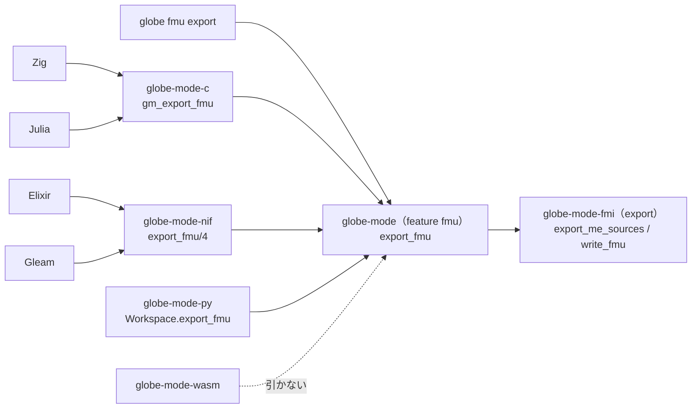

# S118 FMU export を facade と各言語に

| | |
| --- | --- |
| セッション | S118 |
| 日付 | 2026-11-03 |
| ブランチ | `feature/s118-lang-fmu-export` |
| Phase | P7（言語 API と UI 比較の 5 回目。前回は [S116](../S116-lang-columns/解説書.md)） |
| スライド | [slides.html](slides.html) |
| 作業記録 | [log/work/2026-11-03-lang-fmu-export.md](../../../log/work/2026-11-03-lang-fmu-export.md) |

## 1. 目的

[S110 の調査](../../research/lang-api-matrix-2026-11-03.md)の「埋める順」の 5。FMU の書き出しは `globe-mode-fmi` の feature `export`（S094・S098・S105）と CLI の `globe fmu export` にしか無かった。これを facade `globe-mode` に置き、C ABI・Zig・Julia・Elixir・Gleam・Python から呼べるようにする。

## 2. 決定と理由

| 項目 | 決定 | 理由 |
| --- | --- | --- |
| facade | feature `fmu`（`globe-mode-fmi/export` と `serde` を引く）に `FmuOptions { fmi_version, build, targets, fmi_headers }`、`export_fmu(&CompiledModel, out_dir, &FmuOptions)`、`Workspace::export_fmu(model, out_dir, &FmuOptions)` | 既存の `sundials` と同じく任意の feature にした。wasm はファイルを書けないので引かない（zip を wasm に入れない）。CLI・C・NIF・py が有効にする |
| 設定の形 | `FmuOptions` は serde で読む（`{"fmi_version": 2, "build": false, "targets": [], "fmi_headers": null}`、省略した鍵は既定、知らない鍵は誤り） | C・NIF・Python が同じ JSON を同じ型で読む。`--build` と `--target` と `--fmi-headers` に 1 対 1 |
| `build` | `build = true` で `fmi_headers` が無ければ誤り。`cc`・zig が無い環境の試験は `build = false` | CLI は clap の `requires` で同じ約束をしていた。facade では実行時に確かめる |
| CLI | `globe fmu export` はコンパイルまで今のまま（診断を本文つきで出す）、書き出しを facade の `export_fmu` に替えた | 挙動を変えない（`tests/fmu_export.rs` の 5 本が通る）。`globe-mode-fmi` は dev-dependency（試験が `modelDescription.xml` を読む）だけに |
| 誤り | `Workspace::export_fmu` は DAE まで変換できなければ診断の文を 「; 」でつないだ `Err(String)` | 束ねの誤りは文字列（C は `{"error"}`、NIF は `{:error, 理由}`、Python は `ValueError`） |
| C ABI | `char *gm_export_fmu(ws, model, out_dir, options_json)` → `{"path": ".fmu のパス"}` | 既存の `gm_*` と同じく NULL を返さず JSON。`options_json` は NULL 可 |
| NIF | `export_fmu/4`（DirtyIo）→ `{:ok, path}`。Elixir は `GlobeMode.export_fmu(ws, model, out_dir, options \\ %{})`（`/3` と `/4`）、Gleam は `export_fmu(ws, model, out_dir, options_json)` | ファイルを書くので DirtyIo。Elixir は `simulate` と同じく map を JSON にして渡す |
| Python | `Workspace.export_fmu(model, out_dir, **options) -> Path` | `simulate(**settings)` と同じ形 |
| wasm | 対象外（機能表に書いた） | ファイルを書けない |
| CI | `.github/workflows/` は変えない。`test_ci_plan.py` に「fmi の変更で C・NIF・py と lang・python が回る」を足した | facade が `globe-mode-fmi` に依存したので、`ci_plan.py`（Cargo.toml を読む）で fmi の変更の届く先が C・NIF・py・wasm・lsp まで広がった（8 crate、main では 2）。`Cargo.lock` が変わるので、このマージの push は全体の検査になる |

## 3. 図



## 4. 再現手順

ビルドは共有の target と `CARGO_BUILD_JOBS=2`（RAM 3 GB、別の作業と並行）。

```bash
export CARGO_TARGET_DIR="$MAIN/.git-worktree/target-shared" CARGO_BUILD_JOBS=2
cargo test -p globe-mode -p globe-mode-c
cargo test -p globe-mode-cli --test fmu_export
mise run c:zig
mise run c:julia
mise run elixir:test
mise run gleam:test
uv sync --reinstall-package globe-mode && uv run pytest -q src/Python/tests
python3 .github/scripts/test_ci_plan.py
```

各言語の試験は、`GlobeModeValidation.Simulation.Decay`（C は同じ形の簡易版 `Decay`）の FMU（2.0、build なし）を書き、展開したディレクトリ `<名前>/modelDescription.xml` があることと、`fmi_version: 4` が誤りになることを確かめる。

| 言語 | 試験 | 結果 |
| --- | --- | --- |
| C | `globe-mode-c` の単体試験（`{"path"}` が `Decay.fmu` で終わる、`fmi_version: 4` で `{"error"}`）と `tests/header.rs` | 通った |
| CLI | `globe-mode-cli/tests/fmu_export.rs`（facade 経由に替えた後も同じ） | 5 passed |
| Zig | `src/Zig/src/main.zig` | `modelDescription.xml` 2,214 バイト |
| Julia | `src/Julia/test.jl`（`mktempdir()` に書く） | 通った |
| Elixir | `globe_mode_test.exs` | 1 test, 0 failures |
| Gleam | `globe_mode_test.gleam`（`build/gm-gleam-fmu` に書き、Erlang の `file:read_file` で読む） | 1 passed |
| Python | `src/Python/tests/test_api.py` の `test_export_fmu`（`tmp_path`） | 4 passed, 1 skipped（skip は既存） |

## 5. 次回

- S110 の埋める順の 6: 進捗と途中で止める口（ADR を先に）。
- LSP からの FMU export（コマンド）は呼ぶ人がいれば。
