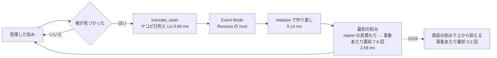

# S119 sim-thyristor-event-cost

| | |
| --- | --- |
| セッション | S119 |
| 日付 | 2026-11-03 |
| ブランチ | `feature/s119-sim-thyristor-event-cost` |
| Phase | P3（実行系） |
| スライド | [slides.html](slides.html) |
| 作業記録 | [log/work/2026-11-03-sim-thyristor-event-cost.md](../../../log/work/2026-11-03-sim-thyristor-event-cost.md) |
| 前のセッション | [S088](../S088-sim-dimmer-thyristor/解説書.md) の 2.3 と「次回」 |

## 1. 目的

[S088](../S088-sim-dimmer-thyristor/解説書.md) の持ち越し。`Modelica.Electrical.PowerConverters.Examples.ACDC.RectifierBridge2mPulse.ThyristorBridge2mPulse_DC_Drive`（と `RectifierBridge2Pulse.ThyristorBridge2Pulse_DC_Drive`）が `auto` の回し直し（esdirk34、予算 180 s）で時間切れ（`GM-E11005`）になる。事象 1 回ごとに esdirk34 が何をやり直しているかを測り、いちばん重い所を 1 つだけ軽くする。

## 2. 決定と理由

| 項目 | 決定 | 理由 |
| --- | --- | --- |
| 測る道 | session の道（[ADR-0014](../../adr/0014-session-route-wasm.md)）の diffsol の RK・SDIRK のプラグイン `globe-mode-exec/src/rumoca/plugins/rk.rs` に一時的な計測（`GM_PROF` のときだけ `eprintln`）を入れて測った。計測はコミットしていない | esdirk34 の事象の後の処理はここだけで決まる。`globe-mode-sim` の `sdirk.rs`・`integrators.rs`・`solvers.rs` は係数表と自前の固定刻みの積分器で、diffsol の esdirk34 の道は通らない |
| 測る区間 | 0〜2 s（`--stop-time 2`）。0.5 s と 1 s は使えない | `--stop-time 0.5`・`1` では、直す前の版でも t = 0.0617 s で `GM-E11003`（事象の反復が収束しない）になる（2 以上では起きない）。終了時刻で変わる何か（出力の格子か刻みの上限）が事象の反復に効いている。今回は追わず持ち越した |
| 入れた対策 | 事象のあとの最初の刻み幅を「直前の受理した刻みのあとに diffsol が次に試すつもりだった刻み幅」で上から抑える（`DiffsolRk::last_step`、`initial_state` の 1 つの `if`）。初めの初期化では抑えない | 事象ごとの作り直し（`truncate_reset` と、その直後の `initialize` の両方）で diffsol は Hairer の見積もりで刻みを選び直す。切り替えの直後は見積もりが直前の刻みの平均 3.8 倍（2.3e-4 s 対 6.2e-5 s）になり、事象 1 回あたり誤差の検査で平均 7.6 回、Newton 法で 2.0 回刻みが棄てられ（棄てる度に LU を作り直す）、事象の後の最初の刻みが通常の刻みの約 14 倍かかっていた。抑えるだけなので、刻みが大きくなる向きの変化は無い。刻みの下限（`min_timestep` の 10 倍）は従来どおり後から当てる |
| 選ばなかった案 | ヤコビ行列の使い回し、`truncate_reset` の省略、事象の後の再初期化の省略 | 事象ごとのヤコビ行列の作り直し（reset と init の合計）は区間の時間の 7% で、最初の刻みの棄却（28%）より小さい。`truncate_reset` の直後に Rumoca の session が `initialize`（作り直し）を呼ぶので reset の作業は無駄になっているが、それを省くには Rumoca の session の約束（reset のあとの状態の照合）を読み替える必要があり、1 つの最小の対策の範囲を超える |
| 対象のソルバ | session の道の diffsol の SDIRK（`esdirk34`・`trbdf2`・`esdirk23`・`esdirk45`・`sdirk34hw`）だけ。陽的 RK（`tsit45`・`dopri853`・`cerk*`）は引き継がない | 最初は陽的 RK にも当てたが、`mise run wasm:compare` で `DiodeSwitching/tsit45` が wasm とネイティブで分かれた（相対 1.3e-6、386 / 400・不一致 1）。陽的 RK は硬い回路で安定の限界の刻みを刻み、丸めの差が直前の刻みを通して事象を越えて残る。見積もりから始め直せば事象ごとに揃う。SDIRK だけにして 387 / 400・既知の差 13・不一致 0（S114 と同じ）。`bdf`・`dopri45`・`auto` の最初の段（型付きの道）と `radau5`・`cvode`・`ida` は変わらない |
| 文書 | [ADR-0013](../../adr/0013-exec-backend.md) の「結果」に追記した | session の道の積分器の性質で、予算の規則（ADR-0017）は変えていない |

### 2.1 事象 1 回あたりの内訳（直す前、手元の release、`--solver esdirk34 --tolerance 1e-7 --stop-time 2`）

区間 0〜2 s で、`truncate_reset` 2,402 回、`initialize`（作り直し）3,003 回（時刻事象 約 600 回は reset なしの作り直しだけ）。受理した刻みは 57,605 歩（事象の後の最初の刻み 3,002、通常 54,603）。時間は他のビルド（S118）と同時なので揺れる。下は揺れの少なかった 3 回の中央値。

| 部分 | 時間 | 実行に占める割合 | 1 回あたり |
| --- | ---: | ---: | ---: |
| 事象の処理: `truncate_reset`（状態の差し替え、ヤコビ行列と LU） | 1.45 s | 5% | 0.60 ms |
| 事象の処理: `initialize`（問題と解法の作り直し。この行だけ別の回の値） | 0.43 s | 2% | 0.14 ms |
| 事象の後の最初の刻み | 7.74 s | 28% | 2.58 ms |
| 通常の刻み | 10.20 s | 37% | 0.19 ms |
| 残り（Rumoca の host: 根の探索、Event Mode、出力） | 約 7.8 s | 28% | - |
| 実行（CLI の表示） | 27.6 s | 100% | - |

事象の後の最初の刻みは、通常の刻みの約 14 倍かかる。誤差の検査の失敗は区間の合計で 18,273 回、Newton 法の失敗は 4,824 回（どちらも作り直しから次の reset までの集計の和）。

### 2.2 対策の前後（同じ 2 s、同じバイナリで環境変数で対策を切り替えて交互に 5 回ずつ）

| 量 | 前 | 後 | 差 |
| --- | ---: | ---: | ---: |
| 誤差の検査の失敗 | 18,273 | 7,612 | -58% |
| Newton 法の失敗 | 4,824 | 2,662 | -45% |
| 右辺の評価 | 439,753 | 379,957 | -14% |
| ヤコビ行列の方向微分 | 36,075 | 35,065 | -3% |
| 受理した刻み | 57,605 | 58,254 | +1% |
| 最初の刻みの時間（3 回の中央値） | 7.74 s | 5.48 s | -29% |
| 実行（3 回の中央値） | 27.6 s | 25.6 s | -7% |

数え上げ（失敗・評価の回数）は決定的で毎回同じ。時間は負荷で揺れ、最初の 2 組（負荷 25〜35）は逆転した組もあった。状態の結果は 2 s 時点まで出力の格子で相対 4e-7 以内（`meanVoltage.y` 3.9e-7、`dcpm.wMechanical` 2.5e-8）。切り替えの瞬間の値（`lMains.v` など）は事象の時刻の位置の差で格子の点によって 8% ずれる。

## 3. 図



## 4. 再現手順

```bash
# worktree で（data/msl は main の取得物への symlink）
CARGO_TARGET_DIR=.../target-shared CARGO_BUILD_JOBS=2 cargo build --release -p globe-mode-cli
globe simulate -L data/msl \
  -m Modelica.Electrical.PowerConverters.Examples.ACDC.RectifierBridge2mPulse.ThyristorBridge2mPulse_DC_Drive \
  --solver esdirk34 --tolerance 1e-7 --stop-time 2 --timeout 600 -o out.csv
# 内訳は rk.rs に一時的な計測（Instant と回数の thread_local）を入れて測った（コミットしていない）
# CI（全例題 + esdirk34 単独）
gh workflow run msl-sim.yml --ref feature/s119-sim-thyristor-event-cost -f 'solvers=["esdirk34"]'
gh run download <run-id> -n msl-sim
```

## 5. CI の結果

`msl-sim.yml` run [41589277425](https://github.com/asari300/20261018_GlobeMode/actions/runs/41589277425)（`--ref feature/s119-sim-thyristor-event-cost`、`solvers=["esdirk34"]`、最初のコミット `8789b84`。陽的 RK を外した 2 つ目のコミットは esdirk34 の道を変えず、`auto` の段にも陽的 RK は無いので、この run の数字はそのまま使える）。ジョブ `msl-sim`・`split-all` は success。

| モデル | 前（run 41403194603 の報告、main の `doc/msl-sim.md`） | 後 |
| --- | --- | --- |
| `ThyristorBridge2mPulse_DC_Drive` | 回し直しも時間切れ（187.52 s） | 終了時刻まで（積分 177.14 s、計 180.95 s）・管 OK 38/38 |
| `ThyristorBridge2Pulse_DC_Drive` | 回し直しも時間切れ（197.41 s） | 終了時刻まで（積分 63.42 s、計 65.08 s）・管 OK 19/19 |
| 全体 | 実行できた 310・管に収まった 301 / 309 | 実行できた **312**・管に収まった **303 / 311**（97.4%） |

- ほかの 353 本はモデルごとの判定と管の結果が前の報告と同じ（時間だけ変わる）。既知の外れは 5 本のまま。
- `ThyristorBridge2mPulse_DC_Drive` は予算 180 s に対して積分 177.1 s で、余裕は 3 s しかない。ランナーの揺れで再び時間切れになりうる。
- `doc/msl-sim.md` はこの run の artifact に置き換えた。ジョブ `solvers (esdirk34)` は報告の時点でまだ動いていた（esdirk34 単独の表は `doc/msl-solvers.md` に使わない。S055 の規則）。

## 6. 次回

- 事象 1 回あたりの残り: `truncate_reset` の直後に Rumoca の session が `initialize` を呼ぶので、reset のヤコビ行列と LU（実行の 5%）は捨てられている。reset を遅らせて、次が `advance` のときだけ行う形にできるかを、Rumoca の session の約束（`require_current_point`）と照らして調べる。
- Rumoca の host の部分（根の探索・Event Mode・出力、実行の約 28%）は Rumoca の側。
- `--stop-time 0.5`・`1` で t = 0.0617 s に `GM-E11003` になる件（直す前から。終了時刻 2 以上では起きない）。
