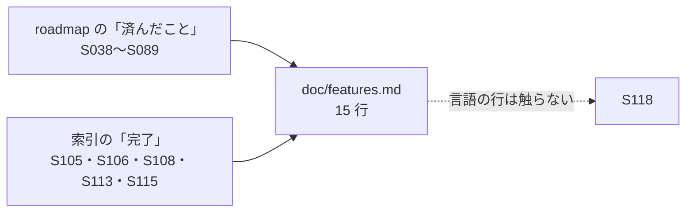

# S120 features.md の P4 の行を追いつかせる

| | |
| --- | --- |
| セッション | S120 |
| 日付 | 2026-11-03 |
| ブランチ | `feature/s120-features-p4-sync` |
| Phase | P4（文書だけ） |
| スライド | [slides.html](slides.html) |
| 作業記録 | `log/work/2026-11-03-features-p4-sync.md` |

## 1. 目的

[S107](../S107-features-libraries-sync/解説書.md) の持ち越し。正典の [features.md](../../features.md) の P4 の行（エディタ、LSP、整形・lint、ライブラリツリー、graph、プロット、Desktop、ブラウザ）に、S094 より前の成果で書かれていないものを書く。あわせて S104〜S117 のうち main に入ったもの（索引で「完了」の行）を該当する行に書く。

- 根拠は [roadmap.md](../../roadmap.md) の各「SNNN で済んだこと」と [索引](../README.md)。
- 言語 API の行（S118 が触る）、コード、[upstream.md](../../upstream.md) は触らない。

## 2. 決定と理由

- **既存の行に書き足すだけ（15 行）。新しい行は足さない。** S107 と同じく、同じ機能を 2 行にしないため。状態は既存の書き方（Phase の列に「SNNN」、方針の列の末尾に「未」）に合わせた。
- **ライブラリツリーは「UI は未」と書いた。** roadmap の S048 の持ち越しにあり、その後に済んだ記録が無く、`src/Svelte/src/lib` にもツリーの部品が無い。
- **graph の fps は「実 GPU で未測定」と書いた。** S046 の約 10 fps はヘッドレス Chromium（ソフトウェア GL）の参考値で、P4 の完了条件の 30 fps の根拠にならない。
- **S104・S117 は書かない。** 索引に行が無い（main に入っていない）。S110・S111・S116 は言語の行なので S118 に任せた。S109・S112・S114・S107 は S107 までに反映済み。

### 変えた行

| 章 | 行 | 足したこと | 出典 |
| --- | --- | --- | --- |
| 1 | 補完・定義ジャンプ・参照・リネーム・ホバー | `globe lsp`（診断・documentSymbol・hover）、補完、VS Code 拡張。定義ジャンプなどは未のまま | S038・S053・S059 |
| 1 | アウトライン・inlay hint・call hierarchy | LSP の documentSymbol。inlay hint・call hierarchy は未 | S038・S059 |
| 1 | 整形・lint | ruff 風の走査、節の空行と annotation の並べ替え（`GM-L0004`）、`connect-type-mismatch`（`GM-L0005`）、HTML の整形。設定ファイルは未 | S060・S061・S062 |
| 1 | Text ビュー | CodeMirror 6 のエディタと検査パネル、補完と波線。LSP との直接の接続は未 | S041・S053・S049 |
| 2 | MSL の読み込み | 「必要なファイルだけ読むのは P2」を、wasm の分割読み込みとネイティブの閉包に直した | S037・S047・S054 |
| 2 | ライブラリツリー | UI は未 | S048 の持ち越し |
| 2 | connect のネットワークグラフ | 描画（sigma 4）、fps は実 GPU で未測定、ライブラリのモデル・部品・import | S046・S079・S081・S089 |
| 3 | 結果のプロット | uPlot の `Plot.svelte`、ChuaCircuit、列ごとの道（wasm・UI・Desktop・Python）、anywidget。2 軸・MAT の読み込みは未 | S042・S048・S051・S065・S076・S078・S085 |
| 4 | FMI 2.0 Export | Linux・Windows・macOS の置き場を 1 つの FMU に同梱 | S105 |
| 4 | FMI 3.0 Export | 同上 | S105 |
| 5 | Desktop | Tauri のシェルと .deb・.msi、MSL の RSS 基準値、MSL の取得と版の切り替え、列の道。署名と自動更新は未 | S049・S056・S069・S076・S084 |
| 5 | Android | release の APK（ABI ごと、secret があるときだけ署名）。署名つきの実機確認は未 | S106 |
| 5 | ブラウザ | Svelte の UI、UI から MSL を読んで ChuaCircuit | S041・S048 |
| 6 | Rumoca との差分照合 | 下書き 31・32、v0.10.4 での確かめ直し。01〜16 は未 | S108・S113・S115 |
| 6 | Reference-FMUs、FMPy、fmusim、fmuCheck | Windows・macOS の FMPy の validate。Windows・macOS の fmusim は未 | S105 |

【未確認】にした項目は無い。どの行も roadmap と索引の記述だけを写し、実物を動かしての確認はしていない。

## 3. 図



## 4. 再現手順

```bash
git diff main -- doc/features.md
python3 -I .claude/skills/session-docs/check_docs.py
```

## 5. 次回

- ライブラリツリーの UI、定義ジャンプ・参照・リネーム、graph の実 GPU での fps は P4 の残り。
- S104・S117 が main に入ったら、該当する行（marimo・FMI）を直す。
- 言語の行は S118 のあとに見直す。
