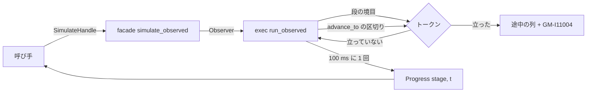

# S121 進捗と中断の ADR

| | |
| --- | --- |
| セッション | S121 |
| 日付 | 2026-11-03 |
| ブランチ | `feature/s121-progress-cancel-adr` |
| Phase | P7 |
| スライド | [slides.html](slides.html) |
| 作業記録 | [log/work/2026-11-03-progress-cancel-adr.md](../../../log/work/2026-11-03-progress-cancel-adr.md) |

## 1. 目的

S110 の [言語 API の機能表](../../research/lang-api-matrix-2026-11-03.md) の埋める順の 6「進捗と途中で止める口」の前に、設計を ADR に書く。文書だけで、コードは触らない。実装は次のセッションから。

## 2. 決定と理由

決定の全文と却下した案は [ADR-0033](../../adr/0033-progress-and-cancel.md)（Proposed）。

| 項目 | 決定 | 理由 |
| --- | --- | --- |
| 進捗の単位 | 段（`ExecStage`）は毎回、積分の時刻 t は 100 ms に 1 回まで | 段だけでは長い積分が見えない。毎点では通知があふれる。t は session の道の `advance_to` の区切りで取れる |
| 中断の仕組み | 呼び手の `CancelToken`（`Arc<AtomicBool>`）を、段の境目・`auto` の回し直しの前・`advance_to` の区切りで見る | Desktop の `cancel_msl` と同じ形。Rumoca の公開の `advance_to` だけで済む。期限を後から縮める口もスレッドを落とす手段も無い |
| 各口の形 | facade に `SimulateHandle`。C はコールバックの戻り値、NIF は `cancel(token)`、Python はコールバックと Ctrl-C、wasm は postMessage と `terminate()`、LSP は `$/progress` と `$/cancelRequest` | 1 つの型を各口が写すだけにする（束ねは facade だけに依存する方針） |
| 止めたあと | 積分の中なら止めた時刻までの列と情報 `GM-I11004`、その前なら診断だけ | trace は区切りで止めるので壊れていない。止めたのは失敗ではない |

見られないところ（lowering・組み立て、ネイティブの型付きの道の積分）は、今まで通り予算と外から止める道（[ADR-0017](../../adr/0017-lowering-limit-and-hard-timeout-retry.md)・[ADR-0023](../../adr/0023-desktop-and-web-process-layout.md)）が受け持つ。

## 3. 図



## 4. 再現手順

```bash
# 今ある口を読む（main d41e130）
grep -rn -E 'run_with_progress|ExecStage|max_wall_seconds|cancel_msl|AtomicBool' src --include='*.rs'
# Rumoca の session の道の区切り（rev 276e82bd）
sed -n 455,513p ~/.cargo/git/checkouts/rumoca-*/276e82b/crates/rumoca-solver/src/fmi_me/session.rs
python3 -I .claude/skills/session-docs/check_docs.py
```

検証の結果（数字）は [作業記録](../../../log/work/2026-11-03-progress-cancel-adr.md) にある。

## 5. 次回

- 実装の順: facade と exec → wasm → Python → C・Zig・Julia と NIF・Elixir・Gleam → LSP と Desktop。各段の試験の案は ADR-0033 の「結果」。
- 持ち越し: ネイティブの型付きの道（bdf・dopri45・auto）の積分の中で t と中断を出すこと（session の道をネイティブの既定にするなら、速さを測ってから）、lowering の中で止めること、CLI の Ctrl-C で途中の結果を書くこと、wasm で途中の列を返すこと。
