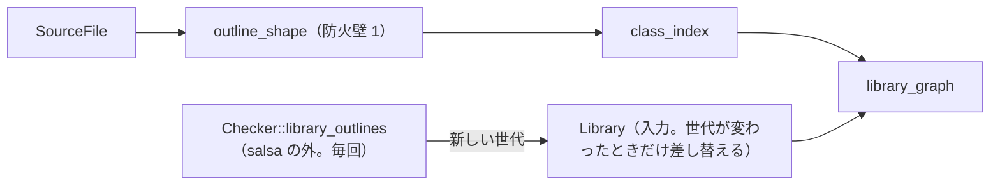

# S122 ライブラリがあるときの graph の backdate

| | |
| --- | --- |
| セッション | S122 |
| 日付 | 2026-11-03 |
| ブランチ | `feature/s122-graph-salsa-backdate` |
| Phase | P4 |
| スライド | [slides.html](slides.html) |
| 作業記録 | [log/work/2026-11-03-graph-salsa-backdate.md](../../../log/work/2026-11-03-graph-salsa-backdate.md) |

## 1. 目的

S089（[解説書](../S089-graph-imports-index-cache/解説書.md)）の持ち越しの 2 つ目を片付ける。ライブラリがあるとき、`GlobeDb::connect_graph` は文書のモデルの graph を salsa の外で毎回作っていたので、コメントや空白だけの編集でも作り直していた（S081 から同じ）。ライブラリが無いときは salsa の `connect_graph` が `class_index` の防火壁で再計算を省いていた（[ADR-0005](../../adr/0005-lazy-query-db.md)）。

## 2. 決定と理由

| 項目 | 決定 | 理由 |
| --- | --- | --- |
| ライブラリの索引 | salsa の入力 `Library`（欄は `Arc<ClassIndex>` 1 つ）。`GlobeDb` は `(世代, Library)` を持つ | 入力は値を比べないので、大きな索引を比べずに済む。差し替えるのは `Checker::library_outlines` が新しい世代を返したときだけ（世代の意味は S081 と同じ） |
| graph | tracked の `library_graph(workspace, library, request)`。`class_index(workspace)` を `ClassIndex::over` でライブラリの索引に重ねて `globe_mode_graph::build` | ライブラリが無いときの `connect_graph` と同じ防火壁（`outline_shape` → `class_index`）がそのまま効く |
| 閉包の読み込み | `Checker::library_outlines` は今までどおり呼ぶたびに呼ぶ | 分割読み込みでは文書が使うファイルが増えたかを salsa の外の Session でしか判断できない。同じ世代なら索引を作らず `None` を返すので軽い |
| 触った crate | `globe-mode-db`（入力 1 つ、クエリ 1 つ、`connect_graph` の後半）と試験。`globe-mode` は試験だけ | frontend・graph・ir は変えていない |

## 3. 図



## 4. 再現手順

```bash
export CARGO_TARGET_DIR=…/.git-worktree/target-shared CARGO_BUILD_JOBS=2
ln -s <main のチェックアウト>/data/msl data/msl   # worktree に MSL が無ければ
cargo test -p globe-mode-db --test validation library_graph_is_backdated
cargo test -p globe-mode --test graph_library -- --nocapture
mise run check
```

検証の結果（数字）:

- `library_graph_is_backdated`（`src/Modelica` をライブラリにして、文書 `Doc.mo` が `GlobeModeValidation.Components` の部品を使う）: `library_graph` の実行は (1) 同じ文書の 2 回目で 0 回、(2) コメントと空白だけの編集で 0 回（`outline` は 1 回）、(3) 部品を足すと 1 回でノードが 1 つ増える
- MSL の `ChuaCircuit`（`with_libraries_full`、debug）の graph: 1 回目 181.1 ms、2 回目 0.069 ms（S101 は 4.6 ms）。7 ノード・9 辺は変わらない（試験で確かめる）
- 検査の数字は[作業記録](../../../log/work/2026-11-03-graph-salsa-backdate.md)にある

## 5. 次回

- 同じワークスペースの別のモデルを編集すると `class_index` が変わるので、graph も作り直す（ライブラリが無いときと同じ）。モデルごとの依存に分けるのは今は要らない
- `Medium.AbsolutePressure` のような短いクラスの別名の中（S101 の持ち越し）
