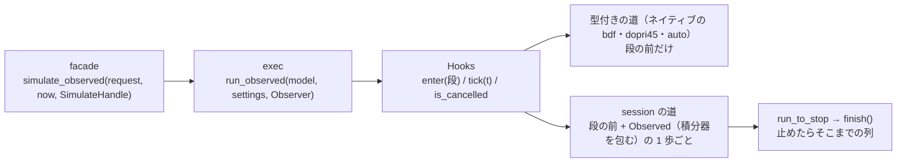

# S123 進捗と中断の 1 段目（core・IR・exec・facade）

| | |
| --- | --- |
| セッション | S123 |
| 日付 | 2026-11-03 |
| ブランチ | `feature/s123-progress-cancel-core` |
| Phase | P7（[ADR-0033](../../adr/0033-progress-and-cancel.md) の実装の順の 1。設計は [S121](../S121-progress-cancel-adr/解説書.md)） |
| スライド | [slides.html](slides.html) |
| 作業記録 | [log/work/2026-11-03-progress-cancel-core.md](../../../log/work/2026-11-03-progress-cancel-core.md) |

## 1. 目的

[ADR-0033](../../adr/0033-progress-and-cancel.md)（Proposed）の「結果」の実装の順の 1。実行の進捗（段と積分の時刻 t）と、呼び手が持つトークンでの中断を、`globe-mode-core`・`globe-mode-ir`・`globe-mode-exec`・facade `globe-mode` に入れる。wasm・UI・Python・C/NIF・LSP（2 段目以降）は持ち越し。

## 2. 決定と理由

| 項目 | 決定 | 理由 |
| --- | --- | --- |
| 型 | exec に `Progress { stage, time, start_time, stop_time }`・`CancelToken`（`Arc<AtomicBool>`）・`Observer { on_progress, cancel, now }`・`run_observed`。`run_with_progress` は `time` の無い進捗だけを段として写す包み | ADR の (1)〜(3) のとおり。xtask の `msl-sim` は `run_with_progress` のまま |
| facade | `SimulateHandle { on_progress, cancel }`、`Workspace::simulate_observed(request, now, handle)`。`simulate_with` は既定の handle で呼ぶ包み。`CancelToken`・`ExecStage`・`Progress` を再公開 | 束ね（2 段目以降）は facade だけを見る |
| 見る場所 | 段に入る前（`Hooks::enter`。ネイティブの dopri45 の単独プリフライトの前も）、`auto` の回し直しの前、session の道の積分器の 1 歩の前 | lowering と組み立ての中（Rumoca の閉包の中）では見られない。ADR のとおり |
| **session の道の区切り** | **`advance_to` を出力の点で区切らず、積分器（`MeIntegratorBackend`）を包む `Observed` が `advance` の前に見る** | `advance_to(t)` の t は刻みの上限なので、区切ると刻みの列と数値が変わる（出力の点で区切った版で `tests/integrators.rs` の 6 本が落ちた。euler の x(1) 0.348678 が 0.367511 に）。100 ms で区切る案は、区切りが壁時計で決まるので同じ入力で結果が揺れる。包む形は刻みの要求を変えない |
| 速さ | 包む形 +1.2%（和）、出力の点ごとの `advance_to` は小さなモデルで +182〜366% | 5% 未満なので包む形を採った（下の表） |
| 中断後 | 積分の中: `Termination::Cancelled { time }`（列の最後の出力の点）とそこまでの列、`ok: true`、情報 `GM-I11004`。それより前: 列は無く `ok: false` と `GM-I11004` だけ（Error 無し） | ADR の (4)。`auto` の回し直しの前に止めたときも、前の失敗は Error にしない |
| t の間引き | 段が変わるたびに `time: None` で 1 回、積分器の 1 歩の前に「前に知らせてから `now` で 100 ms 以上」なら t、積分の終わりに t を 1 回 | ADR の (1)。時計は facade の `now`（ミリ秒）。実行系は `Instant` を呼ばない |
| 型の追加の波及 | `Termination` に変種が増えたので、CLI の表示（「t = … で止められた」）と xtask の `msl-sim`（来ないが `Terminated` 扱い）に腕を足した | `match` を網羅にしておく |

速さ（release、`Simulation.*` 20 本 × 実装のあるソルバすべてを session の道で 3 回ずつ、モデルごとの最小の `run_seconds`。load average 18〜25 の WSL）:

| モデル | `run_to_stop`（前） | 包む形（採用） | 出力の点ごとの `advance_to` |
| --- | --- | --- | --- |
| Decay | 0.0161 s | 0.0167 s（+3.6%） | 0.0460 s（+186%） |
| HarmonicOscillator | 0.0432 s | 0.0450 s（+4.3%） | 0.0741 s（+72%） |
| BouncingBall | 0.0228 s | 0.0227 s（−0.6%） | 0.0644 s（+182%） |
| TinyStateRestart | 0.0087 s | 0.0089 s（+1.9%） | 0.0407 s（+366%） |
| DiodeSwitching | 22.034 s | 22.316 s（+1.3%） | 21.575 s（−2.1%） |
| 20 本の和 | 22.368 s | 22.630 s（+1.2%） | 22.107 s（−1.2%） |

## 3. 図



## 4. 再現手順

ビルドは共有の target と `CARGO_BUILD_JOBS=2`（RAM 3 GB、別の作業と並行）。

```bash
export CARGO_TARGET_DIR="$MAIN/.git-worktree/target-shared" CARGO_BUILD_JOBS=2
cargo test -p globe-mode-core -p globe-mode-ir -p globe-mode-exec -p globe-mode
mise run wasm:node
mise run wasm:compare
```

| 試験 | 結果 |
| --- | --- |
| (a) 止めないとき同じ: exec の既存の試験（`the_session_route_matches_the_typed_route` ほか）と `observed.rs` の最後の値のビット比較 | 通った（exec 21 + integrators 13 + simulate 31、facade の observed 3） |
| (b) Decay（esdirk34）を t ≥ 0.5 で止める | `Cancelled { time }`、0.5 ≤ time < 1、列の最後の時刻と同じ、`GM-I11004` |
| (c) 先に立てたトークン | bdf・dopri45・esdirk34 で段の知らせ 0 回、`ok: false`、`GM-I11004` だけ |
| (d) 回数の上限 | 段 5 つ（Lowering・Preflight・Build・Initialization・Integration）、t は単調で最後が 1、回数 ≤ 段の数 + 壁時計 / 0.1 s + 1 |
| `wasm:node` | ok（Decay を bdf・dopri45・auto、MSL の ChuaCircuit、panic の文言） |
| `wasm:compare` | 400 件中 387 件が一致、既知の差 13、一致しない 0（減っていない） |

## 5. 次回

- ADR-0033 の順の 2: wasm（`simulate_columns(request, onProgress)`・`GlobeWorker` の `postMessage`）と Svelte の進捗の表示。積分器の 1 歩ごとに `now`（`performance.now()`）を呼ぶ費用をそこで測る。
- 順の 3〜5: Python、C・NIF、LSP と Desktop。
- 状態の無いモデル（積分器が無い）は積分の中で止められない。要るなら Rumoca の host に口が要る。
