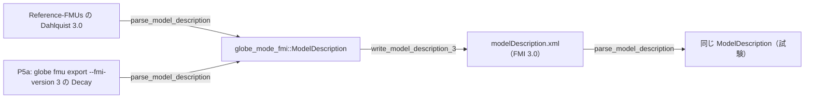

# S124 FMI 3.0 の modelDescription.xml を書く

| | |
| --- | --- |
| セッション | S124 |
| 日付 | 2026-11-03 |
| ブランチ | `feature/s124-fmi3-writer` |
| Phase | P5（P5a・P5b の共通） |
| スライド | [slides.html](slides.html) |
| 作業記録 | [log/work/2026-11-03-fmi3-writer.md](../../../log/work/2026-11-03-fmi3-writer.md) |

## 1. 目的

- [S117](../S117-fmi-model-description-shared/解説書.md) の持ち越し「FMI 3.0 の書く側」を片付ける。
- `globe-mode-fmi` の型 `ModelDescription` と読む側（S057）に合わせて `write_model_description_3` を足す。
- P5b の 3.0 のランタイム、CS、`dependencies`、Enumeration・String は範囲の外。`globe-mode-fmu` は 2.0 のまま。

## 2. 決定と理由

詳細は [ADR-0031](../../adr/0031-fmi-export-p5a-first.md) の追記（S124）。

| 項目 | 決定 | 理由 |
| --- | --- | --- |
| 形 | `write_model_description_3(&ModelDescription) -> Result<String, Error>`。2.0 と private な `write_model_description(md, major)` を共有 | 違うのはトークンの属性名・変数の要素・`ModelStructure` だけ。2.0 の出力は 1 字も変えない |
| 変数 | `<Float64>`・`<Int32>`・`<Boolean>` に `name`・`valueReference`・`causality`・`variability`・`initial`・`start`・`derivative` をまとめて書く | 3.0 には `ScalarVariable` の入れ子が無い。`derivative` は状態の valueReference |
| `ModelStructure` | `Output`・`ContinuousStateDerivative`・`InitialUnknown` の `valueReference` | 読む側と同じ欄。`dependencies` は持たないので書かない |
| `causality` | 3.0 は `structuralParameter` も書く | 2.0 では `Err` のまま |
| `ScheduledExecution` | あれば書く | 型が持つ。2.0 は読む側が埋めないので常に `None` |
| イベント指標 | 読む側は 3.0 で `<EventIndicator>` の数を `number_of_event_indicators` に入れる。書く側は 1 つ以上なら `Err` | 3.0 に `numberOfEventIndicators` の属性は無い。valueReference を持つには `ModelStructure` に欄が要り、それを組み立てる `globe-mode-fmu` を変えることになる（範囲の外。`shortcut:` の注記） |
| 型の範囲 | Real・Integer・Boolean（3.0 は Float64・Int32・Boolean）。それ以外は `Err` | 2.0 と同じ範囲。Enumeration は declaredType が要る |

## 3. 図



## 4. 再現手順

```bash
export CARGO_TARGET_DIR=…/.git-worktree/target-shared CARGO_BUILD_JOBS=2
cargo test -p globe-mode-fmi -p globe-mode-cli --test fmu_export --test parse
```

- `globe-mode-fmi` の `fmi3_round_trips_through_the_writer`: Dahlquist 3.0 の読み→書き→読みが同じ `ModelDescription`。2.0 の Dahlquist、String・Enumeration を持つ Feedthrough 3.0、`<EventIndicator>` を 1 つ足した XML は `Err`。
- `globe-mode-cli` の `exports_a_fmi3_source_fmu`: `globe fmu export --fmi-version 3` の Decay の XML（Rumoca の `fmi3` テンプレート）でも同じく一致。
- `fmi2_round_trips_through_the_writer` と `exports_a_source_fmu`（2.0）は変えずに通る。

## 5. 次回

- P5b の 3.0 のランタイム（そのとき `ModelStructure` に `EventIndicator` の valueReference を足す）。
- CS、`dependencies`、Enumeration・String。
