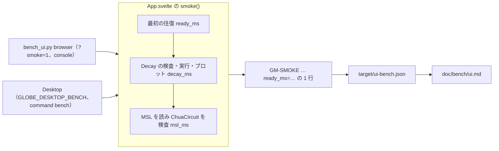

# S125 UI の測定ハーネス

| | |
| --- | --- |
| セッション | S125 |
| 日付 | 2026-11-03 |
| ブランチ | `feature/s125-ui-bench-harness` |
| Phase | P7 |
| スライド | [slides.html](slides.html) |
| 作業記録 | [log/work/2026-11-03-ui-bench-harness.md](../../../log/work/2026-11-03-ui-bench-harness.md) |

## 1. 目的

[roadmap](../../roadmap.md) の P7 の完了条件「`doc/bench/ui.md` に 3 UI × 3 OS の比較を書く」の前段。負荷の測定ハーネスを作り、今ある Svelte 版（ブラウザと Tauri の Desktop）を Linux と Windows で測る。Leptos 版・Dioxus 版はまだ無いので「未」にし、作るときに同じ手順で測れる形にする。

## 2. 決定と理由

測り方は [ADR-0034](../../adr/0034-ui-bench-method.md)（Proposed）。

| 項目 | 決定 | 理由 |
| --- | --- | --- |
| 測る道 | S100 の `GM-SMOKE` の行の末尾に `ready_ms`・`decay_ms`・`msl_ms` を足す | `test_ui.py`・`android.yml` と同じ道。測るためだけのコードが時刻 3 つで済む。待ち手は先頭で照合するので壊れない |
| ブラウザ | `bench_ui.py browser`。Chromium を回ごとに起動し直して `?smoke=1` | cache を持ち越さない。Playwright は既にある |
| Desktop | `GLOBE_DESKTOP_BENCH=<ファイル>` で UI が同じ手順を回し、command `bench` が行をファイルに書いて終わる | Windows の GUI のアプリは stdout を持たない。Rust の smoke は UI を通らない |
| MSL | 測るときは取得済みの MSL を起動時に渡さない | ブラウザと同じく「MSL を読む」を UI の手順の中に置く |
| RSS | プロセスごとの最大の 1 つ | S056 の `time -v` と同じ意味。Windows は `PeakWorkingSet64` を 0.2 s ごとに見る |
| 回数と表 | 3 回の中央値、`bench_ui.py report` が `doc/bench/ui.md` を作る | cargo のビルドを避けて Python。しきい値は置かない |
| macOS | 「未」 | `desktop.yml` の matrix に無い。.dmg のビルドと測定を足すかはユーザーが決める |

## 3. 図



## 4. 再現手順

```bash
# ブラウザ（手元。load が 10 未満のとき）
cd src/Svelte && CARGO_TARGET_DIR=<target> pnpm build && cd ../..
uv run python src/Svelte/tests/bench_ui.py browser --runs 3 --source "手元（WSL2、load …）"
# Desktop（Linux・Windows）
gh workflow run desktop.yml --ref <branch>
gh run download <run-id> -n ui-bench-linux -D /tmp/l
uv run python src/Svelte/tests/bench_ui.py add svelte-tauri/linux /tmp/l/bench.txt --source "desktop.yml run <run-id>"
uv run python src/Svelte/tests/bench_ui.py report
```

結果（中央値、3 回。表は [doc/bench/ui.md](../../bench/ui.md)）:

| 測るもの | Svelte ブラウザ Linux（手元） | Svelte Tauri Linux | Svelte Tauri Windows |
| --- | ---: | ---: | ---: |
| 起動から操作可能まで（ms） | 1,232 | 114 | 178 |
| Decay の検査・実行・プロット（ms） | 258 | 54 | 43 |
| MSL を読み ChuaCircuit を検査（ms） | 2,800 | 1,045 | 1,927 |
| 最大の RSS（MiB） | 345.5 | 151.6 | 128.7 |
| バンドル（MiB） | 15.6 | 22.7 | 20.6 |

- Desktop は run 41622934035。ブラウザは手元の WSL2（開始時の load 9.05）で、ランナーとは比べられない。ブラウザの 3 回目の Decay が 100,525 ms に跳ねた（他の 2 回は 258・225 ms。並行の重い仕事で load が上がった）。中央値には効かない。
- ブラウザのバンドルの大半は wasm（`globe_mode_wasm_bg.wasm` 14.7 MiB）。

### Linux の Desktop で UI が描かれなかった件

最初の 5 回の run は Linux だけが時間切れになった。切り分けると、ランナーの既定の `LANG=C` で WebKitGTK の既定の言語が `C` になり、CodeMirror の `Intl.Segmenter` が `RangeError: invalid language tag: C` を投げて、module の評価が止まり画面が空になっていた（run 41617814119）。測定の手順に `LANG=en_US.UTF-8` を付けて通した。経過は [作業記録](../../../log/work/2026-11-03-ui-bench-harness.md)。

## 5. 次回

- Leptos 版・Dioxus 版（`src/Rust/apps/experimental/`）を作り、同じ `GM-SMOKE … ready_ms=…` の行を出して `bench_ui.py add` で表に載せる。
- Linux で `LANG=C` のまま Desktop を起動すると画面が空になる件の製品側の直し（`Intl.Segmenter` を使う前に既定の言語を確かめる、または Desktop が起動時に言語を補う）。実機での確認も。
- ブラウザの Windows 列（Actions の Windows で wasm の dist を配る）、macOS の列（ユーザーの判断）、Android の列。CPU・フレーム時間・PSS。
