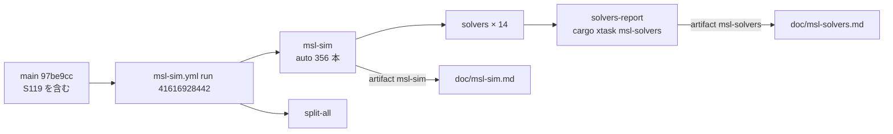

# S126 msl-solvers-refresh

| | |
| --- | --- |
| セッション | S126 |
| 日付 | 2026-11-03 |
| ブランチ | `feature/s126-msl-solvers-refresh` |
| Phase | P3（実行系）・P8（ソルバの表） |
| スライド | [slides.html](slides.html) |
| 作業記録 | [log/work/2026-11-03-msl-solvers-refresh.md](../../../log/work/2026-11-03-msl-solvers-refresh.md) |
| 前のセッション | [S119](../S119-sim-thyristor-event-cost/解説書.md)、表を作った [S050](../S050-solver-matrix-ci/解説書.md) |

## 1. 目的

文書だけのセッション。[S119](../S119-sim-thyristor-event-cost/解説書.md)（session の道の SDIRK で、事象のあとの最初の刻みを抑えた）が main に入った後に、`msl-sim.yml` を既定の入力（14 ソルバすべて）で回し、ソルバの表 [doc/msl-solvers.md](../../msl-solvers.md) と [doc/msl-sim.md](../../msl-sim.md) を更新する。S119 は esdirk34 だけの run で `msl-sim.md` を更新したので、ソルバの表は S050（run 41194959752、2026-10-31）のままだった。Rust のコードは触らず、手元で `msl:sim`・`msl:funnel` も回していない。

## 2. 決定と理由

| 項目 | 決定 | 理由 |
| --- | --- | --- |
| 回した run | `msl-sim.yml` run [41616928442](https://github.com/asari300/20261018_GlobeMode/actions/runs/41616928442)（`--ref main`、head `97be9cc`、入力は既定）。全 17 ジョブ success、ジョブ `msl-sim` 10:09〜11:29 UTC、`solvers` 11:29〜14:29 UTC | `msl-solvers.md` は全ソルバ同時の run で作る（S055 の規則）。head には S119 のほか S123（進捗と中断）・S130（整形の設定）が入っている。モデルごとの判定は S119 の run と同じだった（4 節） |
| 出す時期 | S119 の esdirk34 だけの run（41589277425）が終わるのを待ってから出した | `msl-sim.yml` の `concurrency` は `group: msl-sim`・`cancel-in-progress: false`（`libraries.yml` と同じく 1 つ）。待機中に 2 つ目を出すと、待っている方が cancelled になる |
| 写し方 | artifact `msl-sim` の `doc/msl-sim.md` と `msl-solvers` の `msl-solvers.md` をそのまま写した | どちらも全文が `cargo xtask` の生成で、手で書いた前書きは無い（S119 の `msl-sim.md` も artifact そのもの）。リンクとスクリプトの有無は写す前に確かめた |
| 差の取り方 | 表の数に加えて、ソルバごとの artifact `msl-sim-solver-<名前>` の JSON を S050 の run と突き合わせ、判定（outcome・コード・管）が変わったモデルを並べた | S050 から今までに S064（auto の回し直し）・S068・S119 などが入っていて、表の数だけでは何が変わったかがわからない |
| ThyristorBridge2mPulse_DC_Drive の余裕 | 予算・既知の外れの一覧は変えず、事実だけを書いた | 依頼のとおり。直すなら別の WP |
| SDIRK の新しい失敗 | 直さず、事実と【未確認】の推定を書いた | 文書だけのセッション。原因を確かめるには S119 の前の版で SDIRK を回す必要がある |

## 3. 図



## 4. 結果

### 4.1 `msl-sim.md`（`auto`）

| 量 | S119（run 41589277425） | S126（run 41616928442） |
| --- | ---: | ---: |
| 実行できた | 312 | 312 |
| 管に収まった / 比べた | 303 / 311（97.4%） | 303 / 311（97.4%） |
| 時間切れ / 外から停止 | 2 / 6 | 2 / 6 |
| 回し直した本数（うち実行できた） | 15（7） | 14（6） |
| 全体の時間 | 4113.8 s | 3721.4 s |

356 本すべてで、判定・止まった理由・使ったソルバの段・管の結果が S119 の報告と同じ。回し直しが 1 本減ったのは `ThyristorCenterTap2mPulse_RLV_Characteristic` が 1 回目（予算 30 s）で終わったためで、ランナーの速さの違い（全体の時間が 9.5% 短い）による。

ThyristorBridge の 2 本（`auto`、どちらも 1 回目は時間切れで esdirk34 の回し直し）:

| モデル | S119 | S126 |
| --- | --- | --- |
| `ThyristorBridge2mPulse_DC_Drive` | 完走、積分 177.14 s・計 180.95 s、管 OK 38/38 | 完走、積分 **125.64 s**・計 128.78 s、管 OK 38/38 |
| `ThyristorBridge2Pulse_DC_Drive` | 完走、積分 63.42 s・計 65.08 s、管 OK 19/19 | 完走、積分 46.20 s・計 47.57 s、管 OK 19/19 |

2mPulse は時間切れに戻らなかった。予算 180 s に対して今回は 54 s 余ったが、同じコードで S119 の run は 177.1 s（余裕 3 s）だったので、ランナーによって 125〜177 s の幅で揺れる。境目にあることは変わらない。

### 4.2 `msl-solvers.md`（14 ソルバ + `auto`）

| ソルバ | 実行できた S050 → S126 | 管に収まった / 比べた S050 → S126 | 時間切れ | 秒 |
| --- | --- | --- | --- | --- |
| `auto` | 309 → **312** | 301 / 308 → **303 / 311** | 4 → 2 | 3864 → 3721 |
| `bdf` | 301 → 301 | 293 / 300 → 293 / 300 | 2 → 2 | 3294 → 3050 |
| `cerk23` | 288 → 287 | 279 / 287 → 278 / 286 | 27 → 28 | 10044 → 10281 |
| `cerk34` | 286 → 286 | 275 / 285 → 275 / 285 | 27 → 27 | 9806 → 9666 |
| `cerk45` | 285 → 285 | 274 / 284 → 274 / 284 | 22 → 22 | 8624 → 8281 |
| `cvode` | 294 → 293 | 281 / 293 → 281 / 292 | 14 → 14 | 6472 → 6463 |
| `dopri45` | 292 → 293 | 280 / 291 → 281 / 292 | 18 → 18 | 7372 → 7576 |
| `dopri853` | 283 → 283 | 270 / 282 → 270 / 282 | 20 → 20 | 8123 → 7878 |
| `esdirk34` | 294 → 294 | 285 / 293 → 285 / 293 | 16 → 17 | 6883 → 7079 |
| `esdirk45` | 293 → 293 | 280 / 292 → 281 / 292 | 19 → 17 | 7410 → 7263 |
| `ida` | 289 → 289 | 283 / 288 → 283 / 288 | 17 → 18 | 7861 → 7800 |
| `radau5` | 290 → 290 | 279 / 289 → 279 / 289 | 19 → 19 | 8233 → 8208 |
| `sdirk34hw` | 294 → **292** | 285 / 293 → **282 / 291** | 19 → 18 | 7946 → 7781 |
| `trbdf2` | 295 → 295 | 280 / 294 → 280 / 294 | 17 → 17 | 7962 → 7745 |
| `tsit45` | 287 → **285** | 276 / 286 → **274 / 284** | 20 → 23 | 8424 → 8750 |

判定が変わったモデル（ソルバの JSON の突き合わせ。S050 → S126）:

| ソルバ | モデル | S050 | S126 | 見立て |
| --- | --- | --- | --- | --- |
| `esdirk34`・`esdirk45`・`sdirk34hw` | `HBridge_TrianglePWM_RL` | 完走（0.5〜0.8 s） | `GM-E11002`（0.5〜0.6 s） | session の道の SDIRK だけ。`trbdf2` は完走のまま |
| `esdirk34`・`esdirk45`・`sdirk34hw` | `HBridge_DC_Drive` | esdirk34 完走 153 s・他は時間切れ | `GM-E11002`（23〜39 s） | 同上。`trbdf2` は時間切れのまま |
| `sdirk34hw` | `ThyristorBridge2Pulse_DC_Drive` | 完走 79.7 s | `GM-E11003`（t = 13.04 s で事象の反復が収束しない） | 同上 |
| `sdirk34hw` | `Dimmer_R` | 管 OK | 管 NG（既知の外れの一覧にある `y_arg` の窓） | 同上 |
| `esdirk45` | `Dimmer_RL` | 完走（管 NG、既知の外れ） | `GM-E11002` | 同上 |
| `esdirk34`・`esdirk45` | `ThyristorBehaviourTest` | `GM-E11002` | 完走・管 OK | 同上（良くなった向き） |
| `esdirk34` | `ThyristorBridge2Pulse_DC_Drive` | `GM-E11003`（0.9 s） | 完走 36.8 s | 同上（良くなった向き） |
| `esdirk45` | `ThyristorBridge2mPulse_DC_Drive` | 時間切れ | 完走 177.4 s | 同上（良くなった向き） |
| `cerk23`・`cerk45`・`tsit45`・`dopri45`・`cvode`・`ida` など | `HBridge_DC_Drive`・`ThreeTanks`・`ComparisonPullInStroke`・`DifferenceAmplifier`・`IMS_Start` | 予算 180 s の前後 | 反対側 | どれも 150〜240 s の境目で、ランナーの揺れ |

- session の道の SDIRK の変化は、S050 から今までで `globe-mode-exec/src/rumoca/plugins/` を変えたのが S119 の 2 コミットだけなので、S119 の「事象のあとの最初の刻みの上限」によるものと見ているが、S119 の前の版で SDIRK を回していないので【未確認】。esdirk34 は S119 の run（41589277425 の `msl-sim-solver-esdirk34`）と S126 で全モデルの判定が同じ。
- 陽的 RK（`cerk*`・`tsit45`・`dopri*`）は S119 で変えていない（S119 の 2 つ目のコミットで外した）。表の増減は境目のモデルの揺れだけ。

ThyristorBridge の 2 本のソルバごとの行（S050 → S126。秒は親から見た 1 本の時間）:

| ソルバ | `2mPulse_DC_Drive` S050 | S126 | `2Pulse_DC_Drive` S050 | S126 |
| --- | --- | --- | --- | --- |
| `bdf` | `GM-U0005` 7.1 | `GM-U0005` 4.8 | `GM-U0005` 16.0 | `GM-U0005` 10.6 |
| `cerk23`・`cerk34`・`cerk45`・`dopri45`・`dopri853`・`tsit45` | 時間切れ | 時間切れ | 時間切れ | 時間切れ |
| `cvode` | 時間切れ | 時間切れ | 完走 20.8 | 完走 22.0 |
| `esdirk34` | 完走 96.7 | 完走 127.1 | `GM-E11003` 0.9 | **完走 36.8** |
| `esdirk45` | 時間切れ | **完走 177.4** | 完走 62.8 | 完走 59.2 |
| `ida` | `GM-E11003` 3.8 | `GM-E11003` 3.8 | 完走 41.0 | 完走 46.1 |
| `radau5` | 時間切れ | 時間切れ | 完走 101.8 | 完走 101.3 |
| `sdirk34hw` | 時間切れ | 時間切れ | 完走 79.7 | **`GM-E11003` 67.5** |
| `trbdf2` | 完走 145.7 | 完走 158.2 | 完走 51.1 | 完走 56.1 |

## 5. 再現手順

```bash
# 動いている msl-sim.yml の run が無いことを確かめてから（concurrency は 1 つ）
gh run list --workflow msl-sim.yml --limit 3 --json databaseId,headSha,status,conclusion
gh workflow run msl-sim.yml --ref main
D=$(mktemp -d)
gh run download 41616928442 -n msl-sim -D "$D/sim"
gh run download 41616928442 -n msl-solvers -D "$D/solvers"
cp "$D/sim/doc/msl-sim.md" doc/msl-sim.md
cp "$D/solvers/msl-solvers.md" doc/msl-solvers.md
# ソルバごとの判定の突き合わせは msl-sim-solver-<名前> の JSON（S050 は run 41194959752）
```

## 6. 次回

- session の道の SDIRK（`esdirk34`・`esdirk45`・`sdirk34hw`）で `HBridge_TrianglePWM_RL`・`HBridge_DC_Drive` が `GM-E11002`、`sdirk34hw` で `ThyristorBridge2Pulse_DC_Drive` が `GM-E11003` になった。S119 の前の版と後の版で SDIRK を手元で回し、S119 の刻みの上限が原因かを確かめる（この 2 本の HBridge の `auto` の判定は S119 の run と同じ）。
- `ThyristorBridge2mPulse_DC_Drive` の `auto` は 125〜177 s で予算 180 s の境目にある（S088・S119 の持ち越しと同じ）。
