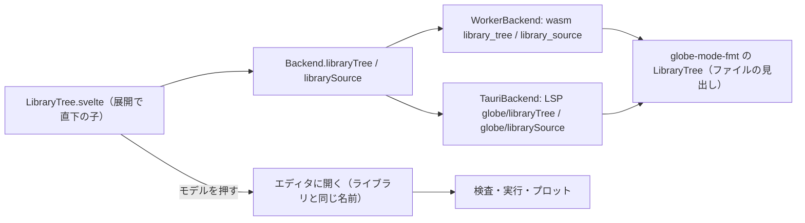

# S127 ライブラリツリーの UI

| | |
| --- | --- |
| セッション | S127 |
| 日付 | 2026-11-03 |
| ブランチ | `feature/s127-ui-library-tree` |
| Phase | P4 |
| スライド | [slides.html](slides.html) |
| 作業記録 | [log/work/2026-11-03-ui-library-tree.md](../../../log/work/2026-11-03-ui-library-tree.md) |

## 1. 目的

[features.md](../../features.md) の「ライブラリツリー」は Must だが、UI が無かった（S048 の持ち越し。[解説書](../S048-ui-msl/解説書.md)）。ブラウザ UI は「MSL を読む」ボタンとモデル名の欄だけで、モデルの完全修飾名を知らないと使えない。

ユーザーの方針「先に全体の流れとして使えるアプリを完成させる」に沿い、MSL を読んだあと、パッケージの木をたどって目的のモデル（例 `Modelica.Electrical.Analog.Examples.ChuaCircuit`）を選び、そのソースをエディタに開いて検査・実行・プロットまで行けるようにする。見た目の調整・検索・アイコンは後回し。

## 2. 決定と理由

| 項目 | 決定 | 理由 |
| --- | --- | --- |
| 木のデータ | `globe-mode-fmt` に `tree`（`LibraryTree`）を足した。各ファイルの見出し（`within` と最初のクラスの種類・名前・説明文字列）だけを小さな字句読みで読み、完全修飾名 → (種類, 説明, ファイル) の索引を作る | wasm と LSP の両方が直に依存し、依存 0 で wasm32 でも動く。facade（`globe-mode`）・`ir` は他のセッションが触るので変えない。`ClassIndex` は分割読み込みでは読んだファイルの分しか持たないので、木には使えない |
| 取り方 | `prefix` の直下の子だけを返す遅延の形（wasm `library_tree(prefix)`、LSP `globe/libraryTree`）。各項目は `{name, path, kind, description, file, hasChildren}` | 全部を一度に返すと大きい。展開のたびに 1 回呼ぶ |
| ソースの取得 | wasm `library_source(path)`、LSP `globe/librarySource`。`{file, text}` を返す。単位はファイル | MSL はパッケージ 1 ファイルの場合と 1 クラス 1 ファイルの場合がある。1 ファイルのパッケージ（`Sources.mo` など）は葉で、開くとそのファイル全体 |
| 開き方 | エディタの文書の名前を、そのライブラリのファイルの名前にする（`App.svelte` の `file`）。モデル名の欄にも完全修飾名を入れる | 同じ名前の `setFile` がライブラリのファイルを差し替えるので、重複の定義にならず、編集が検査・実行に効く（`library_tree_opens_a_model_file_as_the_document` で `k = 2` に書き換えると x(1) = e⁻²） |
| 本文の持ち方 | wasm は読み込みに渡した組をそのまま持つ（`Workspace::with_tree`）。LSP はディスクから読む | 分割読み込みの写しは facade の中にあり、取り出す口が無い。shortcut として残した（MSL で約 15 MiB） |
| 並び | 名前の順 | ブラウザの MSL.json は `.mo` だけで `package.order` を持たない |

## 3. 図



## 4. 再現手順

```bash
export CARGO_TARGET_DIR=…/.git-worktree/target-shared CARGO_BUILD_JOBS=2
ln -s <main のチェックアウト>/data/msl data/msl   # worktree に MSL が無ければ
cargo test -p globe-mode-fmt tree
cargo test -p globe-mode-wasm --test decay library_tree
cargo test -p globe-mode-lsp library_tree
mise run wasm:build
(cd src/Svelte && pnpm check && pnpm build)
uv run python src/Svelte/tests/test_ui.py
```

検証の結果の数字は[作業記録](../../../log/work/2026-11-03-ui-library-tree.md)にある。

## 5. 次回

- 検索ボックス、アイコン、`package.order` の順
- 1 ファイルのパッケージの中の入れ子のクラスを木に出す（今は葉で、ファイル全体を開く）
- wasm がライブラリの本文を 2 重に持つのをやめる（facade が本文を返せるようにする）
- Diagram ビュー、ダークモード
