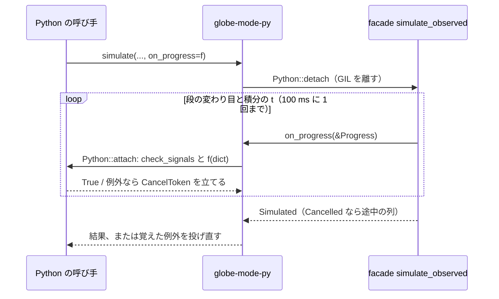

# S129 進捗と中断の Python の段

| | |
| --- | --- |
| セッション | S129 |
| 日付 | 2026-11-03 |
| ブランチ | `feature/s129-progress-cancel-python` |
| Phase | P7（[ADR-0033](../../adr/0033-progress-and-cancel.md) の実装の順の 3。1 段目は [S123](../S123-progress-cancel-core/解説書.md)） |
| スライド | [slides.html](slides.html) |
| 作業記録 | [log/work/2026-11-03-progress-cancel-python.md](../../../log/work/2026-11-03-progress-cancel-python.md) |

## 1. 目的

S123 で facade に入った `Workspace::simulate_observed`（進捗と `CancelToken`）を、Python の `globe_mode` から使えるようにする。ADR の順では wasm の次だが、wasm は S127 が `globe-mode-wasm` を触っているので、独立な Python を先に入れた。exec と facade は変えていない。

## 2. 決定と理由

| 項目 | 決定 | 理由 |
| --- | --- | --- |
| 口 | `Workspace.simulate(model, on_progress=None, **settings)`・`simulate_columns(model, on_progress=None, **settings)`。native も同じ keyword 引数 | 既存の呼び方を変えない。`None` なら前と同じ道（GIL を持ったまま） |
| 進捗の形 | `{"stage": "lowering" など, "time": float か None, "start_time", "stop_time"}` の dict | exec の `Progress` をそのまま写す。ADR の (3) の位置引数 4 つより足しやすい |
| 止め方 | コールバックが真の値を返す、または Ctrl-C | ADR の (2)。真ならトークンを立て、積分の途中なら `termination` が `cancelled` で途中の列と `GM-I11004` |
| GIL | pyo3 0.30.1 の `Python::detach`（旧名 `allow_threads`）で離し、進捗のたびに `Python::attach` で取り直して `py.check_signals()` とコールバック | 名前は crate のソース `pyo3-0.30.1/src/marker.rs` と <https://docs.rs/pyo3/0.30.1/pyo3/marker/struct.Python.html> で確認（2026-11-03） |
| 例外 | `check_signals` かコールバックの例外はトークンを立てて覚え、実行が戻ってから投げ直す | 実行系を次の区切りで正しく止め、Python の例外（`KeyboardInterrupt` など）をそのまま見せる |
| `Send` | `unsafe` を使わない | facade の `Workspace` が `Send` だったので `detach` の閉包にそのまま渡せた（workspace は `unsafe_code` を禁じている） |

## 3. 図



## 4. 再現手順

```bash
CARGO_TARGET_DIR=… CARGO_BUILD_JOBS=2 uv sync --reinstall-package globe-mode
uv run pytest -q src/Python/tests      # 7 passed, 1 skipped
cargo test -p globe-mode-py
```

試験（`src/Python/tests/test_api.py`）:

1. Decay（esdirk34）: 段が `lowering` から `integration` まで届き、最後の t が 1。列と CSV が `on_progress` なしと同じ。
2. `der(x) = sin(100 * time)` を 1000 s（手元で止めずに約 0.9 s）回し、最初の t の進捗で `True` を返す: `ok`、`termination` が `{"kind": "cancelled", "time": …}`（0 < time < 1000、列の最後の時刻と同じ）、`GM-I11004`。約 0.1 s で止まる。
3. 同じモデルで `threading.Timer(0.2, _thread.interrupt_main)`: `KeyboardInterrupt`。約 0.2 s で止まる。

## 5. 次回

- ADR-0033 の順の 2（wasm・Svelte）、4（C・Zig・Julia、NIF・Elixir・Gleam）、5（LSP・Desktop）。
- ネイティブの型付きの道（bdf・dopri45・auto）の積分の中と、lowering・組み立ての中では、`True` も Ctrl-C も次の段まで届かない（S123 の持ち越しと同じ）。
- `on_progress` を渡さないときは前のまま GIL を持って回るので Ctrl-C は戻るまで届かない。既定を変えるかは使い手の声を聞いてから。
