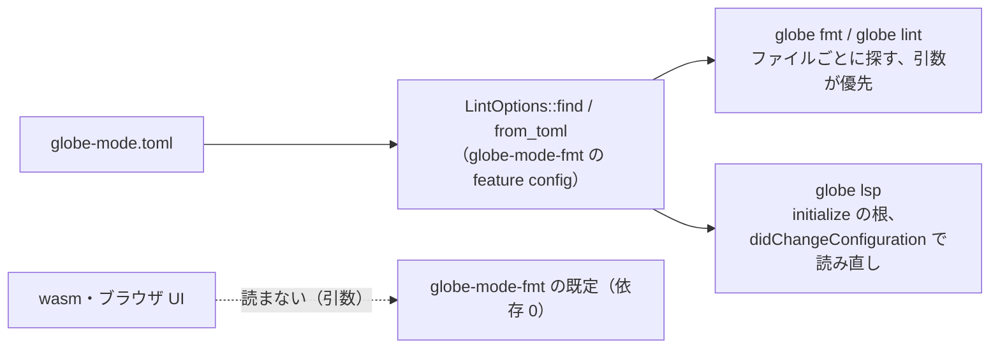

# S130 整形と lint の設定ファイル（`globe-mode.toml`）

| | |
| --- | --- |
| セッション | S130 |
| 日付 | 2026-11-03 |
| ブランチ | `feature/s130-fmt-config-file` |
| Phase | P4（使える流れ。[features.md](../../features.md) の「整形・lint」の行の「設定ファイルは未」） |
| スライド | [slides.html](slides.html) |
| 作業記録 | [log/work/2026-11-03-fmt-config-file.md](../../../log/work/2026-11-03-fmt-config-file.md) |

## 1. 目的

ruff の `ruff.toml`・rustfmt の `rustfmt.toml` のように、プロジェクトの設定ファイルで整形と lint の設定を決められるようにする。CLI（`globe fmt` / `globe lint`）と LSP（`globe lsp`）が読む。wasm とブラウザ UI は設定ファイルが無いので対象外（引数で渡す形のまま）。整形の規則は [format-style.md](../../format-style.md)、整形器の設計は [ADR-0024](../../adr/0024-own-formatter-and-lint.md)、前の段は [S053](../S053-fmt-lint-completion/解説書.md)・[S060](../S060-fmt-cli-vscode-keys/解説書.md)・[S061](../S061-fmt-sections-annotation-order/解説書.md)・[S062](../S062-connect-type-lint/解説書.md)。

## 2. 決定と理由

| 項目 | 決定 | 理由 |
| --- | --- | --- |
| 名前と形 | `globe-mode.toml` の `[fmt]`（`indent`・`width`・`insert_origin`・`blank_around_sections`・`format_html`）と `[lint]`（`disable`） | `Options` の欄と 1 対 1。ADR-0024 の持ち越しにあった `globe-fmt.toml` ではなく、lint も入るのでプロジェクト名にした |
| `disable` の値 | 規則の名前（`missing-description`）でも LSP のコード（`GM-L0003`）でもよい。`globe-mode-fmt` に表 `RULES` を置き、名前にそろえる | CLI は名前、エディタの診断はコードを見せるので、どちらを写してもよいように |
| 誤り | 知らない表・キー・規則、型の違う値は誤り。CLI は終了コード 2、LSP は `window/showMessage` で知らせて既定で続ける | 打ち間違い（`indnt`）を黙って無視しない（ruff と同じ） |
| 読む処理の置き場所 | `globe-mode-fmt` の optional な feature `config`（`LintOptions::from_toml`・`LintOptions::find`）。CLI と LSP だけが立てる | CLI と LSP に別々に書くと、知らないキーの扱いとコードの対応が 2 か所に分かれる。既定の feature は空なので、既定のビルドと wasm は依存 0 のまま |
| TOML の読み | `toml` 0.8（`toml::Table` に読んで手で取り出す。serde の derive は使わない） | rumoca-core の依存で `Cargo.lock` に既にある。新しい crate は 0。手で取り出すと知らないキーの誤りの文が書ける |
| 探し方 | CLI はファイルごとに、その場所から上へたどって最初の `globe-mode.toml`（標準入力はカレントディレクトリから）。LSP は `initialize` の `rootUri`（無ければ `rootPath`）から上へ | ruff と同じ。サブディレクトリに別の設定を置ける |
| 優先 | CLI: `--indent`・`--width`・`--no-…` が設定ファイルより優先、`--disable` は `[lint] disable` に足す。LSP の整形: 設定ファイルがあれば `indent` は `tabSize` ではなく設定ファイル、拡張の追加のキー（`insertOrigin` など）は設定ファイルより優先 | コマンドラインはその場の指示。VS Code は `tabSize` を必ず送るので、そちらを採ると設定ファイルの `indent` が効かない |
| 読み直し | LSP は `workspace/didChangeConfiguration` で読み直し、開いている文書の診断を出し直す | ファイルの監視は入れない。拡張の設定が変わったときに届く通知だけ |
| 触らないもの | 要求の dispatch のうち `globe/format`・`globe/lint`（wasm と同じく params だけで決める）、wasm、Svelte、VS Code 拡張 | 並行の S127（`globe/libraryTree`）・S125・S129 とぶつけない |

## 3. 図



## 4. 再現手順

```bash
export CARGO_TARGET_DIR=…/.git-worktree/target-shared CARGO_BUILD_JOBS=2
cargo test -p globe-mode-fmt --features config -p globe-mode-cli -p globe-mode-lsp
printf '[fmt]\nindent = 4\n' > globe-mode.toml
globe fmt --check src/Modelica       # 2 字下げのファイルは整形が要る
globe fmt --check --indent 2 src/Modelica   # 引数が優先
```

試験:

- `globe-mode-fmt` の `config::tests`: `from_toml_reads_fmt_and_lint`（正常。コードを名前にそろえる、空の設定は既定）、`from_toml_rejects_unknown_keys_and_bad_values`（知らないキー・表・規則、負の数、型の違い、壊れた TOML）。
- `globe-mode-cli/tests/fmt_dirs.rs` の `config_file_changes_fmt_and_lint`: 設定ファイルが無いと `fmt --check` が 0、`indent = 4` で 1、`--indent 2` で 0。`disable = ["GM-L0003"]` で `lint` が 0。知らないキーで終了コード 2。
- `globe-mode-lsp` の `config_file_at_the_root_drives_lint_and_formatting`: 根の設定で GM-L0003 が出ず、`tabSize: 2` を送っても 4 字下げ。誤りを書いて `didChangeConfiguration` を送ると `window/showMessage` と GM-L0003 付きの診断。

数字は [作業記録](../../../log/work/2026-11-03-fmt-config-file.md) にある。

## 5. 次回

- VS Code 拡張の設定 UI と、エディタのオプション（`editor.tabSize`）との同期。
- ブラウザ UI でプロジェクトの設定を持つ形（今は引数だけ）。
- LSP はワークスペースの根の 1 つだけを見る（複数の根、サブディレクトリの設定は見ない）。
