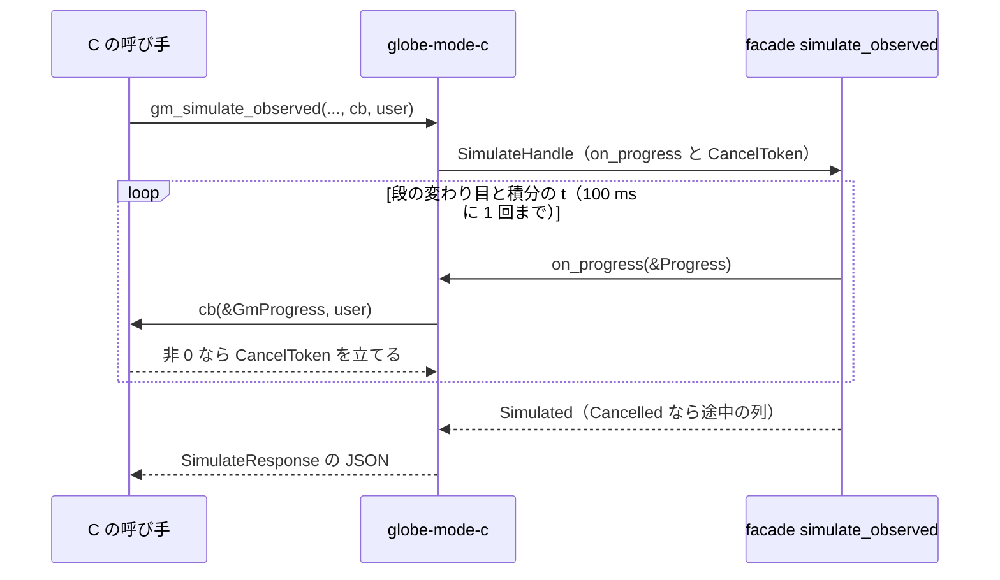
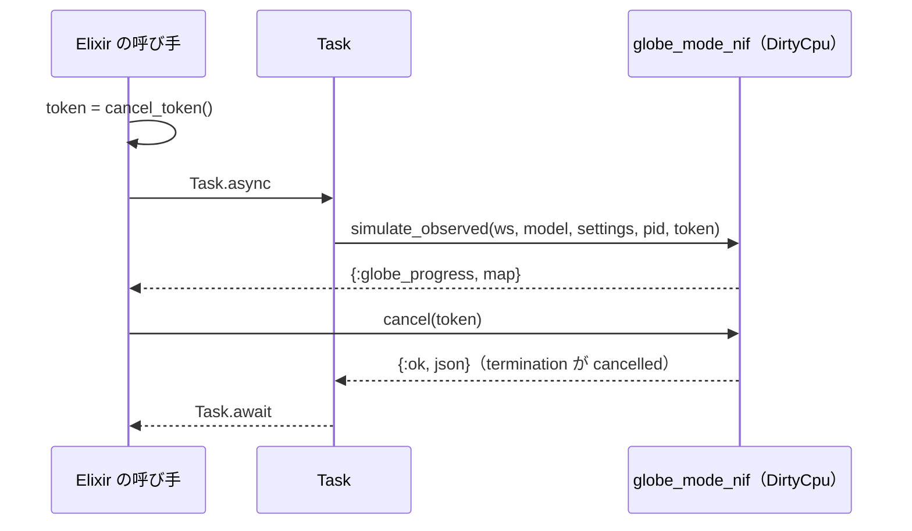

# S131 進捗と中断の C・NIF の段

| | |
| --- | --- |
| セッション | S131 |
| 日付 | 2026-11-03 |
| ブランチ | `feature/s131-progress-cancel-lang` |
| Phase | P7（[ADR-0033](../../adr/0033-progress-and-cancel.md) の実装の順の 4。1 段目は [S123](../S123-progress-cancel-core/解説書.md)、Python は [S129](../S129-progress-cancel-python/解説書.md)） |
| スライド | [slides.html](slides.html) |
| 作業記録 | [log/work/2026-11-03-progress-cancel-lang.md](../../../log/work/2026-11-03-progress-cancel-lang.md) |

## 1. 目的

S123 で facade に入った `Workspace::simulate_observed`（進捗と `CancelToken`）を、C ABI（とその上の Zig・Julia）と Erlang の NIF（とその上の Elixir・Gleam）から使えるようにする。S129 の Python の包み方を型にし、exec と facade は変えていない。

## 2. 決定と理由

ADR-0033 の (3) の表から変えた点は、ADR の「4 段目の結果」に書いた。要点:

| 項目 | 決定 | 理由 |
| --- | --- | --- |
| C の進捗 | `GmProgress { stage, time, has_time, start_time, stop_time }` を `int (*GmProgressCallback)(const GmProgress *, void *)` で渡す。非 0 で中断 | Python の dict と同じ 4 つの値。構造体なら後から足しやすい |
| C の口 | `gm_simulate_observed(ws, model, settings_json, callback, user_data)` と `gm_simulate_columns_observed(..., data, len, callback, user_data)` | 既存の `gm_simulate`・`gm_simulate_columns` と同じ引数に足すだけ。`gm_simulate_columns` は `callback = NULL` の包みにした |
| C の NULL | `callback` が NULL なら `SimulateHandle::default()` | 前の道と同じで結果が変わらない |
| ヘッダの突き合わせ | `tests/header.rs` で `typedef` の行と試験のモジュールを飛ばし、`GmProgressCallback`・`void *` を型の表に足した | 手書きのヘッダの約束（S075）を保つ |
| Julia | 固定の trampoline `progress_trampoline` を `@cfunction` にし、Julia の関数を `Any` の `user_data` で渡す | 閉包の `@cfunction` を使わずに済む。ccall の引数なので GC からも守られる |
| NIF のトークン | `cancel_token()` が `ResourceArc<Token>` を返し、`simulate_observed(ws, model, settings_json, pid, token)`（DirtyCpu）に渡す | DirtyCpu の NIF は戻るまで値を返せないので、トークンを先に作るのが最小 |
| NIF の進捗 | pid へ `{:globe_progress, %{stage, time, start_time, stop_time}}`（Rustler の `NifMap`）を呼び出し元の env の `send` で送る | Rustler 0.39 の `Env::send` はスケジューラのスレッドから呼び出し元の env で送れる。受け手が死んでいても実行は続ける（止めるのはトークン） |
| Gleam | 不透明な型 `CancelToken`・`Pid` と `erlang:self/0`。試験の spawn と受信は `test/globe_mode_test_ffi.erl` | 新しい依存（`gleam_erlang`）を足さない |

## 3. 図





## 4. 再現手順

```bash
export CARGO_TARGET_DIR=… CARGO_BUILD_JOBS=2
cargo test -p globe-mode-c        # 3 + 1 passed
mise run c:zig                    # cancel: calls=7, termination=cancelled
mise run c:julia                  # cancel: progress=7, stages=[lowering, preflight, build, initialization, integration]
mise run elixir:test              # 2 tests, 0 failures
mise run gleam:test               # 2 passed
```

どの試験も S129 と同じ `der(x) = sin(100 * time)` を esdirk34・1000 s・間隔 1 で回し、最初の t の進捗で止める。`termination.kind` が `cancelled`、診断に `GM-I11004`。C の単体試験は列の版も回し、列の最後の時刻が `termination.time` と同じことを確かめる。

## 5. 次回

- ADR-0033 の順の 2（wasm・Svelte）と 5（LSP・Desktop）。
- NIF の列の道（`simulate_columns`）には進捗を付けていない。要るときに `simulate_observed` と同じ形で足す。
- ネイティブの型付きの道（bdf・dopri45・auto）の積分の中と、lowering・組み立ての中では止まらない（S123 の持ち越しと同じ）。
