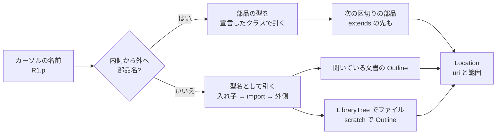

# S132 LSP の定義ジャンプと参照

| | |
| --- | --- |
| セッション | S132 |
| 日付 | 2026-11-03 |
| ブランチ | `feature/s132-lsp-definition` |
| Phase | P4（使える流れ。[features.md](../../features.md) の「補完・定義ジャンプ・参照・リネーム・ホバー」の行の未着手の 2 つ） |
| スライド | [slides.html](slides.html) |
| 作業記録 | [log/work/2026-11-03-lsp-definition.md](../../../log/work/2026-11-03-lsp-definition.md) |

## 1. 目的

`globe lsp` に `textDocument/definition` と `textDocument/references` を足し、VS Code 拡張（[S059](../S059-vscode-extension/解説書.md)）でモデルの型・部品名から定義へ飛べるようにする。前の段は [S038](../S038-lsp/解説書.md)（LSP の骨格）、[S053](../S053-fmt-lint-completion/解説書.md)（補完）、[S127](../S127-ui-library-tree/解説書.md)（ライブラリの木）。ブラウザ UI（CodeMirror）への接続は持ち越し。

## 2. 決定と理由

| 項目 | 決定 | 理由 |
| --- | --- | --- |
| 解析の土台 | 既存の `Outline`（クラス・部品・extends・import と範囲）だけで引く。新しい解析器は入れない | 補完（S053）と同じ土台。字句の位置を持つ CST は Track B の仕事 |
| 名前の切り出し | カーソルの点つきの名前を、頭からカーソルのある区切りの終わりまで（`R1.p.v` の `p` の上なら `R1.p`） | `Modelica.Electrical` の途中にカーソルがあればパッケージへ飛べる |
| 引く順 | 内側のクラスから外へ部品名（extends の先も、深さ 8 まで）、無ければ型名を `ClassIndex::resolve` と同じ順（スコープの入れ子 → そのクラスの import → 外側） | MLS §5.3.1。`ClassIndex` はワークスペースのファイルしか持たない（ライブラリの索引は検査の内側）ので、同じ順を LSP の側で書いた |
| ライブラリのクラスを探す | 名前の頭から一番長く `LibraryTree`（S127）にある名前のファイルを読み、別の空の `Workspace`（`scratch`）でアウトラインにして入れ子をたどる | MSL 全部のアウトラインを先に作らない（必要なファイルだけ読む）。facade だけを使い、frontend に直接依存しない |
| 開いている文書が先 | ワークスペースのファイル（開いた文書）を先に見る | ライブラリのファイルを開いて編集中なら、その本文の位置を返す |
| 返す範囲 | `Outline` の範囲そのまま（クラスは名前から `end` まで、部品は名前だけ） | 新しい位置を持たない。VS Code は範囲の頭にカーソルを置く |
| 参照 | 同じ文書で、カーソルを含む一番内側のクラスの中の字句の一致（前が識別子の文字か `.` でないもの） | 依頼の最小。全ライブラリ横断は持ち越し |
| capability | `definitionProvider`・`referencesProvider` を `initialize` で宣言 | VS Code の `vscode-languageclient` はこれだけで「定義へ移動」「参照の検索」を出す。拡張のコードは変えない |

shortcut（コードに書いた）: 受け継いだ入れ子のクラス、コメントや文字列の中の名前、for の添字は区別しない。

## 3. 図



## 4. 再現手順

```bash
export CARGO_TARGET_DIR=…/.git-worktree/target-shared CARGO_BUILD_JOBS=2
cargo test -p globe-mode-lsp
```

試験（`globe-mode-lsp`）:

- `definition_of_a_type_and_a_component_in_the_same_document`: capability の宣言、同じ文書の `Pin p;` の `Pin` から `connector Pin` へ、`p.v` の `v` から `Pin` の部品 `v` へ。数の上は null。
- `definition_into_another_file_of_the_library`: `GlobeModeValidation` をライブラリにし、`import GlobeModeValidation.Components;` のあとの `Components.Resistor` から `Components.mo` の `model Resistor`（14 行目）へ。`r1.p` の `p` から extends の先の `TwoPin` の部品 `p` へ。
- `references_in_the_same_class`: `Real x;` の `x` で 3 箇所（宣言と `der(x)`・`-x`。`xx` は数えない）。
- `definition::tests::name_at_cuts_at_the_segment_under_the_cursor`: 名前の切り出し。

数字は [作業記録](../../../log/work/2026-11-03-lsp-definition.md) にある。

## 5. 次回

- ブラウザ UI（CodeMirror）からの定義ジャンプ（`globe/…` の口か LSP の要求を Worker に通す）。
- リネーム、全ライブラリ横断の参照。
- 受け継いだ入れ子のクラス・コメントと文字列の除外。
