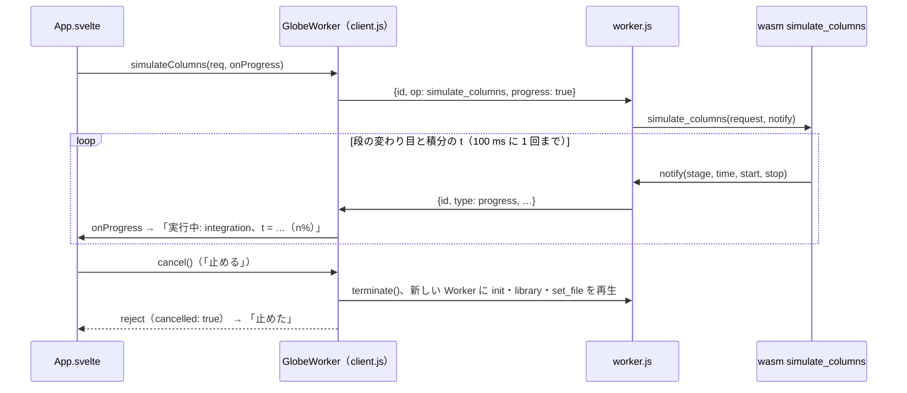

# S133 進捗と中断の wasm と UI の段

| | |
| --- | --- |
| セッション | S133 |
| 日付 | 2026-11-03 |
| ブランチ | `feature/s133-progress-cancel-wasm` |
| Phase | P7（[ADR-0033](../../adr/0033-progress-and-cancel.md) の実装の順の 2。1 段目は [S123](../S123-progress-cancel-core/解説書.md)、3 段目は [S129](../S129-progress-cancel-python/解説書.md)） |
| スライド | [slides.html](slides.html) |
| 作業記録 | [log/work/2026-11-03-progress-cancel-wasm.md](../../../log/work/2026-11-03-progress-cancel-wasm.md) |

## 1. 目的

ブラウザ UI で長い実行の進捗が見え、途中で止められるようにする（ユーザーの方針「先に全体の流れとして使えるアプリを完成させる」の一部）。S123 で facade に入った `Workspace::simulate_observed` を wasm から呼び、Worker の `postMessage` で UI に届け、止めるのは Worker の `terminate()` と作り直しにする（ADR-0033 の (2)。Worker は 1 本のスレッドなのでトークンは立てられない）。exec・facade・LSP・Desktop・C/NIF は触らない。

## 2. 決定と理由

| 項目 | 決定 | 理由 |
| --- | --- | --- |
| wasm の口 | 既存の `simulate_columns(request_json, on_progress?)` に省略できる引数を足す | ADR-0033 の (3) の表の形。UI は列の道しか使わない。省略すると前と同じ道なので `run`・`wasm:compare` は変わらない |
| JS の関数の呼び方 | `#[wasm_bindgen] extern` で `Function.prototype.call` を宣言（`ProgressFn`） | js-sys を足さない（新しい依存を足さない）。関数の例外は無視して Rust の状態を壊さない |
| 進捗の形 | `stage`（小文字）・`time`（無ければ `undefined`）・`start_time`・`stop_time` | Python（S129）と同じ |
| Worker | `{id, type: "progress", …}` を親へ。`GlobeWorker.simulateColumns(req, {onProgress})` | 呼び出しは直列なので `id` で今の呼び出しの `onProgress` に渡せる |
| 止め方 | `GlobeWorker.cancel()`: 実行中の呼び出しがあれば `terminate()` と作り直し。止めた呼び出しは `cancelled: true` で reject | 既存の panic の作り直し（`#die`）と再生（ライブラリとファイル）をそのまま使う。暇なときに押しても作り直さない |
| UI | 実行中に `role="status"` の 1 行（段と t / 終了時刻の割合）と「止める」。止めたら `data-run="cancelled"` と「止めた」 | 途中の列は返らない（Worker を捨てるため）ので、プロットは出さない |
| Desktop | `TauriBackend` は `cancel` を持たず、ボタンを出さない | LSP の `$/progress`・`$/cancelRequest` は 5 段目 |

`performance.now()` の費用（ADR の持ち越し）: 実行系は積分器の 1 歩ごとに `now` を呼ぶ（進捗を受けないときも）。release の wasm で、Decay（esdirk34）55 回、`ChuaCircuit`（bdf）12,074 回 / 1 回の実行。1 回 60〜160 ns なので ChuaCircuit で約 1〜2 ms、実行の中央値 363 ms の 0.5% 未満。定数の `now` との差は揺れの範囲で見分けられなかった。

## 3. 図



## 4. 再現手順

```bash
export CARGO_TARGET_DIR=… CARGO_BUILD_JOBS=2
cargo test -p globe-mode-wasm --test decay observed
mise run wasm:node                                   # 進捗と performance.now() の費用を出す
node src/Rust/mod/globe-mode-wasm/web/worker-node.mjs  # Worker 越しの進捗と cancel()
mise run wasm:compare
(cd src/Svelte && pnpm check && pnpm build) && uv run python src/Svelte/tests/test_ui.py
```

| 試験 | 結果 |
| --- | --- |
| `decay.rs` の `observed_columns_report_progress_and_match` | 通る |
| `wasm:node`（Decay の進捗 6 回、lowering から integration の t = 1、列は同じ） | 通る |
| `worker-node.mjs`（Worker 越しの進捗、Long を t = 25.0 で止めて作り直し、続けて Decay） | 通る |
| `wasm:compare` | 400 件中 387 一致、既知の差 13、不一致 0（S123 と同じ） |
| `test_ui.py`（Long の進捗の行、「止める」で cancelled、ボタンが戻る） | 通る（t = 54.86 / 1000 の進捗から 41 ms で「止めた」、残りの試験も通る） |

## 5. 次回

- ADR-0033 の順の 4（C・Zig・Julia、NIF・Elixir・Gleam。S131）と 5（LSP の `$/progress`・`$/cancelRequest` と Desktop の「止める」）。
- wasm で止めたときの途中の列（Worker の中で計算を区切って返すか SharedArrayBuffer。要るときに）。
- MSL を読んだあとに止めると、作り直しで MSL を読み直す（数秒）。読み直しの間の次の呼び出しは待つ。
