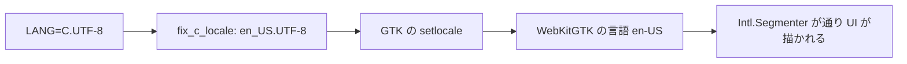

# S134 Desktop の C.UTF-8 の白画面

| | |
| --- | --- |
| セッション | S134 |
| 日付 | 2026-11-03 |
| ブランチ | `feature/s134-desktop-lang-c-fix` |
| Phase | P4 |
| スライド | [slides.html](slides.html) |
| 作業記録 | [log/work/2026-11-03-desktop-lang-c-fix.md](../../../log/work/2026-11-03-desktop-lang-c-fix.md) |

## 1. 目的

[S125](../S125-ui-bench-harness/解説書.md) で見つけた製品の不具合を直す。Linux の Desktop（Tauri + WebKitGTK）をランナーの既定の locale で起動すると、CodeMirror（`@codemirror/commands`）の `Intl.Segmenter` が `RangeError: invalid language tag: C` を投げ、module の評価が止まって UI が白画面になる。S125 は測定の段に `LANG=en_US.UTF-8` を足して避けただけだった。P4 の「使える流れ」の不具合。

## 2. 決定と理由

判断の正典は [ADR-0023](../../adr/0023-desktop-and-web-process-layout.md) の「S134 で決まったこと」。

| 項目 | 決定 | 理由 |
| --- | --- | --- |
| 原因 | locale が `C.UTF-8` のとき WebKitGTK の既定の言語が `C` になる | WebKit は `C`・`POSIX` そのものは `en-US` にするが、`C.UTF-8` は `.` 以降を落とすだけ（[LanguageUnix.cpp](https://github.com/WebKit/WebKit/blob/main/Source/WTF/wtf/unix/LanguageUnix.cpp)、確認日 2026-11-03） |
| 直し方 | (b) Rust の `main` の最初の `fix_c_locale` | (a) UI で包むと、CodeMirror の `Intl.Segmenter` のほかに uPlot の `Intl.NumberFormat`・`Intl.DateTimeFormat`（どれも module の評価のとき）も包むことになる。(b) は言語の根で直す |
| 替える変数 | 効いているもの（`LC_ALL`、無ければ `LC_CTYPE`、無ければ `LANG`）だけ | 上書きの順を崩さない。`C.`・`POSIX.` で始まるときだけ替え、利用者の locale には触らない |
| 替える値 | `en_US.UTF-8` | 入っていない環境でも `setlocale` が失敗して `C` になり、WebKit が `en-US` にする |

## 3. 図



## 4. 再現手順

```bash
git push -u origin feature/s134-desktop-lang-c-fix
gh workflow run desktop.yml --ref feature/s134-desktop-lang-c-fix
gh run list --workflow desktop.yml --limit 3 --json databaseId,headSha,status,conclusion
```

検証の結果:

- `desktop.yml` の UI の測定（Linux）から S125 の `LANG: en_US.UTF-8` を外し、ランナーの既定の locale（段の最初に表示: RUNLOCALE）のまま `GM-SMOKE check=ok simulate=ok … msl=ok` が 3 回出た（run RUNID）。
- 手元には webkit2gtk が無いので desktop の `cargo check` は回さず、`rustfmt --check` だけ。clippy は `desktop.yml` で回る。
- UI（`src/Svelte`）は変えていないので `test_ui.py` は回していない。

## 5. 次回

- 実機（Debian・Ubuntu の `C.UTF-8` の環境）での確認。
- 署名と自動更新は別の WP。
