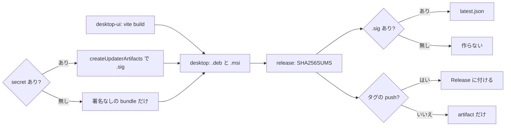

# S135 Desktop の自動更新

| | |
| --- | --- |
| セッション | S135 |
| 日付 | 2026-11-03 |
| ブランチ | `feature/s135-desktop-updater` |
| Phase | P4 |
| スライド | [slides.html](slides.html) |
| 作業記録 | `log/work/2026-11-03-desktop-updater.md` |

## 1. 目的

[features.md](../../features.md) の Desktop の行の「署名と自動更新は未」。Tauri 2 の updater プラグインで、Release に付けた .deb・.msi から自動で入れ直せるようにする。署名は secret があるときだけ行う（[S106](../S106-android-release-apk/解説書.md) の Android と同じ流儀）。鍵は作らず、コミットもしない（[roadmap.md](../../roadmap.md) の P4、[ADR-0023](../../adr/0023-desktop-and-web-process-layout.md) の S135）。

## 2. 決定と理由

| 項目 | 決定 | 理由 |
| --- | --- | --- |
| プラグイン | `tauri-plugin-updater` 2.14（Apache-2.0 OR MIT）。`cfg(not(any(target_os = "android", target_os = "ios")))` の依存、権限は `capabilities/desktop.json`（`platforms` を Linux・Windows・macOS） | 公式の手引きの形。Android の lib（同じ `Cargo.toml`）に入れない |
| Linux の形式 | .deb のまま | 手引きは AppImage しか書いていないが、プラグインは 2.1 で .deb、2.10 で全形式に対応した（CHANGELOG）。`latest.json` のキーは `<os>-<arch>-<installer>` を先に引き、.deb は `pkexec dpkg -i` で入れる（`updater.rs`） |
| 公開鍵 | `tauri.conf.json` の `plugins.updater.pubkey`（今は空）にユーザーが書く | 公開鍵は秘密ではない。手引きの形。空のビルドは `main.rs` がプラグインを入れず、command `updater_configured` が偽 |
| UI | `TauriBackend.checkUpdate()` とボタン「更新を確認」（`{#if desktop}` の中、ブラウザ・Android では出ない） | 結果をボタンの文に出す（未設定・最新・失敗、更新があれば確かめてから入れる） |
| JS | npm の `@tauri-apps/plugin-updater` を入れず `window.__TAURI__.updater` | 既存の `tauri-backend.ts` は `withGlobalTauri` の注入だけを使い npm を増やさない方針。プラグインは `global_api_script_path("./api-iife.js")` を持つ |
| 配布 | `release.yml` に `desktop-ui`・`desktop`（.deb・.msi）を足し、`release` が待つ | Release に付けるのは `release.yml` だけ。`desktop.yml` は smoke と試験のまま触らない |
| 版 | タグの push では `--config` で `version` をタグに合わせる | updater は版を比べる。`tauri.conf.json` の 0.0.1 のままだと更新が出ない |
| 署名 | job の `env` に secret を写し、`TAURI_SIGNING_PRIVATE_KEY` が空でなければ `--config` で `createUpdaterArtifacts: true` | secret は `if:` に書けない。鍵が無いのに `true` だと tauri-cli が失敗する |
| `latest.json` | ジョブ `release` が `.sig` の中身と Release の URL から作る（`.sig` が無ければ作らない） | `endpoints` は `releases/latest/download/latest.json`（prerelease は対象外） |
| `cargo deny` | desktop の `deny.toml` の `allow` に CDLA-Permissive-2.0 | `reqwest` 経由の `webpki-root-certs`。ルートの [licenses.md](../../licenses.md) では S053 から許可済み |

## 3. 図



## 4. 鍵の作り方と secret の登録（ユーザーがやること）

鍵はこのセッションでは作らず、コミットもしない。出典は [Tauri: Updater](https://v2.tauri.app/plugin/updater/)（確認日 2026-11-03）と [GitHub: Using secrets in GitHub Actions](https://docs.github.com/en/actions/security-for-github-actions/security-guides/using-secrets-in-github-actions)（確認日 2026-11-03）。

```bash
# 1. 鍵を作る（リポジトリの外に置く。パスワードを聞かれる）
cargo tauri signer generate -w ~/.tauri/globemode.key
# 2. secret を登録する
gh secret set TAURI_SIGNING_PRIVATE_KEY < ~/.tauri/globemode.key
gh secret set TAURI_SIGNING_PRIVATE_KEY_PASSWORD     # 対話で入れる
# 3. 公開鍵（~/.tauri/globemode.key.pub の中身）を tauri.conf.json の plugins.updater.pubkey に書いてコミットする
# 4. タグを push すると Release に .deb・.msi・.sig・latest.json が付く
```

- 秘密鍵を失うと、それまでに配ったアプリに更新を届けられない（Tauri の手引き）。鍵とパスワードはリポジトリの外に控える。
- 公開鍵を書いた版より前のアプリ（`pubkey` が空）は「未設定」のまま更新を確かめない。最初の 1 回は手で入れ直す。

## 5. 再現手順

```bash
gh workflow run release.yml --ref feature/s135-desktop-updater   # 手動実行は dry-run（Release を作らない）
gh run download <run-id> -n globe-desktop-linux
gh run download <run-id> -n globe-desktop-windows
gh run download <run-id> -n SHA256SUMS
```

検証の結果:

- `cargo deny --manifest-path src/Rust/apps/desktop/Cargo.toml --config src/Rust/apps/desktop/deny.toml check`: advisories・bans・licenses・sources とも ok。desktop の `Cargo.lock` に 48 パッケージ（新しい版を含む）
- `cargo fmt --check`（desktop）: ok。手元に webkit2gtk が無いので `cargo check`・clippy・Tauri のビルドは CI に任せる
- `pnpm check`: 0 errors・0 warnings（main の `App.svelte` の `FILE`（S125 と S127 の merge で残った名前）を `file` に直した）
- `latest.json` の生成の段: `.sig` のある .deb と無い .msi を置いて回し、`linux-x86_64-deb` だけが出ること、`.sig` が無ければ作らないことを手元で確かめた
- `release.yml` の dry run: この環境ではエージェントが `gh workflow run release.yml` を回せなかった（権限の確認で止まった）。親が回して、run id と artifact を作業記録に足す

## 6. 次回

- 鍵と secret を登録し、タグの Release から実機で更新する（Linux は pkexec の確認、Windows は passive の msi）
- Desktop の THIRD-PARTY.md（`release.yml` の `third-party` は CLI と wheel だけ）
- macOS の bundle
