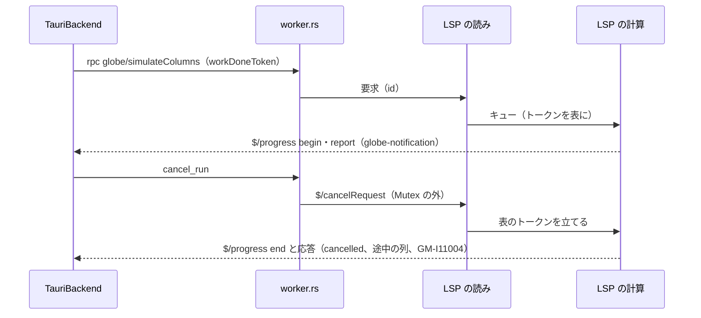

# S136 進捗と中断の LSP と Desktop の段

| | |
| --- | --- |
| セッション | S136 |
| 日付 | 2026-11-03 |
| ブランチ | `feature/s136-progress-cancel-lsp` |
| Phase | P7 |
| スライド | [slides.html](slides.html) |
| 作業記録 | [log/work/2026-11-03-progress-cancel-lsp.md](../../../log/work/2026-11-03-progress-cancel-lsp.md) |

## 1. 目的

[ADR-0033](../../adr/0033-progress-and-cancel.md) の実装の順の 5（最後の段）。`globe lsp` の `globe/simulate`・`globe/simulateColumns` に進捗（`$/progress`）と中断（`$/cancelRequest`）を入れ、Desktop の UI（S133 の進捗の行と「止める」）を sidecar の道でも動かす。ユーザーの方針は「先に全体の流れとして使えるアプリを完成させる」で、Desktop でも長い実行を止められることが目的。

## 2. 決定と理由

| 項目 | 決定 | 理由 |
| --- | --- | --- |
| スレッドの形 | `run_stdio` は `serve(server, input, out)` を呼ぶだけ。`serve` は読みのスレッドを立て、`mpsc` のキューに積む。計算と書き出しは元のスレッドで 1 度に 1 つ | 書き手が 1 つで済み、`Server` を別のスレッドへ動かさない。ADR-0023 の直列も変わらない |
| 中断の表 | 読みのスレッドが実行の要求を読んだ時点で `CancelToken` を作り、id（JSON の文字列）をキーに `Arc<Mutex<HashMap>>` へ置く。`$/cancelRequest` はキューに積まずに立てる | キューで待っている要求にも効く。計算のスレッドは終わったら表から消す |
| 進捗のトークン | 要求の params の `workDoneToken`（クライアントが作る）があるときだけ `$/progress` を出す | ADR の決定 (3)。サーバが作るトークン（`window/workDoneProgress/create`）は応答の往復が要り、今の読みと計算の分け方では待ちが増える |
| report の値 | `message`（段）と `percentage`（t のあるときだけ、(t − start) / (stop − start) × 100）に、`stage`・`time`・`start_time`・`stop_time` を添える | Desktop の UI の `Progress` をそのまま渡せる。LSP のクライアントは知らない欄を無視する |
| `Server::handle` | `handle_with(msg, cancel, notify)` の包みにして残す | 同期の試験（17 本のうち 16 本）を変えない |
| Desktop の中断 | `worker.rs` に `Canceller` と command `cancel_run` | 実行中は `Worker` の `Mutex` が握られていて、`notify` からは送れない。依頼では `src/Rust/apps/desktop` を触らない見込みだったが、ここを触らずには止められないので最小限で足した |
| 応えないとき | `$/cancelRequest` から 2 s（`CANCEL_GRACE`）で sidecar を kill し、次の要求で作り直す | ADR の表の Desktop の行。ネイティブの型付きの道（既定の `auto`）の積分の中と lowering は見られない |

## 3. 図



## 4. 再現手順

```bash
export CARGO_TARGET_DIR=$PWD/../target-shared CARGO_BUILD_JOBS=2
cargo test -p globe-mode-lsp            # 17 本。cancel_request_stops_a_long_run_with_partial_columns が新しい
cargo build -p globe-mode-cli           # globe
# Desktop の worker.rs は desktop.yml の cargo test（GLOBE_BIN）で回る
(cd src/Svelte && pnpm check)
```

- 新しい試験は `std::io::pipe` で `serve` を回し、`der(x) = sin(100 * time)` を 1e5 s（esdirk34。1000 s では止める前に終わることがあった）の `globe/simulateColumns` を送って、t > 1（出力の間隔）の最初の `report` を待ってから `$/cancelRequest` を送る。`begin` で始まり `end` の後に応答が来て、`termination` が `cancelled`、診断に `GM-I11004`、列の最後の時刻が 1 以上 1e5 未満。
- Desktop の `worker.rs` の `canceller_stops_a_long_simulate` は、手元では `worker.rs` を `#[path]` で読む使い捨ての crate で回して 4 本通った（Tauri を組まずに済むため）。

## 5. 次回

- Desktop の既定のソルバ（`auto`）では積分の中の t と中断が出ない（段の境目か 2 s 後の作り直し）。session の道をネイティブの既定にする案は ADR-0033 の持ち越しのまま。
- CodeMirror と LSP の直接の接続、wasm で止めたときの途中の列。
