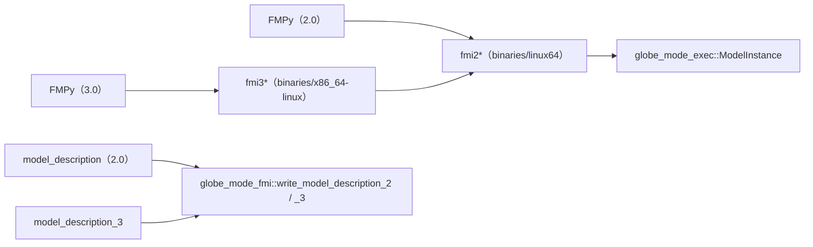

# S137 自前の FMU で FMI 3.0 の ME も出す（P5b の 6 回目）

| | |
| --- | --- |
| セッション | S137 |
| 日付 | 2026-11-03 |
| ブランチ | `feature/s137-fmu-runtime-fmi3` |
| Phase | P5（P5b） |
| スライド | [slides.html](slides.html) |
| 作業記録 | [log/work/2026-11-03-fmu-runtime-fmi3.md](../../../log/work/2026-11-03-fmu-runtime-fmi3.md) |

## 1. 目的

- `globe-mode-fmu`（S095〜S114、FMI 2.0 ME）と `write_model_description_3`（[S124](../S124-fmi3-writer/解説書.md)、EventIndicator は `Err`）の持ち越し。同じ cdylib で FMI 3.0 の ME も出す。
- 2.0 と同じ `ModelInstance` を使い、2.0 の関数を形だけ変えて呼ぶ。
- CS、Windows・macOS の FMU、MSL を使うモデル、Enumeration・String、`dependencies` は範囲の外。

## 2. 決定と理由

詳細は [ADR-0032](../../adr/0032-p5b-own-runtime.md) と [ADR-0031](../../adr/0031-fmi-export-p5a-first.md) の追記（S137）。

| 項目 | 決定 | 理由 |
| --- | --- | --- |
| cdylib | `fmi2*` と `fmi3*` を同じ `globe_mode_fmu.so` から出す | 名前が衝突しない。FMU の置き場だけ `binaries/linux64/` と `binaries/x86_64-linux/` で分かれる |
| 3.0 の関数 | 2.0 の関数を呼ぶ包み（Instantiate の中身は共有、`EnterInitializationMode` は `SetupExperiment`、`UpdateDiscreteStates` は `NewDiscreteStates`） | 実装を 2 つ持たない。`fmi3Boolean` は C の `bool` なので Rust の `bool` で受ける |
| `resourcePath` | `file:` があれば外し、無ければそのままのパスとして読む | 3.0 は URI でなくパスを渡す |
| 残りの関数 | `fmi3FunctionTypes.h` の 75 関数をすべて出し、ME に要らない 49 関数は引数を宣言しない `fmi3Error` の stub（マクロ）。CS・SE の Instantiate は NULL | S098 で FMPy が関数を引けずに落ちた経緯から、全部の名前を出す。C の呼び出し規約では呼び手が引数を片付けるので、読まない引数は宣言しなくてよい |
| `FMI3_OVERRIDE_FUNCTION_PREFIX` | 関係しない | C のヘッダで `<modelIdentifier>_` を付けるかの切り替え。Rust の `#[unsafe(no_mangle)]` は接頭辞の無い名前で出す |
| EventIndicator | 値参照 `2n+p+q..` に Float64 の変数 `_eventIndicator1..` を足し、`ModelStructure` の `EventIndicator` から指す | 3.0 の `EventIndicator` は変数の valueReference を指す。`fmi3GetFloat64` で読める |
| `time` | 3.0 だけ independent の `time` を EventIndicator の次に置く | FMPy の validate が `Exactly one independent variable must be defined.` で落ちた |
| `globe-mode-fmi` | `ModelStructure` に `event_indicators` を足し、`write_model_description_3` は数が `number_of_event_indicators` と違うときだけ `Err` | 2.0 の読み書きは変えない |
| 試験 | `tests/fmpy.rs` の FMPy の試験を `for v3 in [false, true]` で 2.0・3.0 の両方に回す。`fmpy_run.py` の 7 番目の引数が FMI の主版 | 既存の道に引数を 1 つ足すだけ |

## 3. 図



## 4. 再現手順

```bash
export CARGO_TARGET_DIR=…/.git-worktree/target-shared CARGO_BUILD_JOBS=2
cargo test -p globe-mode-fmi -p globe-mode-fmu
cargo test -p globe-mode-fmu --test fmpy -- --nocapture
```

FMPy 0.3.32 の ME（CVode）。3.0 の値は 2.0 と全桁で同じ。

| モデル | 3.0（= 2.0）の終了時刻の値 | 比べた相手 | 差 |
| --- | --- | --- | --- |
| Decay | x(1) = 0.3678794150955906 | 解析解 e^-1 | 2.6e-8 |
| HarmonicOscillator | x(1) = -0.41614683955697307、v(1) = -1.818594856574809 | exec（bdf）-0.4161468121809279、-1.8185947093271577 | 2.7e-8、1.5e-7 |
| BouncingBall（状態事象・`reinit`） | h(2) = 0.26073984246749315、v(2) = -0.16588584207712853、n = 3、Event Mode 6 回・reinit 3 回 | exec 0.26074169044319206、-0.1658694813220666、n = 3 | 1.8e-6、1.6e-5 |
| SampleCounter（時刻事象） | x(1) = 1.0、n = 10（Int32）、xs = 0.9500000000000001、Event Mode 10 回 | exec 0.9999999999999998、10、0.9499999999999997 | 2e-16、4e-16 |
| NonlinearLoop（代数変数） | y = 1.9999999999999991、z = 4.000000000000001 | exec 2.0、4.0 | 9e-16 |
| InputDecay（入力の階段） | x(1) = 1.1548180654142353、y(1) = 2.3096361308284705 | 解析解 1.1548181217461755、2.309636243492351 | 5.6e-8、1.1e-7 |

- `cargo test -p globe-mode-fmu --test fmpy`: 11 件成功・失敗 0（FMPy の 6 本はそれぞれ 2.0・3.0 の 2 回、738.6 s、`--test-threads 3`）。

- `validate_fmu` は 3.0 の 6 モデルとも問題なし（`time` を足す前は 6 本とも `Exactly one independent variable must be defined.`）。
- `model_description_3_lists_event_indicators`: BouncingBall の 3.0 の XML で `der(h)` の `derivative="0"`、`ContinuousStateDerivative valueReference="2"`、`EventIndicator` が `_eventIndicator1` を指す。
- `globe-mode-fmi` の `fmi3_round_trips_through_the_writer`: `EventIndicator` を足した XML が読み→書き→読みで同じ `ModelDescription` になり、数が合わなければ `Err`。

## 5. 次回

- CS（2.0・3.0）、Windows・macOS の FMU（P5a の `--target` に当たるもの）。
- MSL を使うモデル、Enumeration・String、`Outputs` の `dependencies`、Integer・Boolean の書き込み、初期化が入力に依るモデル。
