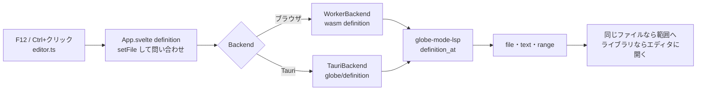

# S138 エディタから定義ジャンプ

| | |
| --- | --- |
| セッション | S138 |
| 日付 | 2026-11-03 |
| ブランチ | `feature/s138-ui-editor-lsp` |
| Phase | P4（使える流れ。[features.md](../../features.md) の「Text ビュー」と「補完・定義ジャンプ」の行の持ち越し） |
| スライド | [slides.html](slides.html) |
| 作業記録 | [log/work/2026-11-03-ui-editor-lsp.md](../../../log/work/2026-11-03-ui-editor-lsp.md) |

## 1. 目的

[S132](../S132-lsp-definition/解説書.md) で `globe lsp` に入れた定義ジャンプを、ブラウザと Tauri の CodeMirror 6 のエディタから使えるようにする。F12 か Ctrl/Cmd+クリックで、同じファイルなら範囲へ動き、ライブラリのファイル（MSL）なら [S127](../S127-ui-library-tree/解説書.md) と同じく同じ名前の文書としてエディタに開く。補完は [S053](../S053-fmt-lint-completion/解説書.md) のまま。LSP の全機能を流す汎用のクライアントは足さない。

## 2. 決定と理由

| 項目 | 決定 | 理由 |
| --- | --- | --- |
| 口 | `Backend.definition(file, line, character)` を 1 つだけ足す。返す形は `{file, text, range}`（`text` は定義のあるファイルの本文、`range` は LSP の Range） | ライブラリのファイルを開くには本文が要る。Tauri では UI がディスクを読めないので、LSP の `Location`（uri と範囲）だけでは足りない |
| Tauri | sidecar の新しい要求 `globe/definition`（`{file, line, character}`）。解決は `textDocument/definition` と同じ `Resolver` | `globe/libraryTree` などと同じ流儀。`textDocument/definition` は VS Code 用にそのまま残す |
| wasm | `Workspace.definition(file, text, line, character)`。`globe-mode-lsp` の `definition::definition_at` を呼ぶ | `globe-mode-lsp` は wasm32 でそのままビルドできた。定義の核を facade や fmt へ動かすより、`Resolver` に「ファイル名から本文を読む関数」`read` を 1 つ足すだけで済む（LSP はディスク、wasm は読み込んだ組） |
| 依存 | `globe-mode-wasm` から `globe-mode-lsp`（内部の crate）へ。外部の crate は足さない | wasm は facade・fmt だけに依存する決まり（S035）の例外を 1 つ。理由は上 |
| 文書の本文 | `GlobeWorker`（`client.js`）が覚えている `setFile` の本文を渡す | `Backend` の口は (file, line, col) のまま。UI は呼ぶ前に `setFile` して `Outline` を最新にする |
| エディタ | `modelicaDefinition`（`editor.ts`）が F12 と Ctrl/Cmd+クリックを受け、位置を `jump(line, character)` に渡すだけ。引いて動かすのは `App.svelte` | 業務ロジックを UI に置かない。CodeMirror の列は UTF-16 で LSP と同じなので換算は無い |
| ライブラリのファイルを開く | `openLibrary` と同じく、同じ名前の文書としてエディタに入れる。入る前の文書と位置は積み、Alt+← で戻る | エディタは 1 文書なので、入ると自分の文書が見えなくなる。積んでおけば失われない |
| カーソル | 範囲を選び、head（カーソル）は宣言の頭に置く | クラスの範囲は `end Resistor;` まで。末尾に置くと宣言が画面の外に出る |
| アクティブ行 | `highlightActiveLine()` を足す | どこへ動いたかが見える。試験も行で確かめる |

shortcut: Alt+← の戻りは 1 本の積み（進むは無い）。モデル名は、ライブラリのファイルへ入っても変えない（定義のクラスの完全修飾名は返していないので）。

## 3. 図



## 4. 再現手順

```bash
export CARGO_TARGET_DIR=…/.git-worktree/target-shared CARGO_BUILD_JOBS=2
cargo test -p globe-mode-lsp -p globe-mode-wasm
mise run wasm:build && mise run wasm:node
cd src/Svelte && pnpm check && pnpm build && cd ../..
uv run python src/Svelte/tests/test_ui.py    # data/msl があれば MSL も
```

- `globe_definition_returns_the_target_file_text`（lsp）: `Components.Resistor` の上で `{file: …/Components.mo, text, range}`、予約語は null。
- `definition_jumps_into_the_library_file`（wasm）: 同じ入力で wasm の `definition` が同じ形を返す。
- `test_ui.py`: Decay の `der(x)` の `x` で F12 を押すと `Real x(start …` の行へ。ChuaCircuit のファイルで `Modelica.Electrical.Analog.Basic.Resistor` の上の F12 で `model Resistor` のファイルが開き、Alt+← で ChuaCircuit に戻る。

数字は [作業記録](../../../log/work/2026-11-03-ui-editor-lsp.md) にある。

## 5. 次回

- ホバー（LSP には既にある。UI は未）、参照・リネーム・inlay hint。
- ライブラリのファイルへ入ったときのモデル名（定義のクラスの完全修飾名を返す）、複数の文書（タブ）。
- 受け継いだ入れ子のクラス・コメントの中の名前（S132 の shortcut のまま）。
- ダークモード。
