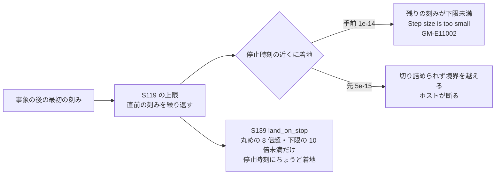

# S139 sim-sdirk-regression

| | |
| --- | --- |
| セッション | S139 |
| 日付 | 2026-11-03 |
| ブランチ | `feature/s139-sim-sdirk-regression` |
| Phase | P3（実行系） |
| スライド | [slides.html](slides.html) |
| 作業記録 | [log/work/2026-11-03-sim-sdirk-regression.md](../../../log/work/2026-11-03-sim-sdirk-regression.md) |
| 前のセッション | [S126](../S126-msl-solvers-refresh/解説書.md) の持ち越し、[S119](../S119-sim-thyristor-event-cost/解説書.md) |

## 1. 目的

[S126](../S126-msl-solvers-refresh/解説書.md) が見つけた疑い。S119 の後、session の道の SDIRK（`esdirk34`・`esdirk45`・`sdirk34hw`）で `HBridge_TrianglePWM_RL`・`HBridge_DC_Drive` が `GM-E11002`、`sdirk34hw` の `ThyristorBridge2Pulse_DC_Drive` が `GM-E11003` に変わった。原因が S119 の「事象のあとの最初の刻みの上限」かを、上限を切り替えられる形で前後を回して決め、原因なら直す。ThyristorBridge 2 本の改善は失わない。

## 2. 決定と理由

| 項目 | 決定 | 理由 |
| --- | --- | --- |
| 原因の判定 | S119 の上限が原因。`HBridge_TrianglePWM_RL`（`esdirk34`・`--tolerance 1e-7 --stop-time 1`）は、上限あり: t = 0.2689999999999885 で `GM-E11002`、上限なし: 完走（受理 4,014 歩）。`sdirk34hw`・`esdirk45` も同じ（上限あり: 「accepted step reached t=0.3340000000000077 past the host bound t=0.33400000000000024」、上限なし: 完走）。`HBridge_DC_Drive`（`esdirk34`、0〜24 s）は上限あり: t = 3.7139999999999005 で `GM-E11002` | 上限を環境変数で一時的に切って（コミットしていない）同じバイナリで比べた |
| 仕組み | 上限は事象のあとの最初の刻みを「直前の刻み」に揃える。直前の刻みは出力の格子（0.2 ms など）に合わせて切り詰められた値なので、同じ値（誤差を含む）が繰り返される。その刻みが停止時刻（ホストが渡す次の境界。例 0.269）の手前 1.15e-14 に着地すると、残りの刻みが `min_timestep`（1.2e-14）を下回って diffsol が `Step size is too small`。先 5.3e-15 に着地すると、diffsol が切り詰める範囲（`100·eps·(\|t\|+\|h\|)`）の内側なので切り詰められず、ホストの境界を越えて落ちる。上限なしでは見積もりの刻みが大きく、diffsol が停止時刻にちょうど着地するよう切り詰めるので起きなかった | 失敗した時刻と `停止時刻 - 時刻` の差から確かめた |
| 直し方 | `advance` で `set_stop_time(latest)` の直後に、刻みが停止時刻の手前か先の「丸めの 8 倍より大きく、`min_timestep` の 10 倍未満」の隙間に着地するときだけ、刻みを `latest - t`（ちょうど着地）にする（`land_on_stop`。`rk.rs`） | 上限の側を変える案（直前の刻みの数倍にする、など）は、隙間を作る原因（刻みの繰り返し）を残す。着地の側を直すと上限の効き方（棄却の減り方）は変わらない |
| 最初に入れた版は捨てた | 丸めの 8 倍以下でも刻みを `latest - t` に直す版（隙間 0 のときも書き込む）は、`ThyristorBridge2mPulse_DC_Drive`（`esdirk34`、0〜2 s）が t = 0.0383 で `GM-E11003`（事象の反復が収束しない）になった。診断では隙間はほとんど 0（`diffsol` が停止時刻へ切り詰めた刻み）で、`latest - t` と元の刻みの差は 1 ulp 程度。それでも事象の反復は 1 ulp の違いで収束したりしなかったりした | 隙間が丸めの数 ulp 以下なら何もしない条件を足して、S119 と同じ数値に戻した |
| 対象 | `DiffsolRk` の `advance` 全体（SDIRK だけでなく陽的 RK も通る）。ただし隙間の条件は上限を使う SDIRK で起きる大きさだけに絞っているので、陽的 RK の数字は変わらない見込み（`wasm:compare` で確かめた） | 条件の外では刻みを書き換えない |
| 文書 | [ADR-0013](../../adr/0013-exec-backend.md) の「結果」に追記した | session の道の積分器の性質で、予算の規則（ADR-0017）は変えていない |

### 2.1 手元の前後（release、`--tolerance 1e-7`、`GM_PROF` の一時の計測で数えた）

誤差の検査・Newton 法の失敗は、`DiffsolRk` の統計を受理のたびに読み、作り直しで戻る所で合計した値（S119 の表とは数え方が違い、絶対値は比べない。受理した歩数は S119 の表と一致した: 2mPulse の S119 は 58,254 歩）。

| モデル・ソルバ・区間 | 上限なし（S119 の前） | 上限あり・直す前（S119） | 直した版 |
| --- | --- | --- | --- |
| `HBridge_TrianglePWM_RL` esdirk34 0〜1 s | 完走・受理 4,014・誤差の失敗 0 | **`GM-E11002`**（t = 0.2689999999999885） | 完走・受理 9,109・誤差の失敗 402 |
| 同 sdirk34hw 0〜1 s | 完走・受理 4,014 | **境界を越えて失敗**（t = 0.3340000000000077） | 完走・受理 5,511・誤差の失敗 0 |
| 同 esdirk45 0〜1 s | 完走・受理 4,014 | **境界を越えて失敗**（同上） | 完走・受理 5,511・誤差の失敗 0 |
| `HBridge_DC_Drive` esdirk34 0〜24 s | 未測定（24 s を回さなかった） | **`GM-E11002`**（t = 3.7139999999999005、受理 102,368 歩の所） | 積分は終了時刻 24 s まで通った（受理 279,600 歩、誤差の失敗 0）。CSV の書き出しだけ `/tmp` の満杯（os error 28）で失敗した |
| `ThyristorBridge2mPulse_DC_Drive` esdirk34 0〜2 s | 受理 57,602・誤差の失敗 19,946・Newton の失敗 7,532 | 受理 58,254・誤差の失敗 11,221・Newton の失敗 4,865 | **同じ**（受理 58,254・11,221・4,865） |
| `ThyristorBridge2Pulse_DC_Drive` esdirk34 0〜2 s | 受理 33,382・誤差の失敗 5,699・Newton の失敗 3,428 | 受理 33,605・誤差の失敗 4,032・Newton の失敗 2,513 | **同じ**（33,605・4,032・2,513） |

- 直した版の ThyristorBridge 2 本は、上限ありの版（S119）と受理・誤差の失敗・Newton の失敗がすべて同じ。S119 の改善（誤差の検査の失敗 2mPulse -44%、2Pulse -29%。この数え方で）は失っていない。
- `HBridge_TrianglePWM_RL` は上限のせいで歩数が増える（esdirk34 で 4,014 → 9,109）。これは上限の効き方で、S139 では直していない（0.1 s の短い例題で、費用の問題は無い）。

### 2.2 ThyristorBridge の `GM-E11003`（sdirk34hw）は S119 だけが原因ではない

| 実行（0〜2 s、`--tolerance 1e-7`） | 結果 |
| --- | --- |
| `ThyristorBridge2mPulse_DC_Drive` sdirk34hw、上限なし | t = 0.1017 で `GM-E11003` |
| 同、上限あり（S119、直した版も同じ） | t = 0.0783 で `GM-E11003` |
| `ThyristorBridge2Pulse_DC_Drive` sdirk34hw、上限なし・あり・直した版 | どれも 2 s まで完走（CI の 15 s では再現していない） |

`sdirk34hw` は上限なしでも 2mPulse で事象の反復が収束しない（`GM-E11003`）。事象の反復は刻みの 1 ulp の違いで収束したり落ちたりする（2.の「最初に入れた版」）ので、2Pulse の `GM-E11003` は上限の 1 つの原因ではなく、事象の反復の揺れ（Rumoca の host の `EventIteration`）に刻みの違いが当たったものと見る。手元の 2 s では 2Pulse は再現しないので、15 s の CI の結果（第 5 章）で確かめる。

## 3. 図



## 4. 再現手順

```bash
# worktree で（data/msl は main の取得物への symlink）。GM_NO_LAST_STEP・GM_PROF は一時の計測で、コミットしていない
CARGO_TARGET_DIR=.../target-shared CARGO_BUILD_JOBS=2 cargo build --release -p globe-mode-cli
globe simulate -L data/msl \
  -m Modelica.Electrical.PowerConverters.Examples.DCDC.HBridge.HBridge_TrianglePWM_RL \
  --solver esdirk34 --tolerance 1e-7 --stop-time 1 -o out.csv
# 直す前の版（S119）は t = 0.2689999999999885 で GM-E11002。上限を切った版と直した版は完走
cargo test -p globe-mode-exec -p globe-mode-sim
mise run wasm:compare
gh workflow run msl-sim.yml --ref feature/s139-sim-sdirk-regression -f 'solvers=["esdirk34","sdirk34hw"]'
gh run download <run-id> -n msl-sim
```

## 5. CI の結果

`msl-sim.yml` run [41666815770](https://github.com/asari300/20261018_GlobeMode/actions/runs/41666815770)（`--ref feature/s139-sim-sdirk-regression`、`solvers=["esdirk34","sdirk34hw"]`、コミット `90d99ae`。後のコミットは `then_some` への書き換えと文書だけで数値は同じ）。ジョブ `msl-sim`・`split-all`・`solvers (esdirk34)`・`solvers (sdirk34hw)` は success。`doc/msl-sim.md`・`doc/msl-solvers.md` は全ソルバの run でないので置き換えていない（S055 の規則）。

| モデル | S126 の run 41616928442（S119 の上限、直す前） | S139 の run 41666815770 |
| --- | --- | --- |
| `HBridge_TrianglePWM_RL` esdirk34 | `GM-E11002` | 終了時刻まで・管 OK 7/7（0.83 s） |
| `HBridge_TrianglePWM_RL` sdirk34hw | `GM-E11002`（S126 の記録。手元では「host の境界を越えた」） | 終了時刻まで・管 OK 7/7（0.78 s） |
| `HBridge_DC_Drive` esdirk34 | `GM-E11002` | **`GM-E11005`**（時間切れ。予算 180 s で 180.85 s。`GM-E11002` ではなくなった） |
| `HBridge_DC_Drive` sdirk34hw | S126 の記録に無い（`GM-E11002` は esdirk34・esdirk45・sdirk34hw の合算の記述） | `GM-E11005`（180.85 s） |
| `ThyristorBridge2Pulse_DC_Drive` esdirk34 | 完走 | 終了時刻まで・管 OK 19/19（積分 45.3 s、計 47.0 s） |
| `ThyristorBridge2Pulse_DC_Drive` sdirk34hw | `GM-E11003` | **`GM-E11003` のまま**（t = 13.040017098 でイベントの反復が収束しない、64.35 s） |
| `ThyristorBridge2mPulse_DC_Drive` esdirk34 | 完走 | 終了時刻まで・管 OK 38/38（積分 156.8 s、計 160.4 s。予算 180 s の内） |
| `ThyristorBridge2mPulse_DC_Drive` sdirk34hw | S126 の記録に無い | `GM-E11005`（181.86 s） |

- 全体: `esdirk34` 実行できた 295・管 286 / 294（S126 の表は 294・285 / 293）、`sdirk34hw` 293・283 / 292（292・282 / 291）。どちらも `HBridge_TrianglePWM_RL` の 1 本ぶん増えた。
- `HBridge_DC_Drive` は直って先に進んだが、24 s の例題で 280 k 歩を要し、ランナーの予算 180 s を超える。`GM-E11002`（S119 の上限の副作用）は消えた。手元では 24 s まで積分が通った（CSV の書き出しだけ `/tmp` の満杯で失敗した）。
- `sdirk34hw` の `ThyristorBridge2Pulse_DC_Drive` の `GM-E11003`（t = 13.04）は直らなかった。手元の 0〜2 s では上限なしでも `sdirk34hw` が 2mPulse で `GM-E11003` になるので、上限の問題ではなく事象の反復の揺れ（第 2.2 節）。S119 の前の版に戻した 15 s の実行は回していないので、2Pulse が S119 の前から `GM-E11003` だったかは【未確認】。

## 6. 次回

- `sdirk34hw` の `GM-E11003`（事象の反復が収束しない）は上限なしでも 2mPulse で起きる。刻みの 1 ulp の違いで収束したりしなかったりするので、Rumoca の host の `EventIteration`（固定した `pre` で収束しない）の側を調べる。
- `--stop-time 0.5`・`1` で t = 0.0617 s に `GM-E11003`（S119 の持ち越し）も同じ種類の揺れの可能性がある【未確認】。
- `HBridge_TrianglePWM_RL` は上限で歩数が約 2 倍になる。上限の対象を事象の直後の 1 歩に限る案は、S119 の改善を落とさないかの測り直しが要る。
