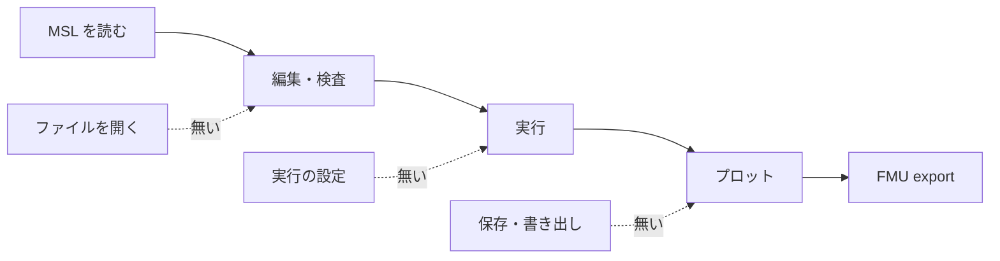

# S140 アプリの使える流れの点検

| | |
| --- | --- |
| セッション | S140 |
| 日付 | 2026-11-04 |
| ブランチ | `feature/s140-app-flow-audit` |
| Phase | P4・P6 |
| スライド | [slides.html](slides.html) |
| 作業記録 | [log/work/2026-11-04-app-flow-audit.md](../../../log/work/2026-11-04-app-flow-audit.md) |
| 調査 | [doc/research/app-flow-2026-11-04.md](../../research/app-flow-2026-11-04.md) |

## 1. 目的

ユーザーの方針「先に全体の流れとして使えるアプリを完成させる」に沿って、ブラウザ版・Tauri の Desktop・Android で「使える流れ」がどこまで通り、何が欠けているかを点検して表にし、次に埋める順を提案する。あわせて正典（[features.md](../../features.md)、[README.md](../../../README.md)、[roadmap.md](../../roadmap.md)）を S118〜S136 の成果に同期する。コードは触らない。

## 2. 決定と理由

| 項目 | 決定 | 理由 |
| --- | --- | --- |
| 判定の方法 | コードと試験を読んで判定する。`test_ui.py` は回さない | main に `dist/` が無く、wasm のビルドに cargo が要る。他の WP が Rust をビルド中で、cargo を回さない条件だった。CI の `ui` が回す |
| ○ の意味 | その列で自動試験が通る | 「コードがある」と「その列で動く」を分けるため。Desktop・Android の UI の操作は試験が無いので △ になり、△ の数がそのまま「UI の試験が足りない所」を示す |
| 段の数 | 23 | 依頼の流れ（起動から更新）に、持ち込み・持ち帰りの段（開く・保存・書き出し）と実行の設定を足した。点検で見つけたため |
| 埋める順 | 持ち込み・持ち帰りを先、ダークモードを最後 | 中核（MSL を読む・検査・実行・プロット）は 3 列とも通る。自分のモデルを開けず、保存も FMU の取り出しもできないと、使える流れにならない |
| 索引の並び | S 番号の降順に全行を並べ直した | S001〜S069 が昇順で末尾に、S070〜S136 が降順で先頭にあり、混ざっていた |
| README の「今後」の表 | 「定義ジャンプ」「整形の設定ファイル」の 2 行を直した | S130・S132 で済んでいるのに「無い」のままだったため |

## 3. 図



実線は 3 列とも通る段（FMU export は CLI と言語 API だけ）、点線は UI に無い段。

## 4. 再現手順

```bash
# 判定の根拠を読み直す（確認日 2026-11-04、main 1496d3d）
grep -n "onclick" src/Svelte/src/App.svelte                     # ボタンは 検査・実行・グラフ・整形・止める・MSL・更新 だけ
grep -n "generate_handler" -A9 src/Rust/apps/desktop/src/main.rs # Desktop の command に fs・dialog が無い
cat src/Rust/apps/desktop/capabilities/desktop.json              # updater:default だけ
grep -n "initialize" src/Rust/apps/desktop/src/worker.rs         # rootUri を渡さない
mise run ui:check                                                # ブラウザの試験（手元では未実行、CI の ui）
```

検証の結果（数字）:

- 23 段のうち ○ はブラウザ 11・Desktop 7・Android 4、△ は 3・7・10、× は 8・8・9、— は 1・1・0。
- 同期した文書: README（英語と日本語の状態の段落、「今後」の表の 2 行）、features.md（Text ビュー・FMU Export・複数ソルバの 3 行）、roadmap（S140 の節）、索引。

## 5. 次回

埋める順（[調査](../../research/app-flow-2026-11-04.md) の 4 章）の上位 5 つ。

1. ファイルを開く・保存: Desktop は dialog プラグイン（新しい依存。`/add-dependency`）と command、ブラウザ・Android は File System Access API か `<input type="file">` とダウンロード。先行して本文の自動保存。
2. 実行の設定の UI: `App.svelte` に小さなパネル。`SimulateRequest.settings` は既にある。
3. エディタの LSP 接続（補完・定義ジャンプ）: S138 が進行中。
4. FMU export の UI: Desktop は LSP に `globe/exportFmu` と 1 の保存。ブラウザは wasm の方針を ADR で決める。
5. Desktop が `globe-mode.toml` を読む: `initialize` に `rootUri`。1 の「フォルダを開く」に依存。

持ち越し: `test_ui.py` を回していない。Android の IME・タッチ・小画面と、Desktop の WebKitGTK・WebView2 で sigma の WebGL が描けるかは【未確認】。
