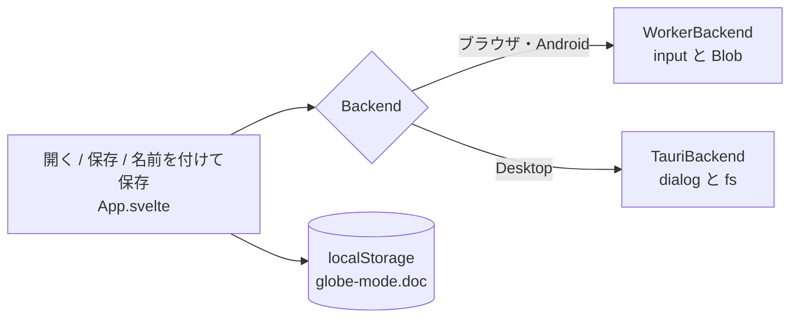

# S141 ファイルを開く・保存する

| | |
| --- | --- |
| セッション | S141 |
| 日付 | 2026-11-04 |
| ブランチ | `feature/s141-ui-file-open-save` |
| Phase | P4（使える流れ。S140 の点検（`doc/research/app-flow-2026-11-04.md`）の順位 1） |
| スライド | [slides.html](slides.html) |
| 作業記録 | [log/work/2026-11-04-ui-file-open-save.md](../../../log/work/2026-11-04-ui-file-open-save.md) |

## 1. 目的

UI に `<input type="file">`・ダウンロード・`localStorage` が 0 件で、Desktop にも fs / dialog の command が無かったため、自分のモデルを持ち込めず、持ち帰れなかった。ブラウザ・Desktop・Android の 3 列で「開く」「保存」を使えるようにする。

## 2. 決定と理由

| 項目 | 決定 | 理由 |
| --- | --- | --- |
| 口 | `Backend.openFile(): {name, text} \| null` と `saveFile(name, text, saveAs?): string \| null` | 計算の口と同じ場所に置けば、`App.svelte` は環境を知らずに済む |
| ブラウザ・Android | `<input type=file accept=".mo">`（DOM に付けて `change` / `cancel` を待つ）と、Blob のダウンロード（`lib/browser-file.ts`） | 依存が 0。Android は sidecar が無く `WorkerBackend` を使うので同じ道になる（[ADR-0023](../../adr/0023-desktop-and-web-process-layout.md)） |
| Desktop | 公式の `tauri-plugin-dialog` 2.8.4 と `tauri-plugin-fs` 2.7.1。UI は `window.__TAURI__.dialog` / `fs`（npm を足さない。S135 と同じ） | 公式で MIT OR Apache-2.0。dialog で選んだパスだけが fs の許可に入るので静的なスコープが要らない |
| 権限 | `dialog:allow-open`・`dialog:allow-save`・`fs:allow-read-text-file`・`fs:allow-write-text-file` だけ（`capabilities/desktop.json`） | 必要なものだけ。`generate_handler!` の command は足していない |
| 「保存」 | Desktop は開いた・保存したパスへ上書き（無ければ dialog）。「名前を付けて保存」は常に dialog | ブラウザは毎回ダウンロードなので、ボタンは「保存」だけ |
| 自動保存 | 本文とファイル名を `localStorage`（キー `globe-mode.doc`）へ。モデル名は保存せず、戻すときも本文から入れ直す（smoke が `model` を ChuaCircuit に書き換えると、保存したモデル名が次の起動の smoke を壊した。desktop.yml の UI の測定で見つかった）。`try/catch` で囲み、使えなくても動く（S102 の方針）。ライブラリのファイルを開いている間は保存しない | MSL のファイルが次回の起動で戻ると、ライブラリが無いまま開いてしまう |
| モデル名 | 開いた本文の先頭の `model` / `block` / `class` / `package` の名前を入れる | 既定の `Decay` のままだと検査が失敗する |
| 前のファイル | 名前が違えば、前のファイルを `setFile(前の名前, "")` で空にする | Workspace に残って同じクラスが二重になるのを避ける |

shortcut: File System Access API は使わない。ブラウザの「保存」は毎回ダウンロードで、同じファイルには上書きできない。モデル名の推定は字面の正規表現（`within` つきの完全修飾名は推定しない）。

## 3. 図



## 4. 再現手順

```bash
export CARGO_TARGET_DIR=…/.git-worktree/target-shared CARGO_BUILD_JOBS=2
mise run wasm:build
cd src/Svelte && pnpm check && pnpm build && cd ../..
uv run python src/Svelte/tests/test_ui.py
cargo deny --manifest-path src/Rust/apps/desktop/Cargo.toml --config src/Rust/apps/desktop/deny.toml check
gh workflow run desktop.yml --ref feature/s141-ui-file-open-save   # Linux の smoke（Tauri は手元でビルドしない）
```

- `test_ui.py`: ファイル選択で `Mine.mo` を開く、モデル名が `Mine` になる、検査が通る、「保存」のダウンロードが `Mine.mo` で内容が一致する、再読み込みで本文とモデル名が戻る。
- Desktop の dialog の操作そのものは自動では確かめていない（CI の smoke はプラグインが組み込まれて起動することまで）。

数字は [作業記録](../../../log/work/2026-11-04-ui-file-open-save.md) にある。

## 5. 次回

- File System Access API（Chromium で同じファイルへ上書き）。
- 複数の文書（タブ）、最近使ったファイル。
- Android の WebView でのダウンロードとファイル選択の実機確認（`accept=".mo"` が拡張子で絞れるか【未確認】）。
- FMU export の UI、実行の設定の UI（S142）、ダークモード。
