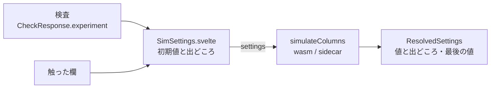

# S142 実行の設定の UI

| | |
| --- | --- |
| セッション | S142 |
| 日付 | 2026-11-04 |
| ブランチ | `feature/s142-ui-sim-settings` |
| Phase | P4（使える流れ。S140 の点検（`doc/research/app-flow-2026-11-04.md`。S140 のブランチにあり、main への取り込みは後）の順位 2） |
| スライド | [slides.html](slides.html) |
| 作業記録 | [log/work/2026-11-04-ui-sim-settings.md](../../../log/work/2026-11-04-ui-sim-settings.md) |

## 1. 目的

UI の「実行」は `{model}` だけを渡していて、ソルバも終了時刻もパラメータも変えられなかった。`SimulateRequest.settings`（`SimSettings`）は S011〜S015 からあるので、実行は変えずに UI の部品で決められるようにする。experiment annotation の値は、出どころ（[`SettingOrigin`](../../architecture.md)）つきで初期値に出す。

## 2. 決定と理由

| 項目 | 決定 | 理由 |
| --- | --- | --- |
| 部品 | `SimSettings.svelte`。ソルバ・終了時刻・許容誤差・出力の間隔・パラメータの上書き（1 行に `名前=値`） | 依頼の項目。開始時刻・固定刻み・壁時計の予算は持ち越し |
| ソルバの一覧 | `Backend.solvers()`。wasm は既存の `solvers`（`client.js` に口があった）、sidecar は `globe/solvers` を 1 つ足した | 登録表（`globe-mode-sim::solvers`）を UI に写さない。`status.kind` が `available` のものだけ選べる |
| experiment の値 | `CheckResponse.experiment`（`ExperimentValues`、`Option<f64>` が 4 つ）。annotation が無ければ項目ごと出ない | S10 の `ExperimentVerdict` は判定だけで値を持たない。facade の `check` が `check.preflight.experiment` から写すだけで、解析は変えない |
| 送る欄 | 触った欄だけ `settings` に入れる。触っていない欄は experiment の値を見せるだけ（出どころ「experiment」）で送らない | 送ると出どころが「指定」になり、annotation を直したときに追従しない |
| 悪い入力 | 数や `名前=値` でない欄は `problem` に理由を出し、実行しない | 黙って捨てると別の設定で走る |
| 実行のあと | 使われた値と出どころ（`SimulateResponse.settings`）、最後の時刻の値（`final`）を出す | 「指定 > experiment > 既定」の結果が見える。試験も最後の値を読む |
| モデル名を変えたとき | experiment を捨てる（次の検査まで分からない） | 前のモデルの値を「experiment」と出さない |

shortcut: パラメータ名は手で打つ。tunable でない名前は実行の診断 GM-E10006 で分かる。`TunableParameter` の一覧からの選択は持ち越し。

## 3. 図



## 4. 再現手順

```bash
export CARGO_TARGET_DIR=…/.git-worktree/target-shared CARGO_BUILD_JOBS=2
cargo test -p globe-mode-protocol -p globe-mode-lsp -p globe-mode-cli -p globe-mode-wasm
mise run wasm:build
cd src/Svelte && pnpm check && pnpm build && cd ../..
uv run python src/Svelte/tests/test_ui.py
```

- `solvers_and_experiment`（lsp）: `globe/solvers` に `dopri45`（available）、`experiment(StopTime = 3, Tolerance = 1e-5)` のモデルの check が `experiment.stop_time = 3`・`tolerance = 1e-5`・`interval = null`。
- `test_ui.py`: Decay を終了時刻 2・ソルバ `dopri45` で実行すると x(2) が e⁻²。DecayK（`parameter Real k`、`experiment(StopTime = 3, Tolerance = 1e-8)`）は検査で許容誤差の欄が `1e-8`（出どころ experiment）、終了時刻 1・`k = 2` で x(1) が e⁻²。`k 2` のような行は実行せず理由を出す。

数字は [作業記録](../../../log/work/2026-11-04-ui-sim-settings.md) にある。

## 5. 次回

- 開始時刻・固定刻みの幅・壁時計の予算の欄。
- tunable なパラメータの一覧（`TunableParameter`）から選ぶ。
- モデルごとの設定の保存、ファイルの開く/保存（S141）、ダークモード。
