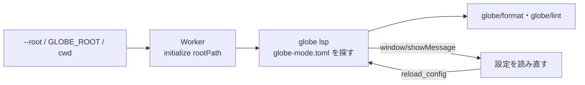

# S143 Desktop が設定ファイルを読む

| | |
| --- | --- |
| セッション | S143 |
| 日付 | 2026-11-04 |
| ブランチ | `feature/s143-desktop-config-root` |
| Phase | P4（使える流れ。S140 の点検（`doc/research/app-flow-2026-11-04.md`。S140 のブランチにあり、main への取り込みは後）の順位 5） |
| スライド | [slides.html](slides.html) |
| 作業記録 | [log/work/2026-11-04-desktop-config-root.md](../../../log/work/2026-11-04-desktop-config-root.md) |

## 1. 目的

S130 で設定ファイル `globe-mode.toml`（[format-style.md](../../format-style.md) の 5 章）を CLI と LSP が読めるようにしたが、LSP は `initialize` の `rootUri`（無ければ `rootPath`）から上へたどって探す。Desktop の `Worker` は `initialize` に `capabilities` しか渡さず、UI の `format()` も indent 2 の固定値だったので、Desktop では設定ファイルが読まれなかった。

## 2. 決定と理由

| 項目 | 決定 | 理由 |
| --- | --- | --- |
| 根 | `--root <DIR>`、無ければ環境変数 `GLOBE_ROOT`、無ければカレントディレクトリ（`main.rs` の `root_from_env`） | 「開く」は S141 が足している途中。起動時の最小の形。`--library` の根は使わない（MSL の置き場は設定を探す根ではない） |
| 渡し方 | `initialize` の `rootPath`（`Worker::with_root`）。作り直した sidecar にも同じ根を渡す | LSP は `rootUri` を先に、無ければ `rootPath` を読む。`rootUri` にすると URI の組み立て（パーセント符号化、Windows のドライブ）を Desktop に持たせることになる |
| 読み直し | command `reload_config`（`workspace/didChangeConfiguration`）。UI の「設定を読み直す」ボタンは `SimSettings` の下の小さな行。誤りは `window/showMessage` を受けて同じ行に出す | S141 のボタンの行と衝突させない |
| LSP の直し | 独自の要求 `globe/format`・`globe/lint` が設定を土台にし、params のキーがあれば優先する | UI が呼ぶのはこの 2 つで、S130 は標準の `textDocument/formatting` と診断だけ設定を見ていた。ブラウザ版の wasm は params で渡すので変わらない |
| UI の `format()` | 引数を渡さない。`Backend.format` の indent・insertOrigin を optional にし、`WorkerBackend` だけが 2・true を補う | Desktop は設定に任せ、ブラウザは設定ファイルが無いので今の固定値のまま |
| smoke | UI の測定（`GLOBE_DESKTOP_BENCH`）の 3 回を、`indent = 4` の `globe-mode.toml` を置いた作業ディレクトリから起動する。UI が整形の結果を見て `cfg=ok`（無ければ `cfg=none`）を GM-SMOKE の行に足す（Desktop だけ） | S125 の道に 1 項目足すだけ。ブラウザの行は変わらない |

shortcut: 根は起動時に決まり、実行中には替えられない（「フォルダを開く」が来たら `Worker` の根を替えて作り直す）。依頼の「読んだと `window/showMessage` で出る」は S130 の実際の挙動と違い、`showMessage` は設定の誤りのときだけ。成功の通知は持ち越し。

## 3. 図



## 4. 再現手順

```bash
export CARGO_TARGET_DIR=…/.git-worktree/target-shared CARGO_BUILD_JOBS=2
cargo test -p globe-mode-lsp config_file
cargo build -p globe-mode-cli --bin globe
cd src/Svelte && pnpm check && pnpm build && cd ../..
uv run python src/Svelte/tests/test_ui.py
```

- Desktop の crate は webkit2gtk が要るので手元では作れない。`worker.rs` の試験 `root_config_drives_format_and_reloads` は、`GLOBE_BIN=…/debug/globe` を付けて `worker.rs` だけを入れた雛形の crate で通した。本番は `desktop.yml`（`gh workflow run desktop.yml --ref feature/s143-desktop-config-root`）の cargo test と UI の測定（`cfg=ok`）。

## 5. 次回

- 設定の値の編集 UI、「フォルダを開く」で根を替えること（S141 の後）、起動時に設定を読んだ通知、VS Code 拡張。
