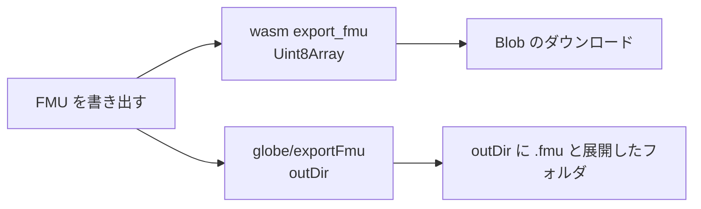

# S144 FMU を UI から書き出す

| | |
| --- | --- |
| セッション | S144 |
| 日付 | 2026-11-04 |
| ブランチ | `feature/s144-ui-fmu-export` |
| Phase | P4/P5（使える流れ。S140 の点検（`doc/research/app-flow-2026-11-04.md`。S140 のブランチにあり、main への取り込みは後）の順位 4） |
| スライド | [slides.html](slides.html) |
| 作業記録 | [log/work/2026-11-04-ui-fmu-export.md](../../../log/work/2026-11-04-ui-fmu-export.md) |

## 1. 目的

FMU export（P5a、ソースの FMU）は CLI の `globe fmu export` と各言語 API（S118、facade の `export_fmu`、feature `fmu`）にあり、UI・LSP・wasm には無かった。ボタン 1 つで、ブラウザ・Android・Desktop のどれでも書き出せるようにする。

## 2. 決定と理由

| 項目 | 決定 | 理由 |
| --- | --- | --- |
| ブラウザ | **出来る**。`cargo check --target wasm32-unknown-unknown -p globe-mode-fmi --features export` が通った | Rumoca のテンプレートを描く `export_me_sources` は文字列の組を返すだけ。ファイルに触るのは `write_fmu` と `cc` だけ |
| バイト列の道 | `fmi::export::fmu_bytes`（zip をメモリ上で）→ facade の `Workspace::export_fmu_bytes(model, fmi_version)` → wasm の `Workspace.export_fmu`（`Uint8Array`） | 中身は `write_fmu` の `build` 無しと同じ（`modelDescription.xml`・`sources/`・Rumoca のライセンス）。新しい依存は無い（`zip` は既にある） |
| UI | `Backend.exportFmu(model, fmiVersion): Promise<string \| null>`。ブラウザは `browserSave` で Blob のダウンロード（`<モデル名の . を _ にしたもの>.fmu`）、Desktop は `dialog.save` で場所を選ぶ | S141 の流儀。`browserSave` を文字列に加えてバイト列も受けるようにした |
| Desktop | LSP の `globe/exportFmu {model, fmiVersion?, outDir}` → `{path}` | facade の `export_fmu` を呼ぶだけ（build 無し）。DAE まで変換できなければ -32000 |
| feature | lsp と wasm が facade の `fmu` を有効にする | wasm は lsp を通じても引く。`ci_plan` は fmi の変更で lsp と wasm も回す（試験を足した） |
| FMI の版 | UI は 2.0 に固定。API は `fmiVersion` を取る | ボタン 1 つの約束。選択は持ち越し |

shortcut: Desktop の `dialog.save` で選んだ**ファイル名は使わず**、フォルダだけを `outDir` にする（facade は `<名前>.fmu` と展開した `<名前>/` を書き、同名のフォルダがあれば消す。CLI と同じ）。ファイル名を指定させるなら LSP の params を `path` にして一時フォルダで組む。

## 3. 図



## 4. 再現手順

```bash
export CARGO_TARGET_DIR=…/.git-worktree/target-shared CARGO_BUILD_JOBS=2
cargo check --target wasm32-unknown-unknown -p globe-mode-fmi --features export
cargo test -p globe-mode-lsp -p globe-mode-wasm
mise run ui:check        # wasm:build、pnpm check、pnpm build、test_ui.py、test_graph.py
mise run wasm:node
python3 .github/scripts/test_ci_plan.py
```

- lsp の `export_fmu_writes_the_source_fmu`: Decay を `globe/exportFmu` で書くと `outDir/Decay.fmu` と `outDir/Decay/modelDescription.xml` が出来る。知らないモデルは -32000、`outDir` 無しは -32602。
- wasm の `decay_exports_a_source_fmu_as_bytes`: バイト列は `PK` で始まり、`modelDescription.xml` と `sources/` を含む。
- `test_ui.py`: 「FMU を書き出す」で `Mine.fmu` がダウンロードされ、zip に `modelDescription.xml` と `sources/`、`modelName="Mine"` がある。
- Desktop の smoke は `desktop.yml`（push した feature ブランチで `gh workflow run`）。

数字は [作業記録](../../../log/work/2026-11-04-ui-fmu-export.md) にある。

## 5. 次回

- `--build`（cc / zig）の UI、FMI 3.0 の選択、FMU import。
- Desktop で選んだファイル名の反映。
- wasm のサイズの増え分の切り分け、Android の WebView でのダウンロードの実機確認。
