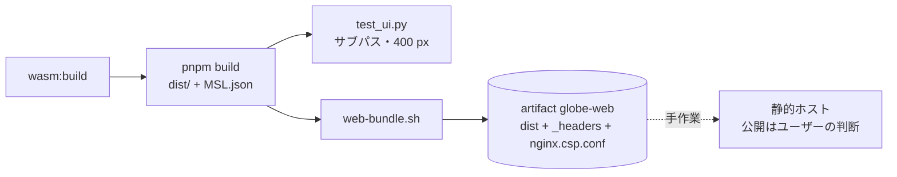

# S145 ブラウザ版を配れる形にする

| | |
| --- | --- |
| セッション | S145 |
| 日付 | 2026-11-04 |
| ブランチ | `feature/s145-web-bundle` |
| Phase | P6（S140 の点検（`doc/research/app-flow-2026-11-04.md`。S140 のブランチにあり、main への取り込みは後）の順位 7） |
| スライド | [slides.html](slides.html) |
| 作業記録 | [log/work/2026-11-04-web-bundle.md](../../../log/work/2026-11-04-web-bundle.md) |

## 1. 目的

ブラウザ版は動くが、配る形が無かった。Pages 向けの workflow は 0 件、`MSL.json` は 15.2 MiB、CSP は S093 で `test_ui.py` のサーバにだけ付いていた。静的ファイルの束を作って artifact に出す手動の workflow と、配る側の手順までを作る。

**公開（GitHub Pages の有効化、URL の配布）はこのセッションではしていない。公開するかどうかはユーザーの判断。**

## 2. 決定と理由

| 項目 | 決定 | 理由 |
| --- | --- | --- |
| 配布物 | `.github/workflows/web.yml`（手動のみ）。`mise run wasm:build` と `pnpm build`（`pack-msl.mjs` が `MSL.json` を作る）で `dist/` を作り、`scripts/web-bundle.sh` で束ねて artifact `globe-web` に出す | android.yml の `ui` ジョブと同じ道。`ci.yml` は触らない |
| サブパス | `vite.config.ts` に `base: "./"` | コードは既に `import.meta.env.BASE_URL` と `new URL(…, location.href)` で引いていたので、`base` を相対にするだけで足りた。`index.html` の `script` と `link` も `./assets/…` になる |
| CSP の正 | `index.html` の meta。`web-bundle.sh` がそこから取り出して `_headers`（Cloudflare Pages / Netlify）と `nginx.csp.conf` にする | 1 か所だけを直せばよい。S093 で `test_ui.py` が header に付けているものと同じ文字列 |
| `Cross-Origin-*` | 要らない | `SharedArrayBuffer`・`crossOriginIsolated`・wasm のスレッドをソースが使っていない（grep で 0 件）。`COOP` / `COEP` を付けると、かえって外の資源が読めなくなる |
| 小画面 | `App.svelte` の `<style>` に `@media (max-width: 600px)`（左の木を上に積む、診断の長い語を折り返す） | 400 px では木の 16 rem の固定幅にエディタが押されて 86 px になった（試験で再現）。ボタンの行は元から `flex-wrap` |
| 試験 | `test_ui.py` に 2 本。dist を `/app/` の下だけで配る `serve("/app")` で検査と MSL の読み込み、viewport 400×800 で主要なボタンの収まり・`scrollWidth ≤ 400`・エディタの幅 300 px 以上 | CSS を外すとエディタの幅の assert が落ちることを確かめた |

shortcut: PWA（service worker、manifest）、ダークモード、`MSL.json` の分割や事前の圧縮配信は持ち越し。圧縮は配布先に任せる前提で、gzip と brotli の大きさだけ測る。

## 3. 図



## 4. 再現手順

```bash
gh workflow run web.yml --ref <branch>      # 取得: gh run download <run-id> -n globe-web
# 手元
mise run wasm:build
cd src/Svelte && pnpm install --frozen-lockfile && pnpm build && cd ../..
uv run python src/Svelte/tests/test_ui.py
bash src/Svelte/scripts/web-bundle.sh src/Svelte/dist /tmp/globe-web
```

## 5. 配布の手順（公開するときにユーザーがやる）

`globe-web/` はどのサブパスに置いても動く（`/`、`/globemode/`、`/app/`）。必要なのは静的ファイルの配信と、次の 2 点。

1. **CSP を応答の header に付ける。** `index.html` の meta は Web Worker に効かないので、Worker のスクリプト（`wasm/worker.js`）にも同じ CSP が掛かるよう、サーバの header に付ける。

   | ホスト | やること |
   | --- | --- |
   | Cloudflare Pages・Netlify | `globe-web/_headers` をそのまま置く（`/*` に CSP・`nosniff`・`Referrer-Policy`）。 |
   | nginx | `nginx.csp.conf` を `location` の中で `include` する。`add_header` は `location` ごとに継承が切れるので、`location` を足すなら各々に `include` する。 |
   | GitHub Pages | カスタム header が付けられない。meta の CSP は効くが Worker には効かず、`connect-src 'self'` を Worker の中では強制できない（動作は変わらない）。header が要るなら Pages ではなく上の 2 つを使う。 |
   | その他 | CSP の文字列は `_headers` の 2 行目を写す。 |

2. **`.wasm` の `Content-Type` は `application/wasm`。** 違うと `instantiateStreaming` が失敗して遅い道に落ちる（動きはする）。多くのホストは拡張子から付ける【未確認。ホストごとに確かめる】。

- **`Cross-Origin-Opener-Policy` / `Cross-Origin-Embedder-Policy` は付けない。** `SharedArrayBuffer` を使っていない。
- **圧縮**: `.wasm`・`.json`・`.js` を gzip か brotli で配ると転送量は下の表になる（Cloudflare・Netlify・nginx の `gzip on` / `brotli on` は既定か設定で効く）。`MSL.json` は「MSL を読む」を押したときだけ取りにいく。
- **公開するか、どこに置くかはユーザーの判断。** このセッションでは GitHub Pages を有効にせず、URL も作っていない。

### 大きさ（web.yml の run、artifact `globe-web`）

| ファイル | 生 (MiB) | gzip -9 (MiB) | brotli -q 11 (MiB) |
| --- | --- | --- | --- |
| wasm (`globe_mode_wasm_bg.wasm`) | 14.7 | 4.5 | 3.1 |
| `msl/MSL.json` | 15.2 | 2.5 | 1.7 |
| JS・CSS (`assets/`) | 0.9 | 0.3 | 0.2 |
| 合計（連結して測った。14 ファイル） | 30.9 | 7.3 | 5.0 |

run 41700103696（`gh workflow run web.yml --ref feature/s145-web-bundle` の代わりに、一時の push トリガで起動）。ジョブの中の `test_ui.py` も通った（サブパス `/app/`、幅 400 px でエディタ 368 px）。

## 6. 次回

- 公開の判断（Pages か別のホスト）。PWA（オフライン、インストール）、ダークモード。
- `MSL.json` を使う分だけ取る（分割の配信）。今は 15.2 MiB を 1 本で取る。
