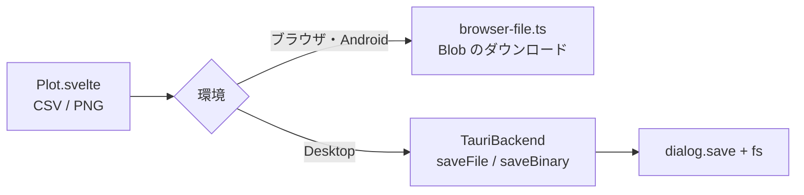

# S146 プロットの書き出し

| | |
| --- | --- |
| セッション | S146 |
| 日付 | 2026-11-04 |
| ブランチ | `feature/s146-ui-plot-export` |
| Phase | P4（使える流れ。S140 の点検（`doc/research/app-flow-2026-11-04.md`）の順位 8） |
| スライド | [slides.html](slides.html) |
| 作業記録 | [log/work/2026-11-04-ui-plot-export.md](../../../log/work/2026-11-04-ui-plot-export.md) |

## 1. 目的

実行した結果をプロットで見られても、持ち帰る道が無かった。プロットに「CSV」「PNG」のボタンを足し、ブラウザ・Desktop・Android で結果を書き出せるようにする。

## 2. 決定と理由

| 項目 | 決定 | 理由 |
| --- | --- | --- |
| 置き場 | `Plot.svelte` の中で完結。`App.svelte` は触らない | 並行する S144・S145 が `App.svelte` を触るため。Plot が保存の道を自分で選ぶ（Desktop は `TauriBackend`、それ以外は `browser-file.ts`） |
| CSV | `toCsv(見出し, 列)`（`plot/csv.ts`）。画面で選んだ系列と x の列だけ。null は空欄、見出しにコンマ・引用符・改行があれば引用 | 画面と同じ内容を持ち帰れる。パラメトリックのときは x の列が時刻でなく選んだ列になる |
| PNG | uPlot の canvas を、白で塗った別の canvas に写して `toBlob` | 透明のままだと暗い背景で線が見えない。凡例と軸の DOM は入らない |
| バイナリ | `Backend.saveBinary?(name, bytes)` を optional で追加。ブラウザは Blob（`image/png`）、Desktop は `dialog.save` と `fs.writeFile` | テキストの `saveFile` はそのまま |
| 権限 | `capabilities/desktop.json` に `fs:allow-write-file` を 1 つ | PNG はバイナリを書くため。dialog で選んだパスだけが許可に入る |
| 保存ダイアログ | 拡張子の絞り込みを、名前の拡張子から作る（`.mo` 固定をやめた） | CSV・PNG でも使うため |

shortcut: PNG は canvas だけで、凡例を含めない（凡例も入れるなら uPlot の `root` を描く必要がある）。ブラウザの保存は毎回ダウンロード。

## 3. 図



## 4. 再現手順

```bash
export CARGO_TARGET_DIR=…/.git-worktree/target-shared CARGO_BUILD_JOBS=2
cd src/Svelte && pnpm check && node tests/test_columns.mjs && pnpm build && cd ../..
uv run python src/Svelte/tests/test_ui.py
gh workflow run desktop.yml --ref feature/s146-ui-plot-export   # Linux の smoke
```

- `test_ui.py`: Decay を実行し、CSV のダウンロードが `result.csv` で見出しが `time,x`、行数が点の数 + 1、2 行目が数値であること、PNG のダウンロードが `result.png` で PNG の署名を持ち 1000 バイトを超えることを確かめる。
- Desktop の dialog の操作そのものは自動では確かめていない（smoke は capability を足しても起動することまで）。

数字は [作業記録](../../../log/work/2026-11-04-ui-plot-export.md) にある。

## 5. 次回

- MAT の読み書き。
- 凡例つきの PNG、SVG。
- Android の WebView でのダウンロードの実機確認。
- ダークモード。
