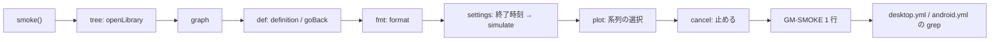

# S147 Desktop と Android の smoke に UI の操作を足す

| | |
| --- | --- |
| セッション | S147 |
| 日付 | 2026-11-04 |
| ブランチ | `feature/s147-ui-smoke-ops` |
| Phase | P6（使える流れ。S140 の点検（`doc/research/app-flow-2026-11-04.md`。S140 のブランチにあり、main への取り込みは後）の順位 6） |
| スライド | [slides.html](slides.html) |
| 作業記録 | [log/work/2026-11-04-ui-smoke-ops.md](../../../log/work/2026-11-04-ui-smoke-ops.md) |

## 1. 目的

ブラウザ版は `test_ui.py` で UI の操作（ライブラリの木、整形、グラフ、止める、実行の設定、プロットの選択、定義ジャンプ）を試験しているが、Desktop と Android の smoke（`App.svelte` の `smoke()`。S100・S103・S125）は Decay の検査・実行と MSL の ChuaCircuit の検査だけだった。Desktop は sidecar（`TauriBackend`）、Android は Worker（`WorkerBackend`）と、バックエンドが違うので、同じ操作が通るかを CI で確かめる。

## 2. 決定と理由

| 項目 | 決定 | 理由 |
| --- | --- | --- |
| 回し方 | Playwright で DOM を叩かず、`smoke()` の中から UI のコードの関数（`openLibrary`・`format`・`graph`・`simulate`・`definition`・`goBack`）を呼び、実行の設定と「止める」とプロットの選択だけ DOM の要素を `click()` / `input` イベントで操作する | Tauri の WebView と Android の WebView には Playwright をつなげない。UI の中から回せば同じコードが 3 つの場所で動く |
| 行 | `GM-SMOKE` の `msl=…`（Desktop は `cfg=…`）の後ろに `tree= fmt= graph= cancel= settings= plot= def=` を足す。落ちた項目は `=ng`、理由は行末の `failure=` に項目名つきで足す。MSL が無いブラウザでは `tree=skip graph=skip` | 既存の `ready_ms` などの時刻は動かさない |
| tree | `libraryTree("Modelica.Electrical.Analog.Examples")` から ChuaCircuit を選び `openLibrary`。エディタにそのファイルが開き、モデル名がクラスの path になり、自分のファイルでなくなる | S127 の操作 |
| graph | 同じ ChuaCircuit で `graph()`。`.canvas[data-nodes]` が 0 でなくなるまで待ち、Graph 自身の `role=alert`（WebGL の失敗など）が無い | S046 の操作。sigma は WebGL を使う |
| def | ChuaCircuit の `Modelica.Electrical.Analog.Basic.Resistor` の中で `definition` を呼び、Resistor.mo が開き、`goBack` で戻る。そのあと Decay の `der(x)` の x で宣言の行へ動く | S138 の操作 |
| fmt | 詰めた `model C` を `format()` に通し、`Real x;` が 2〜4 字下がる（Desktop は S143 の `indent = 4`、ブラウザと Android は 2） | S053・S130・S143 の操作 |
| settings | 「終了時刻」に `abc` で問題が出て、`2` で実行すると `lastSettings.stop_time` が 2、出どころが `requested`、最後の時刻が 2 | S142 の操作 |
| plot | 直前の実行のプロットで、先頭の信号を外す・戻す（`data-series`）、右の軸に移す（`data-right`） | S128 の操作 |
| cancel | 1e6 秒まで走る振動のモデル `Long` を実行し、進捗が `integration` になるのを待って「止める」の要素を押す。`runState` が `cancelled`（Worker の `terminate()`、Desktop で sidecar を作り直したとき）か診断 `GM-I11004`（Desktop で sidecar が止めたとき）になり、そのあと検査が通る | S133・S136 の操作。最後に回す（Worker の作り直しでライブラリが消えるため） |
| 合格条件 | `desktop.yml` の Linux の測定は `msl=ok cfg=ok tree=ok … def=ok` を 3 回、Windows は `cfg=\w+` の後に同じ項目。`android.yml` は `msl=ok` の後に同じ項目。Android の待ちは 120 → 180 回（15 分） | 項目が増えて 1 行が出るまでが延びる |
| `test_ui.py` | smoke の行が `tree=ok fmt=ok graph=ok cancel=ok settings=ok plot=ok def=ok`（MSL.json が無ければ tree・graph は skip）で、`failure=` が無い | ブラウザは同じ関数の最初の砦 |

shortcut: DOM の操作は CSS セレクタと `aria-label` に頼る（`input[aria-label="終了時刻"]`、`.plot`、`.canvas[data-nodes]`）。UI のラベルを変えたら smoke も直す。対象の関数に副作用（localStorage への保存）があるが、smoke の最後に Decay へ戻す。

## 3. 図



## 3.1 見つかった不具合

**0 件。** 7 項目すべてが Desktop（Linux・Windows）と Android（debug・release の emulator）で最初の run から ok だった。`=ng` のまま外した項目は無い。確かめられたことと、確かめていないこと:

- 確かめた: sidecar（`TauriBackend`）と Worker（`WorkerBackend`）のどちらでも、木・定義ジャンプ・整形・グラフ（sigma の WebGL。xvfb の WebKitGTK、Windows の WebView2、Android の x86_64 emulator の swiftshader）・実行の設定・プロットの選択・止めるが通る。
- 確かめていない: `cancel` が Desktop で `cancelled`（sidecar を作り直した道）と `GM-I11004`（sidecar が止めた道）のどちらで通ったか。行は ok だけを出し、どちらかは残していない。実機の Android、実際のタッチ操作、IME。
- 試験が弱いところ: `plot` は `data-series`・`data-right` の属性（Plot の状態）までで、uPlot の描画の中身は見ない。`graph` は `data-nodes` が 0 でないことまで（sigma の描画結果は見ない）。

## 4. 再現手順

```bash
export CARGO_TARGET_DIR=…/.git-worktree/target-shared
cd src/Svelte && pnpm check && pnpm build && cd ../..
python3 -I src/Svelte/tests/test_ui.py     # ブラウザ版。GM-SMOKE の行に 7 項目が ok で出る
git push -u origin feature/s147-ui-smoke-ops
gh workflow run desktop.yml --ref feature/s147-ui-smoke-ops   # Linux・Windows の測定
gh workflow run android.yml --ref feature/s147-ui-smoke-ops   # emulator の smoke（約 35 分）
gh run download <run-id> -n ui-bench-linux     # bench.txt に GM-SMOKE の行が 3 本
```

| 場所 | 結果 | 行の項目 |
| --- | --- | --- |
| ブラウザ（`test_ui.py`） | 通過 | `tree=ok fmt=ok graph=ok cancel=ok settings=ok plot=ok def=ok` |
| Desktop Linux（`desktop.yml` run 41706643110） | 成功、3 回とも | `msl=ok cfg=ok` の後に同じ 7 項目が ok。`msl_ms` 約 0.8 秒 |
| Desktop Windows（同じ run） | 成功、3 回とも | `cfg=none`（toml を置かない）の後に同じ 7 項目が ok。`msl_ms` 約 2.1 秒 |
| Android emulator（`android.yml` run 41706648182） | 成功 | release の行は 7 項目 ok、`decay_ms=2181`、`msl_ms=22461` |

## 5. 次回

- `cancel` の通った道（`cancelled` か `GM-I11004`）を行に出す。
- `plot` と `graph` は描画の中身（canvas の画素、sigma のノードの位置）を見ていない。
- 実機の Android と署名つき APK の確認（ユーザー）。
- 新しい機能（ダークモード、PWA）は持ち越し。
