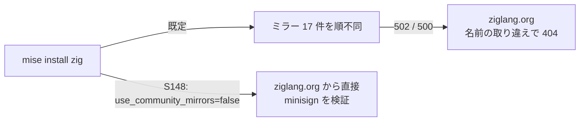

# S148 zig の取得を安定させる

| | |
| --- | --- |
| セッション | S148 |
| 日付 | 2026-11-04 |
| ブランチ | `feature/s148-ci-zig-mirror` |
| Phase | CI の基盤 |
| スライド | [slides.html](slides.html) |
| 作業記録 | [log/work/2026-11-04-ci-zig-mirror.md](../../../log/work/2026-11-04-ci-zig-mirror.md) |

## 1. 目的

`ci.yml` の `lang` ジョブが、`jdx/mise-action@v5` の zig 0.17.0 の取得で落ちた（run 41702810070、2026-11-03）。コードの問題ではない。取得を安定させる。

## 2. 原因

run 41702810070 の `lang` のログ（`gh run view 41702810070 --log-failed`）:

1. mise 2026.10.25 は、zig を **ziglang.org の推すコミュニティのミラーから先に**、順不同で試す（17 件）。
2. 引いた URL は `https://zigmirror.hryx.net/zig/zig-linux-x86_64-0.17.0.tar.xz`（502 Bad Gateway、3 回）、`https://zig.mirror.mschae23.de/zig/zig-linux-x86_64-0.17.0.tar.xz`（500、3 回）。
3. ミラーを使い切って ziglang.org に戻ったが、**ファイル名が `zig-linux-x86_64-0.17.0.tar.xz`（0.14.0 以前の並び）で 404**。正しい名前は `zig-x86_64-linux-0.17.0.tar.xz`（`mise.lock` の url も、成功した run のログもこちら）。

直後の run 41705882970 では、同じ `mise.lock` で 1 番目のミラーから `zig-x86_64-linux-0.17.0.tar.xz` が取れて成功した。つまり**ミラーの一時的な障害に、名前の取り違えが重なった**。名前を取り違えた理由（index.json の取得に失敗したときの代替の名前か、ミラー経路の別の処理か）は【未確認】。

## 3. 決定と理由

| 案 | 可否 | 判断 |
| --- | --- | --- |
| (a) `actions/cache` で zig の install 先 | `mise-action` が既に `~/.local/share/mise` を `mise.toml`・`mise.lock` の hash 込みのキーでキャッシュしている（ログの `mise cache not found for mise-v1-linux-x64-…`）。`mise.toml` を触るたびに外れ、初回は結局取得する | 採らない。外れた回の取得を直さない |
| **(b) 設定 `zig.use_community_mirrors = false`**（環境変数 `MISE_ZIG_USE_COMMUNITY_MIRRORS=false`） | [mise の Zig の頁](https://mise.jdx.dev/lang/zig.html)（確認 2026-11-04）に載る公式の設定。ミラーを飛ばして ziglang.org から取る。署名（minisign）の検証は同じ。手元の mise 2026.10.13 でも `zig-x86_64-linux-0.17.0.tar.xz` を 15.8 s で取れた | **採る**。1 行、zig のバージョンと `mise.lock` は変えない |
| (c) `mlugg/setup-zig` | action を足し、`MISE_DISABLE_TOOLS=zig` にする。zig の版を二重に持つ | 採らない |

(b) の弱点: ziglang.org は「稼働率も速度も保証せず、自動の取得にはミラーを使ってほしい」とする（同じ頁）。1 日に数回、キャッシュが外れたときだけの取得なので許容する。ziglang.org が落ちたら、この設定を消せばミラーに戻る。

当てた所は zig を入れる 3 か所: `ci.yml` の `lang`（ジョブの env）、`fmu-export.yml`（ジョブの env）、`release.yml`（`cargo-zigbuild` の段が使う zig。ファイル全体の env）。他の構造は変えない。

## 4. 図



## 5. 再現手順

```bash
# 手元で設定が効くこと（別の保存先に入れる）
MISE_DATA_DIR=/tmp/zigtest MISE_ZIG_USE_COMMUNITY_MIRRORS=false mise install zig@0.17.0
# CI
gh workflow run ci.yml --ref feature/s148-ci-zig-mirror -f full=true
```

確認した run は作業記録に書いた。

## 6. 次回

- 名前の取り違えの原因は mise 側の問題の可能性がある。再発したら `MISE_VERBOSE=1` のログを取って mise に報告する。
- ziglang.org が落ちて同じ形で失敗したら、`mise.lock` のハッシュで zig のインストール先を `actions/cache` に載せる（案 a）。
