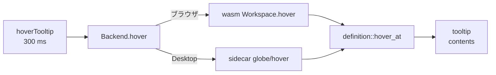

# S149 エディタのホバー

| | |
| --- | --- |
| セッション | S149 |
| 日付 | 2026-11-04 |
| ブランチ | `feature/s149-ui-hover` |
| Phase | P4（S138 の持ち越し） |
| スライド | [slides.html](slides.html) |
| 作業記録 | [log/work/2026-11-04-ui-hover.md](../../../log/work/2026-11-04-ui-hover.md) |

## 1. 目的

S138 でエディタから定義ジャンプができるようになったが、ホバーは持ち越しだった。名前の上にマウスを置くと、その宣言（型と部品の 1 行）と説明文字列が出るようにする。LSP の `textDocument/hover`（S038）は「囲むクラスの種類」しか返さないので、UI では使えない。

## 2. 決定と理由

| 項目 | 決定 | 理由 |
| --- | --- | --- |
| API | `Backend.hover(file, line, character): Promise<{contents, range} \| null>` | `definition` と同じ引数。`range` はカーソルの名前（tooltip の位置に使う） |
| 解決 | `globe-mode-lsp` の `definition::hover_at`。`Resolver::definition` の `Target` に `class: bool` を足し、定義のファイルの本文から宣言を取る | 新しい解析を入れない（[S132](../S132-lsp-definition/解説書.md)、[S138](../S138-ui-editor-lsp/解説書.md)） |
| 宣言の取り方 | 定義の行頭から。部品は `;` まで、クラスは行末まで。空白は 1 つにまとめる | `ComponentOutline` の範囲は名前だけで、説明文字列を持たない。ソースの文字から取れば `Real x(start = 1) "説明"` がそのまま出る |
| ブラウザ | wasm の `Workspace.hover`（`definition` と共通の `resolve`）。ライブラリのクラスの説明は読み込んだ組から | S138 と同じ。MSL の `Resistor` の説明文字列が出る |
| Desktop | sidecar の `globe/hover`（`globe/definition` と同じ params。同じ match の腕で、呼ぶ関数だけ替える） | S138 と同じ |
| エディタ | CodeMirror の `hoverTooltip`（`hoverTime` 300 ms）。素のテキスト。`modelicaDefinition` の第 3 引数 `{backend, file}` を渡すと有効 | 依存を足さない。`App.svelte` は呼び出しの 1 行（第 3 引数の追加）だけ変えた。S147 の `smoke()` と同じ行を触らないため |
| 既存の hover | `textDocument/hover` は変えない | VS Code の挙動と既存の試験を保つ |

shortcut: 宣言が行の途中から始まるとき・宣言の途中の文字列に `;` があるとき・複数行の宣言は行頭から `;` までの切り方になる。組み込み型（`Real`）の上では何も出ない。要るなら宣言の範囲を持つ解析にする。

## 3. 図



## 4. 再現手順

```bash
export CARGO_TARGET_DIR=<共有の target> CARGO_BUILD_JOBS=2
cargo test -p globe-mode-lsp -p globe-mode-wasm
mise run wasm:build
cd src/Svelte && pnpm install --frozen-lockfile && pnpm check && pnpm build && cd ../..
uv run python src/Svelte/tests/test_ui.py
```

`test_ui.py` の結果: Decay の `der(x)` の `x` で `Real x(start = 1, fixed = true)`、ChuaCircuit の `Resistor` で `model Resistor "Ideal linear electrical resistor"`。

## 5. 次回

- 参照・リネームの UI、Markdown の描画、ダークモード
- VS Code 向けの `textDocument/hover` を新しい解決に替える
- 行をまたぐ宣言の正確な範囲、組み込み型のホバー

正典: [features.md](../../features.md)、[roadmap.md](../../roadmap.md)。
